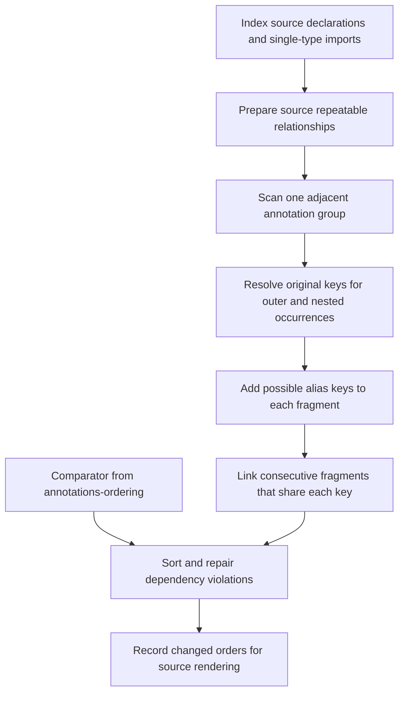

<!--
SPDX-FileCopyrightText: 2026 Anton Lem <antonlem78@gmail.com>
SPDX-License-Identifier: Apache-2.0
-->

# How annotation sorting preserves repeatable order



## What a reorder can change

Java puts repeated annotations into the implicit container's `value` array in source order. Reflection also reads
values from an explicit container in array order, at the container's position relative to a direct annotation. The
following fields show both effects. [JLS §9.7.5][repeated-annotations], [`AnnotatedElement`][annotated-element]

```java
package demo;

import java.lang.annotation.Repeatable;
import java.lang.annotation.Retention;
import java.lang.annotation.RetentionPolicy;

@Retention(RetentionPolicy.RUNTIME)
@Repeatable(Tags.class)
@interface Tag {
    String value();
}

@Retention(RetentionPolicy.RUNTIME)
@interface Tags {
    Tag[] value();
}

@interface Marker {}

class Example {
    @Tag("z") @Marker @demo.Tag("a") int repeated;
    @Tags({@Tag("b"), @Tag("c")}) @Tag("a") int mixed;
}
```

For either field, `java.util.Arrays.stream(field.getAnnotationsByType(Tag.class)).map(Tag::value).toList()`
exposes the order.

| Field | Original values | Values if the dependent outer fragments are reversed |
| --- | --- | --- |
| `repeated` | `["z", "a"]` | `["a", "z"]` |
| `mixed` | `["b", "c", "a"]` | `["a", "b", "c"]` |

Moving `@Marker` leaves the first sequence intact. Moving `@Tags` in `mixed` changes the second sequence even with
its argument text intact. One direct `@Tag` can coexist with one explicit `@Tags`. Two direct `@Tag` occurrences with
an explicit `@Tags` in the same declaration or type context are a compile-time error. The implicit container that
would hold the two direct occurrences would conflict with the explicit one. A `@Tag` inside the explicit container's
array is an array entry. Only annotations written outside the container count as direct occurrences on the field.

With `annotations-ordering: arguments-alpha`, the comparator prefers `@Marker @demo.Tag("a") @Tag("z")` for
`repeated`. The two `Tag` uses share a dependency key, so the sorter emits `@Marker @Tag("z") @demo.Tag("a")`
and reflection still returns `["z", "a"]`. Stable sorting alone preserves only comparator ties.

## Original keys for a fragment

An **annotation group** is a run of adjacent outer annotation uses in source. Other Java tokens separate groups.
A **fragment** is one outer annotation and its captured source text. The scanner collects a set of order-preservation
keys for that fragment, including a key for every annotation use it sees inside its arguments. Nested uses stay in
the outer fragment's text and can contribute several different keys. This applies to any annotation argument that
contains a nested annotation, including ordinary wrappers and explicit repeatable containers.

The scanner supplies each use's opening `@` offset and written type name to the dependency-key resolver. The written
name is the tokenized spelling without `@` or arguments, such as `Derived.Tag`. Its final segment, `Tag`, is the
simple name. A fully qualified inherited spelling such as `demo.Derived.Tag` can denote the type declared canonically
as `demo.Base.Tag`. [Annotation type-name resolution](annotation-type-resolution.md) explains how the resolver
selects a name and records whether its canonical identity is confirmed.

| Name resolution | Original dependency key | Example |
| --- | --- | --- |
| Confirmed canonical annotation type | The terminal key of its source `@Repeatable` chain, or the canonical type name when there is no known chain | `demo.Tag` resolves to `demo.Tags` for the source above. |
| Unconfirmed type | `?.` followed by the name selected by the name resolver | An unconfirmed `Derived.Tag` yields `?.Derived.Tag`. |

The `repeated` field above yields `[{demo.Tags}, {demo.Marker}, {demo.Tags}]` in source order. The `mixed` field
yields `[{demo.Tags}, {demo.Tags}]`. Both nested `@Tag` occurrences contribute the same key as the outer `@Tags`.

An unconfirmed use bypasses source metadata lookup and the root-key cache. Even a matching spelling in the source
declaration index leaves it unconfirmed. In the [spelling-collision fixture][spelling-collision], the package
`EqualsAndHashCode` contains an ordinary class `Exclude`, and `@EqualsAndHashCode.Exclude` refers to Lombok through
`import lombok.*`. The use keeps `?.EqualsAndHashCode.Exclude`. Treating its fallback spelling as canonical would
select the ordinary source class and reject a valid use.

If the metadata for the earlier example were unavailable, the visible `@Tag` uses inside `@Tags({...})` could still
give the explicit container a key in common with direct `@Tag`. Two nested occurrences of the same type contribute
one key to the set. For `@Envelope({@Nested}) @Marker int first; @Nested int second;`, alias collection receives
`[{Envelope, Nested}, {Marker}]` for the first group and `[{Nested}]` for the second, with qualification omitted
here. The shared key across the two fields creates no dependency because each call handles only its own group.

## Source `@Repeatable` relationships

`AnnotationDependencyKeyResolver` prepares the top-level and member declaration index and exact single-type import
names for one source file. It computes a root key for every annotation declaration in that file before the scanner
processes uses. This makes relationships available to the first group even when the annotation declaration appears
later and the group itself contains no confirmed use of that annotation type.

For a confirmed type name, `computeRootGroupKey` walks the chain as follows.

1. Find the current name in the source declaration index. If it is absent, return the current canonical name.
   For a declaration that is present, require an annotation type. Return its canonical name if it has no
   `java.lang.annotation.Repeatable` metadata.
2. Read `@Repeatable`'s `value` as a parsed class literal. Spoon represents `Tags.class` as a field read named
   `class` with a type-access target. The field's declaring type and the target's accessed type must both be
   present and agree. Reading this structure avoids evaluating the expression or loading the container class.
3. Format the type reference. A matching source declaration or exact single-type import confirms this name for the
   chain. Continue at that name. Without either kind of evidence, terminate with `?.` followed by the formatted
   name. For example, a reference spelled through an unavailable inherited owner may still be an alias.

Unavailable external declarations are expected in Spoon's `no-classpath` mode. They can yield a terminal key
without contributing repeatable metadata. When `Tag` points to `Tags` and `Tags` points to `TagGroups` in source,
all three share the final `TagGroups` key. Every visited source declaration must be an annotation type. A malformed
class literal, inconsistent references, or a cycle fails processing for that file. The resolver tests create these
invalid metadata shapes by mutating parsed models. See [metadata tests][metadata-tests].

The `computeIfAbsent` wrapper caches successful results by confirmed canonical name. The computation traverses the
source chain independently of the cache and detects cycles within that traversal. During preparation, each confirmed
terminal receives a self-mapping after the computation returns, including an imported external container. An
unconfirmed terminal may be a cached value but has no entry of its own. For example, `demo.Tag → ?.library.Tags`
can be a relationship in the cache, while `?.Tag` remains a key produced only for a use.

The external container fixtures show how exact import evidence changes the key. A source
`@Repeatable(library.Stamps.class)` and a written `@library.Stamps` can both yield `?.library.Stamps`. An exact
`import library.Stamps` gives the name
resolver and the source metadata lookup the same canonical identity, so `@Stamp` and `@Stamps` can instead share
`library.Stamps`. These examples shorten fixture package names. [Qualified use][external-container],
[single-type import][imported-container]

### A container with an omitted value

The defaulted array container fixture contains `@Owner.Tags` followed by
`@annotationdefaultedarraycontainer.DefaultedArrayRepeatableContainer.Owner.Tag("direct")` on an array dimension.
`Tags.value()` defaults to `{@Tag("default")}`. Spoon omits the annotation-use references at these positions.
The source lookup confirms the relative `Owner.Tags`, while the fully written `Tag` name remains unconfirmed.
Their original keys have different simple names, `Tags` and `Tag`. [Source fixture][defaulted-array]

The prepared source `Tag → Tags` relationship connects those two names. The collector adds the confirmed `Tags`
key to the unconfirmed `Tag` fragment. With alphabetical sorting, independent `Able` and `Zed` move around the pair
and the reflected values remain `["default", "direct"]`. A cache populated only by earlier confirmed uses would
know `Tags → Tags` when processing this group and the alphabetical sort would reverse the two values.

Without a source-declared repeatable relationship and without visible nested uses, `@Tags` or `@Tags(label = "x")`
can hide repetitions supplied by a default `value`. The container declaration alone cannot establish the
relationship. Sorting may then change the order of values seen through reflection. Use `annotations-ordering: []`
or the applicable [`sort-off` directive](directives.md) to preserve source order in that case.

## Candidate keys for unresolved aliases

`AnnotationOrderPreservationKeyCollector` receives the original key sets for the whole adjacent group in source
order. It seeds each distinct input key with itself and checks that every confirmed input key has a terminal
self-mapping. With fewer than two distinct keys, the self-mapping check still runs for any confirmed key and alias
expansion is skipped. Identical original keys already link their occurrences.

With at least two distinct keys, the collector extends each unconfirmed key's candidate set in two ways.

1. Add any original key in the same group whose simple name matches. This can connect two unconfirmed spellings,
   or an unconfirmed spelling and a confirmed type. For example, an unavailable `Derived` might inherit
   `Base.Tag`, so `?.library.Derived.Tag` and `library.Base.Tag` get a shared key.
2. For any non-self cache entry, match the simple name against either the source annotation name or the terminal
   container key. Add the terminal key for every match. With `demo.Tag → ?.library.Tags`, `?.Tag` and `?.Tags` can
   both acquire `?.library.Tags` even if that terminal has no cache entry of its own.

Each fragment takes the union of candidate sets for its **original** keys once. Confirmed keys gain no candidates
of their own. The resulting sets encode possible order constraints, so this step leaves name confirmation and source
metadata lookup unchanged. Consider `p.First.Tag` and `p.Second.Tag` with distinct confirmed declarations and an
unavailable `library.Derived.Tag`.

| Fragment identity | Original key | Expanded set |
| --- | --- | --- |
| First confirmed `Tag` | `p.First.Tag` | `{p.First.Tag}` |
| Second confirmed `Tag` | `p.Second.Tag` | `{p.Second.Tag}` |
| Unconfirmed `Tag` | `?.library.Derived.Tag` | `{?.library.Derived.Tag, p.First.Tag, p.Second.Tag}` |

Only the unconfirmed fragment overlaps both confirmed fragments. If it follows the two confirmed fragments in the
source, they can swap while both stay ahead of it. If it sits between them, the two dependencies together preserve
that sequence. Expanding candidates a second time or merging all three sets would add a direct dependency between
the two confirmed types even when the unconfirmed fragment follows both.

## From shared keys to a sorted group

`SpoonAnnotationSorter` visits the original fragments in order. For each key in a fragment's expanded set, it
records that fragment as the last occurrence of the key. When an earlier occurrence exists, it adds a dependency
requiring the earlier fragment to precede the current one. Three occurrences of a key need only the two consecutive
edges to preserve all three in order. A fragment with multiple keys can connect several such chains.

The dependency-aware sorter starts from the order preferred by the configured comparator. When it reaches a fragment
whose predecessors have yet to be emitted, it places the required predecessors before that fragment. Sorting criteria
such as name, declaration length, and argument text determine the preferred order. Shared keys determine precedence
constraints. Key chains may span intervening annotations, and unrelated fragments remain eligible to move.

Only changed permutations are returned, keyed by the original group start. Rendering uses that map with the original
groups and whole annotation fragments, so nested argument arrays keep their original order. See the
[sorter guide](04-Sorter.md) and the [`annotations-ordering` configuration](config-dsl.md#annotations-ordering).

## Regression coverage

- [Runtime repeatable order][runtime-order] exercises qualified uses, directly repeated annotations, and mixed
  direct and explicit container occurrences.
- [The alias matrix][alias-matrix] checks inherited owner spellings, overlapping container keys, and independently
  sortable confirmed homonyms.
- [The collector tests][collector-tests] check single expansion, same-name candidates, unconfirmed terminal keys,
  and the required confirmed terminal self-mappings.

[repeated-annotations]: https://docs.oracle.com/javase/specs/jls/se21/html/jls-9.html#jls-9.7.5
[annotated-element]: https://docs.oracle.com/en/java/javase/21/docs/api/java.base/java/lang/reflect/AnnotatedElement.html
[spelling-collision]: ../core/src/test/resources/test-cases/core/spoon/valid/qualified-annotation-spelling-collision/QualifiedAnnotationSpellingCollision.java
[metadata-tests]: ../core/src/test/java/io/github/lemon_ant/jharmonizer/core/translator/spoon/annotation/AnnotationDependencyKeyResolverTest.java
[external-container]: ../core/src/test/resources/test-cases/core/spoon/valid/external-repeatable-container/ExternalRepeatableContainerUse.java
[imported-container]: ../core/src/test/resources/test-cases/core/spoon/valid/imported-external-repeatable-container/ImportedExternalRepeatableContainer.java
[defaulted-array]: ../core/src/test/resources/test-cases/core/e2e/reorder/44-defaulted-array-repeatable-container/input/DefaultedArrayRepeatableContainer.java
[runtime-order]: ../core/src/test/resources/test-cases/core/e2e/reorder/39-repeatable-annotation-order/input/RepeatableAnnotationRuntimeOrder.java
[alias-matrix]: ../core/src/test/java/io/github/lemon_ant/jharmonizer/core/sorter/spoon/RepeatableAnnotationAliasMatrixTest.java
[collector-tests]: ../core/src/test/java/io/github/lemon_ant/jharmonizer/core/translator/spoon/annotation/AnnotationOrderPreservationKeyCollectorTest.java
