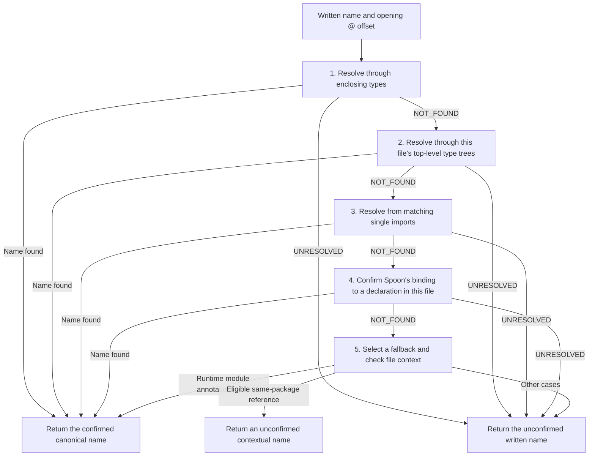

<!--
SPDX-FileCopyrightText: 2026 Anton Lem <antonlem78@gmail.com>
SPDX-License-Identifier: Apache-2.0
-->

# Annotation type-name resolution



## Why type identity matters

`@Tag("z")` and `@Derived.Tag("a")` can use the same annotation. In the example below, both resolve to
`demo.Base.Tag`. Java places the two values in the implicit `Base.Tags` container in source order.
`getAnnotationsByType(Base.Tag.class)` therefore returns values `["z", "a"]`. Swapping the two uses would reverse the
values. Sorting can still move the independent `@Deprecated` annotation while keeping `"z"` before `"a"`.
[Java Language Specification (JLS) §9.7.5](https://docs.oracle.com/javase/specs/jls/se21/html/jls-9.html#jls-9.7.5).

```java
package demo;

import java.lang.annotation.Repeatable;
import java.lang.annotation.Retention;
import java.lang.annotation.RetentionPolicy;

class Base {
    @Retention(RetentionPolicy.RUNTIME)
    @Repeatable(Tags.class)
    @interface Tag {
        String value();
    }

    @Retention(RetentionPolicy.RUNTIME)
    @interface Tags {
        Tag[] value();
    }
}

class Derived extends Base {
    @Tag("z")
    @Deprecated
    @Derived.Tag("a")
    int value;
}
```

The parser uses the resolved names and their confirmation flags to build dependency keys that preserve order.
[Annotation order preservation guide].

## Inputs, names, and lookup outcomes

The source scanner reads annotation uses from Java tokens before sorting. For each use, it supplies the offset of
the opening `@` and the **written name** as a sequence of identifiers. The name retains any written qualification and
uses the identifiers after Java Unicode escape translation. A **simple name** is one identifier, such as `Tag`.
`Derived.Tag` is a qualified spelling through a type. `demo.Derived.Tag` is a fully qualified name for the inherited
type, while its **canonical name** follows the declaring owner and is `demo.Base.Tag`. Spoon may use `$` for nesting
in its qualified reference name. JHarmonizer formats nesting through the owner links recorded on the reference, so
`demo.Base$Tag` becomes `demo.Base.Tag` when `Base` is the recorded owner. Literal `$` in an identifier survives, as in
`demo.Dollar$Owner.Tag$Kind`. [JLS §6.7](https://docs.oracle.com/javase/specs/jls/se21/html/jls-6.html#jls-6.7).

An **annotation use** such as `@Tag` may have a matching `CtAnnotation` node in Spoon's abstract syntax tree (AST).
Its **AST binding** is the `CtTypeReference` returned by `CtAnnotation.getAnnotationType()`. The corresponding
**annotation declaration** is `@interface Tag`. JHarmonizer indexes the references by the source start offsets
reported by Spoon, using valid positions from the original Spoon model of the same file. That model identity check
also keeps shared package nodes from supplying annotations from another file at a coinciding offset. A binding can
exist even when its declaration is unavailable.

Stages 1–4 return an internal lookup result. That outcome determines whether the resolver returns a name or continues.

| Lookup outcome | What happens next |
|---|---|
| `NOT_FOUND` | Continue to the next stage. Within stage 1, continue to the next enclosing type when there is one. |
| Confirmed name | Return the canonical annotation type name with `canonicalTypeNameConfirmed = true`. |
| `UNRESOLVED` | Stop immediately and return the written name with `canonicalTypeNameConfirmed = false`. |

The final result, `AnnotationTypeNameResolution`, always holds a name and the confirmation flag. Stage 5 can confirm
a name in a module descriptor. Its other paths return either the written name or an unconfirmed contextual name.
The flag controls whether downstream processing can use the name to retrieve source repeatable metadata. A matching
string in the declaration index leaves an unconfirmed name unconfirmed. The `?.` prefix belongs to the dependency key.

JHarmonizer expects compilable Java and the original, unmodified parsed model. An available declaration selected as
the final annotation type must be an annotation interface. A known wrong kind fails processing for the file.
Intermediate owners can be ordinary classes or interfaces. External declarations can be unavailable because
JHarmonizer parses one source file at a time in Spoon's no-classpath mode. This lookup uses the evidence available in
that model. [Spoon's no-classpath documentation].

## 1. Resolve through enclosing types

An enclosing type is eligible when its valid range reported by Spoon contains the opening `@` offset. The resolver
tries eligible types from the latest reported start to the earliest, normally innermost to outermost. A field annotation
inside `Outer.Inner` normally yields `[Outer.Inner, Outer]`. A package or module annotation normally yields an empty
list. An annotation on a type declaration can precede the type's reported start and fall outside the list.

Local and anonymous classes can contribute visible inherited types. The resolver includes them in the enclosing-type
index. The separate index of canonical declarations starts at top-level types and follows declared member types.
Java permits annotation interfaces as top-level or member declarations and prohibits declarations within local or
anonymous types, including indirect nesting. [JLS §9.6].

In the local and anonymous class fixture, the outer class's field uses the top-level `Tag`. For fields in two classes
that extend an unavailable `LocalAnnotationBase`, stage 1 retains unconfirmed `Tag` before the resolver can reach the
top-level declaration. For a field in a local class that extends the available `LocalAnnotationScopeBase`, stage 1
confirms `annotationcontextconfidence.LocalAnnotationScopeBase.Tag`. [Local and anonymous class fixture].

### Follow the written path

The **initial lookup type** is the enclosing type selected for this attempt. The **current lookup type** is the owner
whose members are checked for the next segment. It starts at the initial lookup type and advances each time a member
type is selected.

1. If the written name equals the initial lookup type's simple name, validate that declaration and return its
   canonical name. If the first segment matches that simple name, consume the segment as the first owner.
2. Look for the next segment among the current type's directly declared member types. When it has no such member,
   search its available superclass and superinterface branches for that same name.
3. Continue from each selected member type, including inherited member types with their own parents. Validate the
   declaration reached after the last segment and return its canonical name.
4. If the first segment is conclusively absent before any part of the path matched, return `NOT_FOUND`. Once a path
   prefix has selected an owner, an absent suffix yields `UNRESOLVED`. An unavailable parent on a needed branch or an
   ambiguous inherited match yields `UNRESOLVED` at any point.

For the field below, the first attempt begins at `Consumer`. It has no member `Outer` and no parent branch that can
supply one, so that attempt returns `NOT_FOUND`. The next attempt begins at the enclosing `Outer`, consumes `Outer`,
follows `Inner` to `Tag`, and returns `demo.Outer.Inner.Tag` with confirmation.

```java
package demo;

class Outer {
    static class Inner {
        @interface Tag {}
    }

    static class Consumer {
        @Outer.Inner.Tag int value;
    }
}
```

If `Consumer` extends an unavailable `library.Parent`, the first attempt returns `UNRESOLVED` because a member type
named `Outer` inherited from `Parent` could select a different path. The result in that case is unconfirmed
`Outer.Inner.Tag`. The attempt from the enclosing `Outer` happens only after conclusive absence.

### Search only the parent branches needed for the segment

A direct member wins before visiting parents. Within an inheritance search, a direct declaration of the requested
name ends that branch. A private declaration also ends its branch, while contributing no inherited candidate. The
same declaration reached through an interface diamond counts once. Distinct surviving candidates or an unavailable
declaration on a needed branch block confirmation. A candidate on one branch leaves any independent branch to be
checked. The lookup uses parent declarations from the same original Spoon source-file model and skips the fixed
`Object`, `Enum`, and `Record` superclass cases. [JLS §8.5].

## 2. Resolve through this file's top-level type trees

After stage 1 returns `NOT_FOUND`, stage 2 matches the entire first segment against the simple names of top-level
types declared in this file. A matching root starts the same member and inheritance traversal. This lookup also
covers a declaration in a separate top-level type's tree. The resolver leaves any written package prefix in place
here, since a type imported under the same name can change how that prefix is interpreted at stage 3.

For the package annotation `@MultiHopOwnerDerived.Inner.Tag`, stage 1 has no enclosing type. Stage 2 selects
`MultiHopOwnerDerived` and follows its ancestors to `Inner` in `MultiHopOwnerBase`. The selected `Inner` has its own
superclass chain, which leads to `Tag` in `MultiHopAnnotationBase`. The resolver confirms
`annotationmultihop.MultiHopAnnotationBase.Tag`. In the same fixture, the relative name on an array dimension also
resolves through the source declarations even though the use has no AST binding. [Multi-hop fixture].

| Starting path on a package annotation | Inheritance evidence | Stage 2 outcome |
|---|---|---|
| `UnavailableChainDerived.Tag` | An available parent declares `Tag` and has an unavailable parent of its own. The declaration ends the branch. | Confirm `annotationchainunavailable.UnavailableChainAnnotationBase.Tag`. [Hidden ancestor fixture] |
| `RequiredParentDerived.Tag` | No available parent declares `Tag` before the search reaches a required external parent. | `UNRESOLVED`. [Required ancestor fixture] |
| `CompetingAnnotationDerived.Tag` | One branch declares `Tag`. An independent interface branch is unavailable. | `UNRESOLVED`. [Competing branch fixture] |

## 3. Resolve from matching single imports

The parser classifies imports once per file. It indexes definite single-type imports by their final simple name
and records simple names of static members that might hide a type. It retains wildcard imports separately for
stages 4 and 5. The resolver compares the first written segment to the prepared simple names.

| What Spoon supplies | How JHarmonizer uses it |
|---|---|
| `CtTypeReference` for a single imported type, including a resolved static type import | A definite type import. Format its name using the recorded owners. |
| Unresolved ordinary single import, such as `import library.Tag;` | A definite type import. The written import gives the canonical name required by Java. |
| Unresolved single static import, such as `import static library.Owner.Tag;` | A blocker for `Tag`. The member could be a type, field, or method. |
| Static field or method reference | A blocker for that member's simple name. Spoon can omit a same-name inherited type introduced by the import. |
| Package, ordinary type, or static member wildcard import | Retain the original import for later checks. |

If a definite type import matches the entire written name, stage 3 confirms its canonical type name. It checks the
declaration's kind when available, using `getTypeDeclaration()` for a resolved import so an available classpath
declaration can be validated. For `@Derived.Tag` with `import library.Derived;`, the import only identifies the
first segment. `Tag` could be inherited from `library.Base`. The resolver returns `UNRESOLVED` and retains
`Derived.Tag` without guessing the declaring owner or accepting a later AST binding. [JLS §7.5].

A definite type import takes precedence over a static-member blocker for the same name, regardless of import order.
With `import static library.Constants.Deprecated;` and `import java.lang.Deprecated;`, `@Deprecated` resolves to
`java.lang.Deprecated` after the declaration stages find no match. With only the first import, an unresolved static
member keeps `Deprecated` unconfirmed. A blocker for `Deprecated` applies to `@Deprecated` and `@Deprecated.Nested`,
while `@java.lang.Deprecated` starts with `java`. Unrelated imports give `NOT_FOUND` at stage 3.
[Import-priority fixture].

One observed reason for checking imports before the AST binding is `import unavailable.library.Deprecated;`
followed by `@Deprecated class Example {}`. With that library annotation available to the compiler, the source
compiles and uses `unavailable.library.Deprecated`. Spoon 11.5.0 on JDK 21, parsing only `Example.java` in no-classpath
mode, can report `java.lang.Deprecated` for the use. The ordinary single import still gives the resolver
`unavailable.library.Deprecated`.

## 4. Confirm Spoon's binding to a declaration in this file

Stage 4 looks up the AST binding by the offset of the annotation use and calls `getDeclaration()` on its type
reference. If the reference or its source declaration is unavailable, this stage returns `NOT_FOUND`. Spoon's
`getDeclaration()` searches the source model. The model here contains one source file. For an external type,
`getTypeDeclaration()` can additionally return a classpath declaration, which stage 4 does not use.
[Spoon's reference API].

A binding to a source declaration still needs evidence that the written path denotes the same type.

1. When the written name begins with this file's named package, remove that prefix and look up the rest through the
   top-level type trees. An unresolved required path or a different canonical name blocks confirmation.
2. For each wildcard import in Spoon model order, look for the entire written path among its source owner's
   members, including inherited members. An unavailable source owner blocks confirmation at that import, including
   a wildcard on a package, which has no type owner. An unresolved path or different canonical name from an
   available owner also blocks confirmation. Both a conclusive miss and an agreeing name allow the next import to
   be checked.
3. Confirm the AST binding only when the package-qualified path or at least one wildcard owner found the same
   canonical annotation name and no check blocked it. Otherwise return `UNRESOLVED`.

The parser indexes available wildcard owners once, keyed by the identity of the original import. For
`import static demo.Owner.*;` represented by a wildcard member reference, it reads the owner's source declaration.
Spoon 11.5.0 can retain `import demo.Owner.*;` as unresolved even with `Owner` declared in this file. The context
then looks up `demo.Owner` in the canonical declaration index after removing `.*`. A wildcard makes an owner's
members available, so the written path starts at a member. Use the order supplied by the parsed model when checking
these cases. [Spoon import builder].

In the package binding fixture, `@annotationbindings.PackageAnnotationDerived.Tag` has no enclosing type. Stage 2
has no top-level type named `annotationbindings`, and stage 3 has no matching import. Stage 4 strips the package
prefix, follows `PackageAnnotationDerived` to the inherited `Tag`, and confirms
`annotationbindings.PackageAnnotationBase.Tag`. [Package binding fixture].

In the wildcard shadowing fixture, `@annotationwildcardshadow.Derived.Tag` also reaches stage 4. Spoon binds it to a
declaration in this file, and the package-qualified path agrees. The owner of the static wildcard import is
unavailable to Spoon. In the full project it introduces a member type named `annotationwildcardshadow` that changes
the meaning of the first segment. Stage 4 retains unconfirmed `annotationwildcardshadow.Derived.Tag`.
[Wildcard shadowing fixture].

### When Spoon has no binding for the use

With Spoon 11.5.0 on JDK 21, the AST traversal omits some usages that the independent source scanner sees. Reproduced
examples include `@java.lang.Deprecated module example {}`, an array dimension such as `String @Tag [] values`, and
an explicit receiver such as `void execute(@Tag Example this) {}` with a type-use annotation. A source declaration
may still be present. Stages 1 and 2 can resolve a relative path such as `MultiHopOwnerDerived.Inner.Tag` from the
available declarations, and stage 3 can confirm a matching single import. A package-prefixed array annotation can
miss all three stages and then reach stage 5, since stage 4 needs the binding for that specific use.
[Annotation scanning boundary](source-printer.md#annotation-scanning-boundary).

Separately, tests set an annotation's position to `SourcePosition.NOPOSITION` to exercise a missing index entry.
That setup deliberately modifies the model for the test. The three examples above are observations from unmodified
parsed source.

## 5. Select a fallback and check file context

This stage runs only after four `NOT_FOUND` results. Any wildcard import makes it return the unconfirmed written
name immediately, including uses with no AST binding. The resolver then checks whether the file is a module
descriptor before applying the ordinary-file rules.

### Module descriptors

A module descriptor has no current package. With matching single imports already handled and wildcard imports
excluded, the resolver can confirm a `java.lang` annotation through the JDK that is running JHarmonizer.
Unrelated single imports such as `import java.util.List;` permit this lookup. The module rule works without an
annotation-use AST binding. [JLS §7.3](https://docs.oracle.com/javase/specs/jls/se21/html/jls-7.html#jls-7.3).

1. Try the first segment as a public top-level `java.lang` type. If that lookup misses and the written name starts
   with `java.lang.`, remove the explicit package prefix and try the next segment as the top-level type.
2. Follow the remaining segments as public member types, including inherited ones. A missing, ambiguous, or
   non-public selection stops the path and retains the unconfirmed written name.
3. Require the final runtime type to be an annotation. Return its actual canonical name with confirmation. A
   known final type of another kind fails processing.

In `module-info.java` with no imports, both `@Deprecated` and `@java.lang.Deprecated` confirm `java.lang.Deprecated`.
`@Owner.Tag` remains unconfirmed when `Owner` is a package in the project and no public top-level `java.lang.Owner`
exists. The runtime index holds public top-level types from `java.base` without initializing those classes or
loading application dependencies. Lookup uses the running JDK's API. [Module package-owner test].

### Ordinary source files

A written name containing a dot stays as written. For a simple name with an AST reference, the resolver uses the
formatted reference name only when the reference's package equals the file's current package. Both branches remain
unconfirmed. With no reference, the resolver retains the written name.

| Input at stage 5 | Returned name, always unconfirmed |
|---|---|
| `@Tag` in package `demo`, reference `demo.Tag` with no available declaration | `demo.Tag` |
| `@Deprecated` in a named or unnamed package, reference `java.lang.Deprecated` | `Deprecated` |
| `@java.lang.Deprecated` in an ordinary source file | `java.lang.Deprecated` |
| `@EqualsAndHashCode.Exclude`, reference `lombok.EqualsAndHashCode.Exclude` | `EqualsAndHashCode.Exclude` |
| `@demo.Base.Tag` on an array dimension, with no reference for the use | `demo.Base.Tag` |

Another file in the same named or unnamed package can supply a competing type. For example, the current package
can contain its own `Deprecated`. An unseen owner named `Thread` can also change the meaning of `@Thread.Tag`.
An AST name that agrees with the current package gives a contextual spelling, while its declaration and canonical
identity remain unconfirmed. [JLS §6.5.4–6.5.5].

## Implementation and regression coverage

- Stage precedence, single imports, the annotation-use reference index, and fallback selection.
  [`AnnotationTypeNameResolver`].
- Declaration traversal and AST-binding confirmation in stages 1, 2, and 4.
  [`AnnotationTypeNameFromDeclarationsResolver`].
- Unmodified AST bindings, missing uses, same-package shadowing, and imports in module descriptors.
  [`AnnotationTypeNameResolverTest`].
- Local and anonymous enclosing types, multi-hop inheritance, wildcard owners, and import precedence.
  [`AnnotationDependencyKeyResolverTest`].
- Member-type lookup in available source hierarchies and public member lookup in runtime hierarchies.
  [`SpoonTypeInheritanceUtilsTest`], [`RuntimeTypeUtilsTest`].
- Scanning and name resolution in the processing flow. [Parser overview].

[annotation order preservation guide]: annotation-order-preservation.md
[Spoon's no-classpath documentation]: https://spoon.gforge.inria.fr/launcher.html#resolution-of-elements-and-classpath
[JLS §9.6]: https://docs.oracle.com/javase/specs/jls/se21/html/jls-9.html#jls-9.6
[JLS §8.5]: https://docs.oracle.com/javase/specs/jls/se21/html/jls-8.html#jls-8.5
[JLS §7.5]: https://docs.oracle.com/javase/specs/jls/se21/html/jls-7.html#jls-7.5
[JLS §6.5.4–6.5.5]: https://docs.oracle.com/javase/specs/jls/se21/html/jls-6.html#jls-6.5.4
[Spoon's reference API]: https://github.com/INRIA/spoon/blob/v11.5.0/src/main/java/spoon/reflect/reference/CtTypeReference.java
[Spoon import builder]: https://github.com/INRIA/spoon/blob/v11.5.0/src/main/java/spoon/support/compiler/jdt/JDTImportBuilder.java
[Local and anonymous class fixture]: ../core/src/test/resources/test-cases/core/spoon/valid/context-name-confidence/LocalAnnotationScopes.java
[Hidden ancestor fixture]: ../core/src/test/resources/test-cases/core/spoon/invalid/multihop-unavailable-annotation-binding/package-info.java
[Required ancestor fixture]: ../core/src/test/resources/test-cases/core/spoon/invalid/required-inherited-annotation-parent/package-info.java
[Competing branch fixture]: ../core/src/test/resources/test-cases/core/spoon/invalid/competing-inherited-annotation-branch/package-info.java
[Multi-hop fixture]: ../core/src/test/resources/test-cases/core/spoon/valid/multihop-annotation-binding/package-info.java
[Import-priority fixture]: ../core/src/test/resources/test-cases/core/spoon/valid/import-priority/ExplicitTypeAfterStaticMember.java
[Package binding fixture]: ../core/src/test/resources/test-cases/core/spoon/valid/package-annotation-binding/package-info.java
[Wildcard shadowing fixture]: ../core/src/test/resources/test-cases/core/spoon/invalid/wildcard-package-name-shadowing/package-info.java
[Module package-owner test]: ../core/src/test/java/io/github/lemon_ant/jharmonizer/core/translator/spoon/annotation/ModuleAnnotationTypeNameResolverTest.java
[`AnnotationTypeNameResolver`]: ../core/src/main/java/io/github/lemon_ant/jharmonizer/core/translator/spoon/annotation/AnnotationTypeNameResolver.java
[`AnnotationTypeNameFromDeclarationsResolver`]: ../core/src/main/java/io/github/lemon_ant/jharmonizer/core/translator/spoon/annotation/AnnotationTypeNameFromDeclarationsResolver.java
[`AnnotationTypeNameResolverTest`]: ../core/src/test/java/io/github/lemon_ant/jharmonizer/core/translator/spoon/annotation/AnnotationTypeNameResolverTest.java
[`AnnotationDependencyKeyResolverTest`]: ../core/src/test/java/io/github/lemon_ant/jharmonizer/core/translator/spoon/annotation/AnnotationDependencyKeyResolverTest.java
[`SpoonTypeInheritanceUtilsTest`]: ../core/src/test/java/io/github/lemon_ant/jharmonizer/core/translator/spoon/annotation/SpoonTypeInheritanceUtilsTest.java
[`RuntimeTypeUtilsTest`]: ../core/src/test/java/io/github/lemon_ant/jharmonizer/core/utilities/RuntimeTypeUtilsTest.java
[Parser overview]: 03-Parser.md
