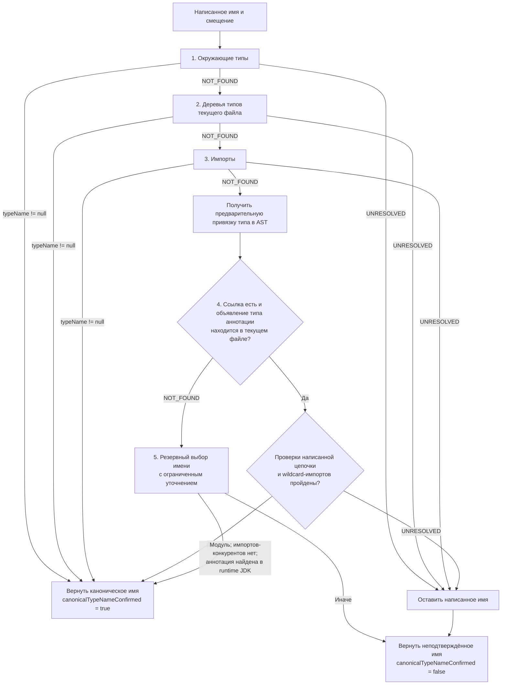
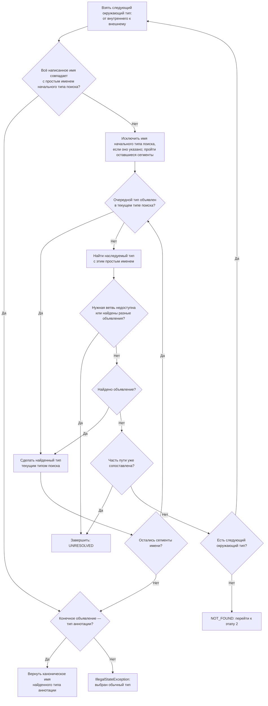
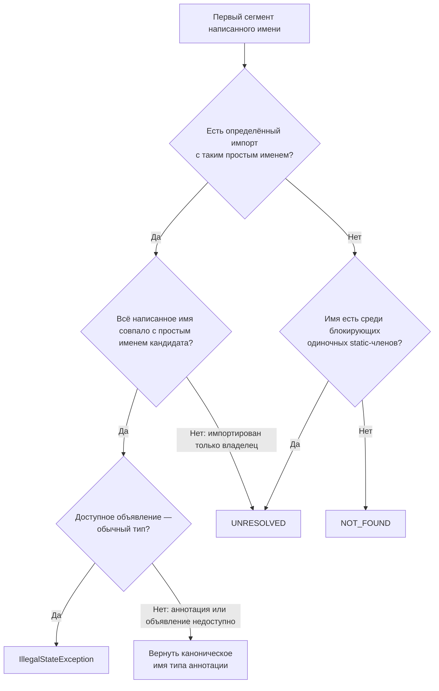

<!--
SPDX-FileCopyrightText: 2026 Anton Lem <antonlem78@gmail.com>
SPDX-License-Identifier: Apache-2.0
-->

# Как JHarmonizer определяет тип аннотации

Этот документ описывает алгоритм `resolveAnnotationTypeName` класса
[`AnnotationTypeNameResolver`](../core/src/main/java/io/github/lemon_ant/jharmonizer/core/spoon/AnnotationTypeNameResolver.java).
Он определяет имя типа аннотации на этапах 1–5.
Метод всегда возвращает `AnnotationTypeNameResolution`: модель содержит имя и признак подтверждения его
канонической идентичности. Основание — объявление, одиночный импорт или найденный тип аннотации из `java.lang`
для описателя модуля. Если каноническое имя установить нельзя, результат содержит неподтверждённое резервное имя.
В схеме и примерах ниже под результатом имени подразумевается поле `annotationTypeName` этой модели.
[`AnnotationDependencyKeyResolver`](../core/src/main/java/io/github/lemon_ant/jharmonizer/core/spoon/AnnotationDependencyKeyResolver.java)
использует это имя для repeatable-контейнеров и ключей сохранения порядка. Далее описаны порядок проверок,
условия продолжения и остановки поиска, а также связь результата с сортировкой.

## 1. Общая схема и причины порядка этапов



**Зачем этапы 1–3, если Spoon уже определил тип.** JHarmonizer разбирает отдельный файл в режиме `no-classpath`:
доступность всех зависимостей компилируемого проекта при этом не гарантируется. Воспроизведён случай, когда
Spoon выбирает `java.lang.Deprecated` вопреки явному импорту другой аннотации —
[подробный пример в разделе 3](#почему-нельзя-сразу-довериться-ast).
Первые три этапа проверяют доступные объявления и импорты: окружающий или унаследованный тип может скрывать внешнее
имя, написанная цепочка — выбирать определённое дерево типов файла, а импорт — задавать другой тип или оставлять
владельца неопределённым. Эти проверки либо устанавливают имя, либо блокируют принятие ненадёжной привязки Spoon.
Часть проверок исправляет неверную привязку, часть сохраняет неопределённость из-за недоступных объявлений.
Этапы 1 и 2 проходят исходные объявления по сегментам написанного имени, включая доступное наследование.
Для них не требуется привязка самого использования аннотации: родители определяются по ссылкам `extends` и `implements`.
Этап 4 проверяет оставшуюся привязку использования после импортов. Если её цепочка заблокирована, поиск завершается;
если привязки к объявлению этого файла нет, этап 5 выбирает резервное имя по оставшимся данным.
Для аннотации модуля после проверок импортов он ищет тип через `java.lang` работающей JDK;
остальные резервные результаты остаются неподтверждёнными.

**AST** (абстрактное синтаксическое дерево) — модель Java-кода, построенная Spoon после разбора исходника.
Она содержит узлы классов, полей, использований аннотаций и других элементов программы.
**Предварительная привязка типа в AST** — связь конкретного использования аннотации с типом, который определил Spoon.
В коде она представлена ссылкой `annotationUseTypeReference` типа `CtTypeReference<?>`, полученной
из `CtAnnotation.getAnnotationType()`. Далее в документе используется сокращение «привязка типа в AST».

Например, в исходнике написано `@Derived.Tag("z")`, а ссылка Spoon указывает на тип с именем `demo.Base.Tag`
из [примера в разделе 2.5](#25-почему-для-этого-нужен-сложный-поиск-типа). Это привязка использования `@Derived.Tag`
к типу `demo.Base.Tag`.
Из неё можно прочитать имя типа и попытаться получить его объявление через `getDeclaration()`;
само объявление при этом может быть недоступно. Привязка предварительная с точки зрения JHarmonizer: Spoon уже
построил AST, но JHarmonizer ещё проверяет, можно ли принять определённый им тип.

На схеме `NOT_FOUND` означает переход к следующему этапу, `UNRESOLVED` — остановку поиска канонического имени.
При `UNRESOLVED` метод сразу возвращает исходное написанное имя без подтверждения; поздние этапы не выполняются.
Подпись `typeName != null` означает наличие имени у отдельного этапа, а не отдельный статус «Имя».
Выходы разделены: этапы 1–4 и модульное правило этапа 5 могут подтвердить каноническое имя;
остальные результаты остаются неподтверждёнными. Подробный контракт исходов приведён в разделе 4.
Для найденного объявления в примерах возвращается каноническое имя типа аннотации, включая пакет и типы-владельцы,
например `demo.Outer.Tag`. На этапе 5 модульное правило подтверждает `java.lang.Deprecated`; остальные ветви
возвращают принятое написание или контекстное имя без подтверждения его полноты или каноничности.
Различие этих форм объяснено в разделе 2.7.

«Объявление типа аннотации по AST» — это объявление `@interface Tag`, с которым Spoon связал конкретное
использование `@Tag`. Проверяется, находится ли найденное Spoon объявление в текущем файле. Само присутствие
`@Tag` в этом файле ещё не означает, что её тип объявлен здесь. Например, в общем примере из раздела 2.5
использование `@Derived.Tag("z")` ссылается на объявление `@interface Tag` внутри `Base` того же файла.

Этап 1 начинает поиск от типов, окружающих использование аннотации. Если он вернул `NOT_FOUND`, этап 2 ищет
объявление аннотации по написанному имени, начиная от верхнеуровневых типов текущего файла. Так поиск может найти
объявление в параллельном дереве — например, во вложенном типе соседнего верхнеуровневого класса.
Дерево типов здесь означает верхнеуровневый Java-тип и объявленные внутри него вложенные типы. Поиск начинается
в таком дереве, а при отсутствии очередного вложенного объявления также рассматривает доступное наследование
через `extends` и `implements`. Выбор начального типа — лишь начало этапа: затем нужно пройти по оставшейся части
написанного имени до самого объявления аннотации.

| Порядок | Что проверяем | Почему здесь |
|---|---|---|
| 1 | Окружающие типы и их родительские типы | Близкое объявление или унаследованный тип могут скрывать внешнее имя. |
| 2 | Деревья типов текущего файла | Написанное имя может вести к объявлению в соседнем дереве: например, `Owner.Inner.Tag` выбирает цепочку `Owner → Inner → Tag`. |
| 3 | Импорты | Явный одиночный импорт надёжнее неподтверждённой внешней AST-привязки и контекстной догадки. |
| 4 | Оставшаяся AST-привязка к объявлению этого файла | Проверяет привязку после импортов, в том числе для написания с пакетом и владельца из обычного или static wildcard-импорта. |
| 5 | Резервный выбор имени | Для модуля ищет аннотацию в `java.lang` работающей JDK, включая вложенные и унаследованные типы; иначе сохраняет написание либо предварительно уточняет простое имя по текущему пакету. |

Это порядок проверки свидетельств в JHarmonizer, а не полная реализация поиска имён компилятором Java.
В частности, этап 2 рассматривает объявления **этого файла**, а не все типы текущего пакета из других файлов.
Конфликт обычного одиночного импорта с одноимённым верхнеуровневым объявлением того же файла не является
допустимым входным сценарием: такой Java-код не компилируется.

## 2. Зачем определять тип аннотации: сохранение порядка повторений

Цель определения типа — подготовить зависимости, которые не дадут сортировщику изменить значимую последовательность
повторяемых аннотаций. Компаратор задаёт желаемый порядок, но он должен уступать этим зависимостям.

### 2.1. Почему повторения имеют значение

По [JLS 9.7.5](https://docs.oracle.com/javase/specs/jls/se21/html/jls-9.html#jls-9.7.5) несколько аннотаций одного типа
на одном объявлении или использовании типа допустимы только для повторяемой аннотации. Компилятор помещает повторения
в `value[]` неявного контейнера в исходном порядке слева направо.

Общие объявления для следующих примеров:

```java
package demo;

import java.lang.annotation.Repeatable;
import java.lang.annotation.Retention;
import java.lang.annotation.RetentionPolicy;

@Retention(RetentionPolicy.RUNTIME)
@Repeatable(Tags.class)
@interface Tag {
    String value();
}

@Retention(RetentionPolicy.RUNTIME)
@interface Tags {
    Tag[] value();
}

@interface Marker {}
```

Аннотации `Tag` и `Tags` имеют runtime retention, чтобы результат можно было увидеть через reflection.
Сохранение исходной последовательности требуется и без runtime retention: оно задано правилом формирования контейнера.

```java
class Example {
    @Tag("z")
    @Marker
    @Tag("a")
    int original;

    @Tag("a")
    @Marker
    @Tag("z")
    int reversed;

    @Marker
    @Tag("z")
    @Tag("a")
    int markerMoved;
}
```

Чтение аннотаций первого поля:

```java
java.util.Arrays.stream(Example.class.getDeclaredField("original").getAnnotationsByType(Tag.class))
        .map(Tag::value)
        .toList();
```

| Поле | Значения `getAnnotationsByType(Tag.class)` | Что произошло |
|---|---|---|
| `original` | `["z", "a"]` | Исходный порядок повторений. |
| `reversed` | `["a", "z"]` | Перестановка двух `Tag` изменила наблюдаемые данные. |
| `markerMoved` | `["z", "a"]` | Независимая `Marker` переместилась, последовательность `Tag` сохранилась. |

В первом случае неявный контейнер соответствует `@Tags({@Tag("z"), @Tag("a")})`, во втором —
`@Tags({@Tag("a"), @Tag("z")})`. Программа, читающая первый элемент или последовательно обрабатывающая аннотации,
получит разные значения. Сортировка только по аргументам могла бы превратить `original` в `reversed`.

Задача JHarmonizer — сохранить относительный порядок `Tag("z")` перед `Tag("a")`, разрешая независимой `Marker`
перемещаться. Повторения не обязаны стоять рядом. Одной стабильности сортировки недостаточно: компаратор может
различать аннотации по аргументам и длине, а стабильность сохраняет исходный порядок только при равенстве сравнения.

### 2.2. Почему связаны аннотация и её явный контейнер

Для reflection содержимое контейнера подставляется на место самого контейнера, сохраняя порядок его `value[]`.
Это определено контрактом
[`AnnotatedElement.getAnnotationsByType`](https://docs.oracle.com/en/java/javase/21/docs/api/java.base/java/lang/reflect/AnnotatedElement.html).

```java
class ContainerExample {
    @Tags({@Tag("b"), @Tag("c")})
    @Tag("a")
    int original;

    @Tag("a")
    @Tags({@Tag("b"), @Tag("c")})
    int containerMoved;
}
```

| Поле | Значения `getAnnotationsByType(Tag.class)` |
|---|---|
| `original` | `["b", "c", "a"]` |
| `containerMoved` | `["a", "b", "c"]` |

Здесь сортировщик не менял массив внутри `Tags`, но перестановка двух внешних фрагментов уже изменила результат.
Поэтому `@Tags` и `@Tag` должны иметь общую зависимость сохранения порядка, хотя это разные типы с разными именами.
Сам контейнер при этом не обязан быть повторяемым.

**Какие сочетания `Tag` и `Tags` допустимы на одном поле.**

Для объявлений из раздела 2.1 `Tag` — повторяемая аннотация, а `Tags` — её контейнер.
Отдельная `@Tag` перед полем применяется непосредственно к этому полю. Аннотации `@Tag` внутри `@Tags({...})`
являются элементами массива контейнера: при подсчёте отдельных `@Tag` перед полем они не учитываются.

| Запись перед одним полем | Допустима? | Как представляются аннотации |
|---|---|---|
| `@Tag("a")` | Да | Одна отдельная `Tag`; контейнер не создаётся. |
| `@Tag("a") @Tag("b")` | Да | Компилятор создаёт контейнер `@Tags({@Tag("a"), @Tag("b")})`. |
| `@Tags({@Tag("a"), @Tag("b"), @Tag("c")})` | Да | Контейнер уже написан явно; компилятору не нужно создавать его для повторений. |
| `@Tag("a") @Tags({@Tag("b"), @Tag("c")})` | Да | Одна отдельная `Tag` и одна явная `Tags`; дополнительный контейнер не нужен. |
| `@Tag("a") @Tag("b") @Tags({@Tag("c")})` | Нет | Несколько отдельных `Tag` требуют неявного контейнера, но явная `Tags` уже присутствует. |

В последней строке компилятору пришлось бы совместить контейнер для первых двух `Tag` с уже написанной `Tags`.
Java не объединяет их содержимое автоматически и запрещает такое сочетание, даже если сам тип `Tags` тоже повторяемый.
Вместо него можно явно записать все три значения в одном контейнере: `@Tags({@Tag("a"), @Tag("b"), @Tag("c")})`.
Эти ограничения установлены в
[JLS 9.7.5](https://docs.oracle.com/javase/specs/jls/se21/html/jls-9.html#jls-9.7.5).

В `ContainerExample` выше снаружи контейнера стоит только одна `@Tag("a")`. Именно поэтому оба порядка —
контейнер перед отдельной аннотацией и контейнер после неё — допустимы. Сортировщик должен сохранить тот порядок,
который выбрал автор: от него зависит последовательность значений, возвращаемых reflection.

### 2.3. Когда зависимости между аннотациями не нужны

Для разных независимых типов этот механизм не требует сохранять исходный взаимный порядок:

```java
class IndependentExample {
    @Marker
    @Deprecated
    int value;
}
```

`Marker` и `Deprecated` не являются повторениями одного типа и не образуют связь «повторяемая аннотация — контейнер».
Сортировщик может переставить их по настроенному компаратору в пределах исходной группы, если сортировка не отключена.

Один неповторяемый тип нельзя дважды применить к тому же объявлению или использованию типа: это ошибка компиляции.
Поэтому для двух прямых повторений **одного типа** на одном элементе компилируемость входа уже означает повторяемость;
загружать внешнее объявление только ради проверки `@Repeatable` не требуется.
Одинаковая неповторяемая аннотация на двух разных полях — другой случай: это разные исходные группы,
между которыми данный алгоритм аннотационных зависимостей не строит рёбер.

Одинаковое короткое имя тоже не означает зависимость. Если `Left.Tag` и `Right.Tag` объявлены как разные типы,
их можно сортировать независимо. Наоборот, записи `@Tag("z")` и `@demo.Tag("a")` в контексте приведённых выше
объявлений обозначают один повторяемый тип и должны сохранить взаимный порядок.

### 2.4. Как результат resolver становится зависимостью сортировки

Ключ сохранения порядка отвечает на вопрос «какие фрагменты могут принадлежать одной защищаемой последовательности».
Он не задаёт приоритет аннотации в компараторе.


Для `Example.original` из раздела 2.1 связь `Tag → Tags` известна из текущего файла:

| Исходный фрагмент | Ключи сохранения порядка | Ограничение |
|---|---|---|
| Первая `@Tag("z")` | `{demo.Tags}` | Начало последовательности повторений. |
| `@Marker` | `{demo.Marker}` | Общего ключа с `Tag` нет. |
| Вторая `@Tag("a")` | `{demo.Tags}` | Должна остаться после первой `Tag`. |

`SpoonAnnotationSorter.orderAnnotationSrcFragments` проходит фрагменты в исходном порядке. Для каждого ключа он
помнит предыдущий фрагмент с этим ключом и добавляет `Dependency(laterFragment, previousFragment)`.
Это означает: более позднее использование зависит от предыдущего и не может оказаться перед ним.
Для трёх повторений получается цепочка «первое раньше второго, второе раньше третьего».

Затем зависимости и обычный настроенный компаратор передаются в `SimplifiedDependencyAwareSorter`.
Компаратор выбирает желаемый порядок по имени, длине или аргументам; зависимости ограничивают разрешённые перестановки.
Они не фиксируют всю исходную группу и не запрещают перемещение независимых аннотаций.
Подмена сравнения повторений возвратом `0` не заменяет этот механизм и может нарушить транзитивность компаратора.

| Метаданные | Для чего используются |
|---|---|
| `name`, `declarationLength`, `arguments` | Критерии компаратора: какой порядок предпочитает конфигурация. |
| `orderPreservationGroupKeys` | Общие ключи для построения рёбер: какие отношения исходного порядка требуется сохранить. |

### 2.5. Почему для этого нужен сложный поиск типа

Сравнение написанных имён даёт две противоположные ошибки:

- Принять `@Tag` и `@demo.Tag` за разные типы — пропустить зависимость и переставить реальные повторения.
- Принять разные `@Left.Tag` и `@Right.Tag` за один тип — добавить ненужную зависимость и запретить допустимую
  сортировку.

**Общий пример наследуемого имени аннотации.** Следующие объявления самостоятельны; их `Base.Tag` отличается от
верхнеуровневой `Tag` из раздела 2.1:

```java
package demo;

import java.lang.annotation.Repeatable;

class Base {
    @Repeatable(Tags.class)
    public @interface Tag {
        String value();
    }

    public @interface Tags {
        Tag[] value();
    }
}

class Derived extends Base {}

class InheritedAnnotationExample {
    @Derived.Tag("z")
    @Base.Tag("a")
    int repeated;

    @Base.Tags({@Derived.Tag("b"), @Base.Tag("c")})
    @Derived.Tag("a")
    int explicitContainer;
}
```

`Derived` наследует вложенный тип `Tag`, но не объявляет нового. Поэтому `Derived.Tag` и `Base.Tag` обозначают
один тип с каноническим именем `demo.Base.Tag`. Речь о наследовании вложенного типа, а не о переносе применённых
аннотаций через `@Inherited`.

У поля `repeated` нужно сохранить `"z"` перед `"a"`, хотя имена владельцев написаны по-разному.
У `explicitContainer` явная `Base.Tags` содержит повторения той же `Base.Tag`; контейнер должен остаться перед
отдельной аннотацией. Это те же зависимости, что в разделах 2.1–2.2, с наследуемым написанием имени.
Если `Base` и `Derived` находятся в недоступной библиотеке, связь между такими написаниями уже нельзя подтвердить
по её объявлениям. Этот пример используется далее при обсуждении наследуемых имён.

Поэтому нужно учитывать видимость имён, наследование, импорты и контейнеры.
Пять этапов основного метода подготавливают сведения для этих решений; сами рёбра создаёт сортировщик.

### 2.6. Почему реализация иногда сохраняет больше, чем доказанные повторения

При этом JHarmonizer разбирает отдельный файл в режиме Spoon `no-classpath`. Внешняя библиотека может отсутствовать
в модели, даже если исходный проект успешно компилируется с ней. Поэтому алгоритм использует доступные свидетельства
и сохраняет неопределённость там, где недостающие объявления могут изменить смысл имени.

Ключи подготавливаются для всех аннотационных фрагментов, а не только после успешной проверки `@Repeatable`.
Сканер учитывает также видимые вложенные аннотации в аргументах внешнего фрагмента. В частности, он делает это
и для обычной аннотации-обёртки, для которой отношение контейнера не доказано.
При недоступных объявлениях дополнительно сохраняется порядок возможных псевдонимов одного типа.
Это консервативная защита: не каждый общий ключ означает, что повторяемость уже подтверждена метаданными.
Подтверждённо разные независимые типы при этом не объединяются только из-за одинакового короткого имени.

Входной контракт: компилируемый Java-код и исходный, не изменённый вызывающим кодом AST Spoon. Отсутствие внешних
объявлений при `no-classpath` допустимо. Некорректную структуру исходного AST нельзя исправлять догадками.

### 2.7. Написанное имя, установленный тип и ключ зависимости

| Понятие | Пример | Значение |
|---|---|---|
| Простое имя типа аннотации | `Tag` | Только имя самого типа, без пакета и владельцев. |
| Написанное имя, `writtenTypeName` | `Derived.Tag` | Последовательность имён из исходного текста, без `@` и аргументов. |
| Полное квалифицированное имя типа аннотации | `demo.Derived.Tag` | Включает пакет и допустимую цепочку типов, через которую доступна аннотация. Может обращаться к унаследованной `Tag` через `Derived`. |
| Каноническое имя типа аннотации | `demo.Base.Tag` | Полное квалифицированное имя через фактические объявления типов-владельцев: `Tag` непосредственно объявлена в `Base`. |
| Результирующее имя типа аннотации | `demo.Base.Tag`, `lib.Derived.Tag` или `Tag` | Поле `annotationTypeName` результата `AnnotationTypeNameResolution`; конкретная форма зависит от завершившего поиск этапа. |
| Ключ сохранения порядка | `demo.Base.Tags` или `?.Derived.Tag` | Основание для связи фрагментов, а не критерий компаратора. |

Разницу между полным и каноническим именем показывает
[пример в разделе 2.5](#25-почему-для-этого-нужен-сложный-поиск-типа): `Base` объявляет `Tag`, а `Derived extends Base`
наследует её. `demo.Base.Tag` и `demo.Derived.Tag` — два полных квалифицированных имени одного типа.
Каноническое имя только одно — `demo.Base.Tag`. Оно также является полным квалифицированным именем.
Таким образом, понятия пересекаются, но не совпадают: полное имя может использовать наследника,
а каноническое указывает фактическую цепочку объявлений.

Для доступных объявлений в примерах результат — полное квалифицированное имя типа аннотации через фактического
объявляющего владельца, то есть её каноническое имя. Возвращается вся строка `demo.Base.Tag`, а не `Tag`.
В безымянном пакете префикса пакета нет; у верхнеуровневой аннотации `Tag` оба вида имени совпадают с простым `Tag`.

`SpoonTypeUtils.formatCanonicalTypeName` форматирует цепочку ссылок `CtTypeReference.getDeclaringType()`,
а не ищет объявления через `getDeclaration()`. Ссылки на владельцев могут существовать и без доступных объявлений.
Spoon соединяет эти уровни в `getQualifiedName()` через `$`; форматтер соединяет их через точки.
Сами идентификаторы сохраняются: для класса `Dollar$Owner` с вложенной аннотацией `Tag$Kind` результат —
`demo.Dollar$Owner.Tag$Kind`, а не `demo.Dollar.Owner.Tag.Kind`.
Сочетание `$` и точек здесь корректно: `$` входит в имена, точка разделяет типы.
Форматтер использует только вложенность, записанную в ссылке; он не восстанавливает недостающих владельцев
и не подтверждает, что эта цепочка ведёт к фактическому объявлению аннотации.

Не каждое принятое имя имеет подтверждённую полноту и каноничность. В обычном файле этап 5 принимает написанное
имя с точкой без добавления пакета: например, `Derived.Tag` без подходящих объявлений, импортов и привязки в AST.
Поэтому для этой ветки используется формулировка «принятое написанное квалифицированное имя», а не «каноническое имя».
Принятое внешнее `lib.Derived.Tag` также ещё не устанавливает, где именно объявлена аннотация.
После разбора всей исходной группы `AnnotationSourceScanner.Parsing.parseAnnotationSrcGroup` вызывает
`AnnotationDependencyKeyResolver.collectConservativeOrderPreservationGroupKeys`, который делегирует сравнение возможных
совпадений в `AnnotationOrderPreservationKeyCollector.collect`. Это отдельная подготовка ключей группы,
а не часть `resolveAnnotationTypeName`; затем сортировщик строит по этим ключам рёбра зависимостей
(раздел 2.4).

Различие написанного пути и канонического имени при наследовании соответствует
[JLS 6.7](https://docs.oracle.com/javase/specs/jls/se21/html/jls-6.html#jls-6.7).

## 3. Вход, подготовленные данные и результат

Основной метод принимает два значения:

```java
resolveAnnotationTypeName(annotationUseSrcStartOffset, writtenAnnotationTypeName)
```

- `annotationUseSrcStartOffset` — индекс UTF-16 начала токена `@` в полном исходном тексте файла, а не строка и столбец.
- `writtenAnnotationTypeName` — имя, прочитанное сканером: например, `Tag`, `Outer.Tag` или `demo.Outer.Tag`.

Здесь сканер — `AnnotationSourceScanner`: он отдельно читает исходный текст токенизатором **Eclipse JDT
(Java Development Tools)** через интерфейс `IScanner`. Используется библиотека, уже входящая в зависимости Spoon.
Этот дополнительный лексический проход нужен потому, что обход AST Spoon 11.5.0 пропускает некоторые использования
аннотаций, например на размерностях массива и receiver-параметрах. JDT позволяет прочитать их имена и смещения
непосредственно из текста. Сканер не строит второй AST и не определяет, какое объявление обозначает имя:
структуру типов и предварительные привязки по-прежнему предоставляет Spoon. Подробности и проверенные примеры —
в [описании границы сканирования](source-printer.md#annotation-scanning-boundary).

Написанная квалификация сохраняется, но имя собирается из переведённых Java-токенов: пробелы и комментарии
пропускаются, Unicode escapes раскрываются. Например, `@pkg /* comment */ . Tag` даёт `pkg.Tag`.
Смещение нужно и для выбора окружающих типов: два одинаково написанных `@Tag` в разных классах могут обозначать
разные типы. Поэтому одного `writtenAnnotationTypeName` для разрешения недостаточно.

При создании `AnnotationDependencyKeyResolver` список исходных типов и индекс их канонических имён подготавливаются
один раз. Затем `SpoonImportUtils.collectTypeImportContext` одним проходом по импортам создаёт доступный только
для чтения `SpoonTypeImportContext`. Он передаётся в `AnnotationTypeNameResolver`, а готовые канонические имена
одиночных импортов также используются при подготовке ключей зависимостей.
Конструктор контекста сам создаёт немодифицируемые представления подготовленных коллекций без копирования;
`SpoonImportUtils` передаёт ему коллекции без предварительных обёрток и не изменяет их после передачи.
Обёртка карты владельцев сохраняет сравнение ключей `CtImport` по идентичности.

`AnnotationTypeNameResolver` выполняет весь алгоритм определения имени: задаёт приоритет этапов 1–5, строит индекс
AST-ссылок использований, обрабатывает одиночные импорты, квалифицированные написания и контекстные имена.
Для поиска по фактическим объявлениям он вызывает вспомогательный `AnnotationTypeNameFromDeclarationsResolver`.
Этот обработчик получает модель файла и упорядоченные сведения о wildcard-владельцах через конструктор.
Из исходного AST он один раз собирает `srcTypeScopes`, включая локальные и анонимные классы, затем проходит
по объявлениям вложенных и унаследованных типов до конечного объявления аннотации.
Его операции различаются начальной точкой обхода: на этапе 1 это окружающий тип, на этапе 2 — верхнеуровневый тип,
совпавший с началом написанного имени. На этапе 4 тем же обходом проверяется исходная AST-привязка:
дерево выбирается по имени с префиксом пакета или через владельца wildcard-импорта.
Поиск по объявлениям и есть общая операция этапов 1, 2 и 4.
Одиночные импорты на этапе 3 и резервное написание с ограниченным уточнением на этапе 5 могут дать принятое имя
без доступного исходного объявления. Этап 5 также обращается к типам работающей JDK для описателя модуля.
Эти решения остаются в общем `AnnotationTypeNameResolver`.
`AnnotationDependencyKeyResolver` использует полученное имя для repeatable-метаданных и ключей зависимостей.
Для исходов этапов 1–4 используется независимая модель `CanonicalAnnotationTypeNameLookupResult`.
Управляющий метод сохраняет имя и его происхождение в отдельной модели `AnnotationTypeNameResolution`.
Подготовленные данные:

1. `compilationUnit` — модель Spoon текущего исходного файла: его пакет, импорты и объявления.
   `AnnotationTypeNameResolver` использует её для контекста пакета,
   а `AnnotationTypeNameFromDeclarationsResolver` — для поиска по объявлениям этого файла.
2. `canonicalTypeDeclarations` — верхнеуровневые типы этого файла и рекурсивно объявленные в их телах типы-члены.
   `AnnotationDependencyKeyResolver` использует их для канонического индекса и repeatable-метаданных.
   Для выбора окружающих типов `AnnotationTypeNameFromDeclarationsResolver` независимо собирает `srcTypeScopes`:
   этот список включает также локальные и анонимные классы, влияющие на видимость имён.
   Он не подменяет канонический индекс: локальные и анонимные классы нужны для видимости и наследования,
   но Java запрещает объявлять аннотации прямо или косвенно внутри них
   ([JLS 9.6](https://docs.oracle.com/javase/specs/jls/se21/html/jls-9.html#jls-9.6)).
   Поэтому индекс верхнеуровневых типов и типов-членов охватывает все допустимые объявления аннотаций файла.
3. `declaredTypesByCanonicalName` — те же объявления, сопоставленные с их каноническими именами.
   `AnnotationDependencyKeyResolver` ищет в общем индексе repeatable-метаданные,
   а `SpoonImportUtils` при подготовке контекста — исходного владельца неразрешённого wildcard-импорта.
4. `SpoonTypeImportContext` — определённые одиночные импорты по простому имени, их канонические имена,
   простые имена одиночных static-импортов без определённого типа, все wildcard-импорты и индекс исходных владельцев.
   Список `wildcardImportsInModelOrder` содержит все реальные wildcard-импорты в порядке модели Spoon.
   В `srcOwnerTypesByWildcardImport` сохраняются только найденные типы, по идентичности исходного `CtImport`;
   отсутствие записи означает недоступного владельца. Подготовка не обрезает список и индексирует все импорты.
   `hasWildcardImports()` выводится из непустоты списка; сам контекст не хранит отдельных флагов наличия
   или недоступности импортов.
   Конструкторы получают весь `SpoonTypeImportContext`, а не отдельные коллекции из него.
   `AnnotationTypeNameFromDeclarationsResolver` извлекает и сохраняет только список wildcard-импортов
   и индекс их доступных исходных владельцев.
   `AnnotationTypeNameResolver` сохраняет индекс одиночных импортов, множество блокирующих static-имён
   и признак наличия wildcard-импортов. Сам объект контекста оба класса после создания не хранят.
5. `annotationTypeReferencesBySrcStartOffset` — AST-ссылки **использований** аннотаций с корректными позициями Spoon,
   сопоставленные с их начальными смещениями. Этот индекс принадлежит `AnnotationTypeNameResolver`;
   это не индекс объявлений `@interface`.
6. `RuntimeTypeUtils` один раз подготавливает общий индекс публичных верхнеуровневых типов пакета `java.lang`
   из модуля `java.base` работающей JDK. Это независимый от исходного файла индекс, а не расширение модели Spoon.
   Классы читаются без инициализации; зависимости приложения не загружаются. Для очередного сегмента пути
   утилита отдельно ищет публичный тип-член с учётом объявлений и наследования.

Подготовка контекста сохраняет форму и имена импортов, но не проверяет все импортируемые типы на `@interface`:
обычный импорт класса-владельца допустим. Проверка вида выполняется только после выбора конкретного импорта
для всего написанного имени аннотации. Поиск членов wildcard-владельца и его родителей тоже остаётся на этапе 4:
его результат зависит от искомого имени, а не только от исходного файла.

Если этапы 1–3 вернули `NOT_FOUND`, управляющий метод извлекает необязательную привязку типа в AST
`annotationUseTypeReference` и передаёт её в
`AnnotationTypeNameFromDeclarationsResolver.confirmSrcBoundAnnotationTypeName`.
Подготовка и проверка этапа 4:

1. Управляющий метод берёт из индекса по смещению ссылку на тип использования аннотации.
   При построении индекса она получена у узла `CtAnnotation` через `getAnnotationType()`.
2. Для ненулевой ссылки `AnnotationTypeNameFromDeclarationsResolver` вызывает `getDeclaration()`:
   Spoon возвращает найденное им объявление типа, например `@interface Tag` внутри `Base`.
3. Если ссылка отсутствует или `getDeclaration()` вернул `null`, этап даёт `NOT_FOUND`.
   Ненулевое объявление принадлежит текущему файлу, поскольку каждый исходник разбирается в новой модели Spoon.

Если по ссылке доступно объявление, привязка типа в AST позволяет связать использование и с этим объявлением.
В [примере из раздела 2.5](#25-почему-для-этого-нужен-сложный-поиск-типа) цепочка имеет вид
`@Derived.Tag("z") → ссылка на Base.Tag → @interface Tag внутри Base`. Поскольку `Base.Tag` объявлена в том же файле,
условие проверки исходной привязки выполнено. Если ссылки нет, объявление находится в другом файле или Spoon
не смог получить его, этап 4 возвращает `NOT_FOUND`, и поиск продолжается на этапе 5.
Поиск по написанному имени на этапах 1–3 выполняется до извлечения этой привязки.

Привязка типа в AST действительно может отсутствовать для компилируемого исходника.
Для Spoon 11.5.0 на JDK 21 в проекте подтверждены три категории использований без записи в индексе AST-ссылок:

- Аннотации описателя модуля. Для существующей
  [фикстуры `module-info.java`](../core/src/test/resources/test-cases/core/e2e/printer/scenarios/18-annotation-language-constructs/input/module-info.java)
  с `@SuppressWarnings("removal") @Deprecated module annotated.sample {}` список `CtModule.getAnnotations()` пуст
  сразу после разбора, до работы сканера JHarmonizer. Это подтверждено debugger logpoint и отдельным запуском Spoon.
  В исходном коде Spoon
  [`JDTTreeBuilderHelper.createModule`](https://github.com/INRIA/spoon/blob/v11.5.0/src/main/java/spoon/support/compiler/jdt/JDTTreeBuilderHelper.java#L846-L890)
  создаёт модуль и его директивы, но не переносит аннотации.
- Аннотации размерностей массива: `String @Z @A [] @D @C []`. Рекурсивный обход Spoon не находит эти четыре
  использования, хотя сканер видит их в исходном тексте.
- Аннотации receiver-параметра — явно записанного параметра `this` метода:
  `execute(@Z @A TypeUseAnnotationOrdering this, String value)`. Тот же обход не находит эти два использования.
  Последние две категории воспроизведены на одной компилируемой фикстуре; результаты приведены в
  [описании границы сканирования](source-printer.md#annotation-scanning-boundary).

Это перечень выявленных случаев для указанной версии и конфигурации, а не доказательство полноты для всех
допустимых конструкций Java. Повторный обход того же AST или знание исходного смещения не восстанавливает
отсутствующую ссылку использования. Само объявление типа аннотации при этом может присутствовать в модели:
поиск объявления по написанному имени на этапах 1–3 остаётся возможным без ссылки этого использования.

Это ограничения представления допустимого исходника, а не восстановление после ошибки компиляции или изменения AST
вызывающим кодом. Сканер передаёт написанное имя и смещение независимо от AST, поэтому поиск может продолжаться.

Отсутствующая позиция — отдельный случай: индекс включает только узлы с `position.isValidPosition()`.
Существующие тесты с `setPosition(SourcePosition.NOPOSITION)` искусственно моделируют отсутствие записи в индексе.
Они не доказывают, что Spoon сам теряет позиции обычных исходных аннотаций; такой пример здесь не установлен.

Сам `resolveAnnotationTypeName` всегда возвращает ненулевой `AnnotationTypeNameResolution`. Модель содержит
ненулевое имя `annotationTypeName` и признак `canonicalTypeNameConfirmed`. Контракт различает два состояния:

| Результат | Что установлено | Когда возвращается |
|---|---|---|
| Признак `true` | Каноническая идентичность типа аннотации подтверждена. | Успешные этапы 1–4 либо модульное правило этапа 5 после проверок импортов. |
| Признак `false` | Имя пригодно для лексической группировки; каноническая идентичность не подтверждена. | `UNRESOLVED` на этапах 1–4 либо неподтверждённый результат этапа 5. |

Результат с `false` не подтверждает объявление или внешний источник аннотации. При раннем `UNRESOLVED`
или недостатке контекстных данных метод сохраняет исходное `writtenAnnotationTypeName`. Если этап 5 предварительно
уточнил текущий пакет, сохраняется выведенное имя без подтверждения. Модульное правило отдельно возвращает
подтверждённое `java.lang.Deprecated`: после исключения блокирующих импортов оно находит реальный тип аннотации
в работающей JDK. Для обычного файла этап 5 сохраняет квалифицированное написание как есть.
Выбор резервного имени целиком принадлежит resolver;
вызывающий код не восстанавливает отсутствующий результат и не повторяет этот выбор.

`AnnotationTypeNameResolution` — простой неизменяемый DTO с тремя конструкторами уровня пакета:

- Генерируемый конструктор `(String annotationTypeName, boolean canonicalTypeNameConfirmed)` сохраняет явно
  выбранные значения.
- Конструктор `(String annotationTypeName)` делегирует первому с `false` для неподтверждённого имени.
- Конструктор `(CanonicalAnnotationTypeNameLookupResult)` переносит имя успешного поиска с подтверждением `true`.
  Если результат не содержит имени, выбрасывается `IllegalArgumentException`.

DTO не ищет объявления, не выводит пакет и не проверяет контекст Spoon. Выбор имени и основания подтверждения
принадлежат `AnnotationTypeNameResolver`; конструкторы только сохраняют значения, задают `false` по умолчанию
либо адаптируют уже успешный результат. Успешный поиск на этапах 1–4 и модульное правило дают `true`, остальные
резервные результаты — `false`. Совпадение строк само по себе не меняет это решение.

Этот метод **не помещает** строки `?.Tag` в результирующее имя и **не заменяет** `Tag` на контейнер `Tags`.
Этим занимается `AnnotationDependencyKeyResolver`; его работа описана в разделе 11.

### Почему нельзя сразу довериться AST

В `no-classpath` Spoon может связать короткое имя с доступным, но неподходящим типом.
Следующий пример воспроизведён на Spoon 11.5.0 и JDK 21:

```java
package demo;

import unavailable.library.Deprecated;

@Deprecated
class Example {}
```

Второй файл проекта объявляет библиотечную аннотацию:

```java
package unavailable.library;

public @interface Deprecated {}
```

Оба файла вместе успешно компилируются `javac`. Если передать Spoon только первый файл с `noClasspath=true`,
его неизменённый AST содержит для `@Deprecated` ссылку на `java.lang.Deprecated` с допустимой позицией.
Это наблюдаемое поведение при недоступном объявлении, а не только гипотетическая защита.
Обычный явный импорт сообщает полное квалифицированное имя типа аннотации `unavailable.library.Deprecated`
и имеет приоритет перед привязкой типа в AST.

Результат относится к указанной версии и условиям разбора. Общий режим работы с недоступными объявлениями описан в
[документации Spoon о no-classpath](https://spoon.gforge.inria.fr/launcher.html#resolution-of-elements-and-classpath);
она не гарантирует именно такую ошибочную привязку во всех версиях или контекстах.

## 4. Три исхода отдельного этапа

Этапы 1–4 возвращают независимую модель `CanonicalAnnotationTypeNameLookupResult`. Ненулевое поле
`canonicalAnnotationTypeName` хранит каноническое имя, принятое для данного использования аннотации.
Объект создаётся тремя конструкторами; конструктора из произвольной строки нет:

- Приватный конструктор с `boolean terminal` создаёт только статус `NOT_FOUND` или `UNRESOLVED`, без имени.
- Конструктор с `CtType<?>` проверяет найденное объявление через `SpoonTypeUtils.requireAnnotationTypeDeclaration`,
  сужает его до `CtAnnotationType<?>` и вычисляет имя из ссылки самого объявления аннотации.
  Обычный конечный класс или интерфейс вызывает `IllegalStateException` ещё до создания успешного результата.
- Конструктор с `CtImport` принимает определённый одиночный импорт после полного совпадения имени. Для разрешённой
  ссылки он вызывает `getTypeDeclaration()` и проверяет доступное исходное или classpath-объявление тем же
  `requireAnnotationTypeDeclaration`. Если объявления нет, остаётся каноническое написание импорта и контракт
  компилируемого исходника — раздел 7.2. Извлечение имени централизовано в `SpoonImportUtils`: wildcard-импорт,
  поле, метод и неразрешённый static-импорт не дают имени типа и отклоняются конструктором.

Промежуточные владельцы в цепочке `Outer.Inner.Tag` могут быть обычными `CtType<?>`: в результат они не помещаются.
Проверяется именно конечная `Tag`. Например, `resolveCanonicalAnnotationTypeNameInSrcTypeScope(Outer, "Inner")`
не создаст успешный результат для обычного класса `Outer.Inner`, а завершится исключением.

Конструктор с `CtType<?>` гарантирует вид исходного объявления. Импортный конструктор обеспечивает такую проверку
только при доступном объявлении: обычный одиночный импорт требует канонического имени, но без объявления отдельно
проверить `@interface` нельзя. Отсутствие объявления само по себе не считается ошибкой `no-classpath`-разбора.
Это ограничение относится к импортному пути создания, а не к конструктору с `CtType<?>`.
У допустимого исходного объявления аннотации всегда есть каноническое имя: это прямо следует из запрета локальных
и вложенных в локальные/анонимные типы объявлений аннотаций в
[JLS 9.6](https://docs.oracle.com/javase/specs/jls/se21/html/jls-9.html#jls-9.6).

На этапе 4 отсутствие привязки к исходному объявлению даёт `NOT_FOUND`, отклонённая исходная привязка — `UNRESOLVED`,
а подтверждённая — успешный результат из проверенного объявления аннотации.
Управляющий метод переносит имя успешного результата в `AnnotationTypeNameResolution` с подтверждением.
Результат этапа 5 не проходит через `CanonicalAnnotationTypeNameLookupResult`: этот этап сразу создаёт итоговую
модель из выбранного имени и признака подтверждения. Модульное правило реализовано в resolver; отдельного
конструктора с контекстом модуля у DTO нет. Проверка при подготовке ключей и repeatable-метаданных описана
в разделе 11.2.

В контексте разрешения аннотации результат трактуется так:

| Результат этапа | `terminal` | `canonicalAnnotationTypeName` | Действие управляющего метода |
|---|---|---|---|
| `NOT_FOUND` | `false` | `null` | Перейти к следующему этапу. |
| Установлено каноническое имя типа аннотации | `true` | Например, `demo.Outer.Tag` | Вернуть `AnnotationTypeNameResolution` с этим именем и подтверждением. |
| `UNRESOLVED` | `true` | `null` | Вернуть `AnnotationTypeNameResolution` с исходным написанным именем без подтверждения; следующие этапы не выполнять. |

`NOT_FOUND` означает: «этот этап не выбрал источник имени». `UNRESOLVED` означает: «продолжение может дать
неверный ответ». Например, недоступный родитель может объявлять `Tag`, скрывающий импортированный `Tag`.
Нельзя пропустить этого родителя и принять импорт только потому, что его удалось прочитать.

Именно поэтому управляющий метод проверяет `isTerminal()`, а не только `getCanonicalAnnotationTypeName() != null`.

## 5. Этап 1: поиск в окружающих типах

Метод: `AnnotationTypeNameFromDeclarationsResolver.resolveCanonicalAnnotationTypeNameInEnclosingTypes`.

### 5.1. Как выбираются окружающие типы

`SpoonTypeUtils.collectEnclosingSrcTypes` оставляет типы, в диапазон которых, **сообщённый Spoon**, входит смещение
аннотации. Обе границы Spoon включительные: `sourceStart <= offset <= sourceEnd`.
Типы упорядочиваются по убыванию начального смещения — от внутреннего окружающего типа к внешнему.
Для этого используется отдельный список `srcTypeScopes`, собранный `SpoonTypeUtils.collectSrcTypeScopes` из AST:
он включает верхнеуровневые, вложенные, локальные и анонимные типы. Поэтому родитель локального или анонимного
класса проверяется раньше, чем одноимённое объявление снаружи либо импорт.
Список `canonicalTypeDeclarations` для канонического индекса остаётся отдельным:
локальные и анонимные классы влияют на поиск унаследованных имён, но не объявляют собственных аннотаций.
Такие объявления запрещены прямо или косвенно внутри них по
[JLS 9.6](https://docs.oracle.com/javase/specs/jls/se21/html/jls-9.html#jls-9.6).

Это важно даже при наличии одноимённой `@interface Tag` в текущем файле. Если локальный или анонимный класс
наследует недоступный `Base`, тот может объявлять другую `Base.Tag`. Этап 1 возвращает `UNRESOLVED` раньше,
чем этап 2 сможет выбрать местную `Tag`. Если найдено каноническое объявление в доступном исходном родителе,
имя этого объявления, напротив, разрешается обычным поиском наследования.
Это проверяет
[фикстура `LocalAnnotationScopes`](../core/src/test/resources/test-cases/core/spoon/valid/context-name-confidence/LocalAnnotationScopes.java):
она сопоставляет аннотацию верхнеуровневого типа с одноимёнными использованиями в локальном и анонимном классах,
а также проверяет доступного исходного родителя, объявившего унаследованную аннотацию.

```java
class Outer {
    static class Inner {
        @Deprecated int value;
    }
}
```

Для аннотации поля обычно получается `[Outer.Inner, Outer]`. Для поля обычного класса список тоже непустой:
наличие вложенных классов не требуется.

Это не вычисление действительных лексических границ Java по исходному тексту. Например, аннотация перед объявлением
класса может предшествовать началу его диапазона Spoon и не попасть в список. Аннотации пакета и модуля обычно
не принадлежат диапазону никакого типа и дают пустой список.

### 5.2. Поиск от выбранного типа

Методы `resolveCanonicalAnnotationTypeNameInSrcTypeScope` и `resolveAnnotationTypeNameInSrcTypeHierarchy`
класса `AnnotationTypeNameFromDeclarationsResolver` выполняют общий поиск для этапов 1 и 2.
На этапе 4 тот же обход иерархии используется для проверки членов wildcard-импортов.

**Начальный тип поиска** — тип, от которого начинается проверка написанного имени. На этапе 1 это очередной
окружающий тип, на этапе 2 — выбранный верхнеуровневый тип текущего файла. На этапе 4 поиск импортируемых членов
начинается от типа — источника wildcard-импорта; само имя этого типа импорт не вводит.

**Текущий тип поиска** — тип, в котором ищется очередной сегмент имени. Вначале он совпадает с начальным,
а после нахождения очередного вложенного или унаследованного типа меняется на найденный тип.



Используется всё имя аннотации, написанное в исходнике, без `@` и аргументов: например, для `@Outer.Inner.Tag("x")`
это `Outer.Inner.Tag`. Последний сегмент `Tag` не отрезается: это простое имя самой аннотации,
объявление которой ищем.

**Для каждого сегмента сначала проверяется непосредственно объявленный вложенный тип.**
При начальном типе поиска `Outer` имя `Outer.Inner.Tag` проверяется так:

1. Сегмент `Outer` обозначает уже выбранный начальный тип поиска.
2. В теле `Outer` ищется объявленный там тип `Inner`.
3. В теле `Inner` ищется объявление аннотации `Tag`.

Это и означает «по прямой вложенности»: каждое следующее объявление находится непосредственно в теле предыдущего.
Имя начального типа поиска допускается в начале, но не требуется: из `Outer` имена `Inner.Tag` и `Outer.Inner.Tag`
ведут к одному объявлению. При совпадении всего имени с простым именем начального типа поиска проверяется вид
этого объявления: для аннотации возвращается каноническое имя, для обычного типа выбрасывается исключение.
Локальный класс может наследовать аннотацию, объявленную у обычного верхнеуровневого или вложенного владельца:
возвращается каноническое имя самого найденного объявления, например `Base.Tag`.
Во всех остальных случаях оставшиеся сегменты проходят один раз с учётом объявлений и наследования, а вид конечного
объявления проверяется после последнего сегмента.

Следующий пример показывает переход от внутреннего окружающего типа `Consumer` к внешнему `Outer`:

```java
package demo;

import java.lang.annotation.ElementType;
import java.lang.annotation.Target;

class Outer {
    static class Inner {
        @Target(ElementType.TYPE_USE)
        @interface Tag {
            String value();
        }
    }

    static class Consumer {
        String @Outer.Inner.Tag("x") [] value;
    }
}
```

Порядок окружающих типов для этого использования — `[Outer.Consumer, Outer]`. Поиск выполняется так:

1. При поиске от `Consumer` имя `Outer.Inner.Tag` не находится: собственного или наследуемого типа `Outer` там нет.
   Недоступных родителей, блокирующих поиск, тоже нет. Поэтому алгоритм переходит к окружающему типу `Outer`.
2. При поиске от `Outer` начальный сегмент `Outer` совпадает с выбранным типом. Далее находятся объявленная в нём
   `Inner` и объявленная в ней `Tag`: возвращается полное квалифицированное имя типа аннотации
   `demo.Outer.Inner.Tag`.

На Spoon 11.5.0 обход AST не находит использование на размерности массива
`String @Outer.Inner.Tag("x") []`, поэтому его ссылка не попадает в индекс
`annotationTypeReferencesBySrcStartOffset`. Сканер при этом читает имя и смещение из исходного текста.
Для этапов 1–2 отсутствие этой привязки не мешает поиску: они проходят объявления по написанному имени.
Обычная аннотация поля с тем же написанием также проходит из `Consumer` к `Outer`, если в `Consumer` нет
соответствующего собственного или наследуемого типа. Привязка использования больше не завершает этот поиск заранее.

Если очередной тип не объявлен непосредственно в текущем типе поиска,
`SpoonTypeInheritanceUtils.findInheritedMemberTypeDeclaration` выполняет поиск по родительским ветвям
для этого простого имени:

1. Для очередного родителя вызывается `getDeclaration()`. Если объявление недоступно, помечено Spoon как `shadow`
   или принадлежит другому исходному файлу, необходимое продолжение этой ветви неизвестно.
2. Если родитель сам объявляет искомый тип, поиск на этой ветви заканчивается. Неприватное объявление становится
   кандидатом. `private`-тип не наследуется, но также завершает ветвь: нельзя пропустить его и «восстановить»
   скрытый одноимённый тип предка.
3. Если собственного объявления нет, поиск продолжается по родителям этого типа. Объявление, найденное в одной
   ветви, не отменяет проверку остальных прямых родительских ветвей текущего типа поиска.
4. Необходимая недоступная ветвь или разные канонические кандидаты дают неопределённый результат.
   Один кандидат даёт найденное объявление; отсутствие кандидатов во всех доступных ветвях — отсутствие совпадения.
   Одно объявление, достигнутое по нескольким ветвям интерфейсов, учитывается один раз. Правила наследования
   и скрытия соответствуют [JLS 8.5](https://docs.oracle.com/javase/specs/jls/se21/html/jls-8.html#jls-8.5).

Результат `SpoonTypeInheritanceUtils.InheritedMemberTypeLookupResult` хранит найденное `declaration`
и флаг `unresolved`.
При `unresolved=true` весь поиск имени завершается с `UNRESOLVED`. Пара `false` и `null` означает,
что наследуемого объявления нет; `false` и ненулевое объявление позволяют перейти к следующему сегменту.

Объявления различаются по каноническому имени. Структурное равенство `CtType.equals()` для этого не подходит:
два пустых `@interface Tag {}` в разных владельцах Spoon может считать равными. Проверка на компилируемой фикстуре
без неоднозначного использования закреплена в
[`SpoonTypeInheritanceUtilsTest`](../core/src/test/java/io/github/lemon_ant/jharmonizer/core/spoon/SpoonTypeInheritanceUtilsTest.java).

Найденный тип становится текущим типом поиска для следующего сегмента. Поэтому для унаследованной `Inner` проверяются
и её собственные родители, если следующий сегмент не объявлен непосредственно внутри неё.
Проверка не ограничена одним суперклассом или только родителями начального `Derived`.

Из проверки родителей исключаются `java.lang.Object` и фиксированные платформенные суперклассы enum/record:
они не добавляют искомых вложенных типов аннотаций. Суперинтерфейсы продолжают проверяться.
Обход использует очередь ссылок на родителей; состояние хранится в локальных переменных одного вызова.
Множество `visitedTypeNames` предотвращает повторный обход в поиске одного простого имени.
Для следующего сегмента создаётся отдельный поиск: его родительские ветви могут завершаться на других объявлениях.

Непосредственное объявление имеет приоритет перед наследуемыми: если очередной сегмент найден в теле текущего типа
поиска, для этого перехода проверять его родителей не требуется. Например, собственная `Derived.Tag` скрывает возможную
`Tag` недоступного суперкласса. То же правило действует внутри наследуемой цепочки:
в `Derived → Base → External` собственная `Base.Tag` завершает эту ветвь, и доступность `External` не проверяется.
Но отдельная интерфейсная ветвь `Derived`, где объявление ещё не найдено, продолжает проверяться и может дать
`UNRESOLVED`.

Пример ниже компилируется с библиотекой `library`, но при рассматриваемом разборе её объявления недоступны:

```java
class Outer {
    @interface Tag {}

    static class Inner extends library.Base {
        @Tag int value;
    }
}
```

Если `Base` объявляет доступную вложенную аннотацию `Tag`, использование относится к ней, а не к `Outer.Tag`.
В типе `Inner` собственного объявления нет, а родитель недоступен: результат — `UNRESOLVED`, и основной метод
возвращает написанное `Tag` без подтверждения. Он не переходит ни к `Outer`, ни к импортам, даже если Spoon
связал использование с `Outer.Tag`.

Та же защита действует для имени с точками. Недоступный родитель может содержать вложенный тип `java`, в нём `lang`,
а в нём аннотацию `Deprecated`. Поэтому даже `@java.lang.Deprecated` нельзя безусловно принять раньше этапа 1.
Приоритет типов и пакетов при интерпретации пути описан в
[JLS 6.5.2](https://docs.oracle.com/javase/specs/jls/se21/html/jls-6.html#jls-6.5.2).

### 5.3. Когда поиск переходит к следующему окружающему типу

Если при поиске от окружающего типа не найден даже начальный сегмент и родители не блокируют поиск,
возвращается `NOT_FOUND`: проверяется следующий внешний окружающий тип. Если часть пути уже сопоставлена,
но продолжение не найдено, возвращается `UNRESOLVED`: нельзя заново интерпретировать то же имя
от другого начального типа или импорта.

Собственное объявление, проверка доступности родителей и наследуемое объявление рассматриваются последовательно
для каждого сегмента при поиске от выбранного окружающего типа. Поэтому унаследованная `Base.Tag` находится раньше
внешней `Outer.Tag`, а неизвестный `Base` блокирует выбор внешнего одноимённого объявления.

Привязка самого использования аннотации в этих проверках не принимается. Ссылки Spoon на суперклассы
и суперинтерфейсы используются для перехода к исходным объявлениям родителей. Это позволяет одинаково разрешать
доступное наследование у обычных аннотаций и у использований, пропущенных обходом AST.

## 6. Этап 2: поиск объявления аннотации в деревьях типов текущего файла

Метод: `AnnotationTypeNameFromDeclarationsResolver.resolveCanonicalAnnotationTypeNameInSrcRootTypeTrees`.

Цель этапа — найти само объявление аннотации по написанному имени, начав поиск от верхнеуровневых типов файла.
Это позволяет обратиться к другому дереву типов того же файла, даже если оно не окружает использование аннотации.
Проверяются как непосредственно объявленные вложенные типы, так и доступные наследуемые типы на каждом шаге пути.

Список верхнеуровневых объявлений и типов-членов, включая вложенные аннотации, уже собран в `canonicalTypeDeclarations`.
Но наличие объявления не определяет, к чему относится конкретное использование. Например, найденные в разных
деревьях `First.Tag` и `Second.Tag` нельзя выбирать для `@Tag` только по совпадению последнего сегмента.
Порядок этапов определяет допустимый начальный тип и затем проверяет весь написанный путь, включая наследование.

Проверки внутри этапа:

1. Выбрать начальный верхнеуровневый тип по первому сегменту написанного имени. Верхнеуровневый тип объявлен
   непосредственно в исходном файле, вне других типов: например, `class Owner`. Если подходящего типа нет,
   вернуть `NOT_FOUND`.
2. Выполнить общий поиск `resolveCanonicalAnnotationTypeNameInSrcTypeScope`, описанный в разделе 5.2:
   пройти цепочку по сегментам, проверяя непосредственно объявленные типы и при необходимости наследуемые объявления.
3. При успехе вернуть полное квалифицированное имя найденного типа аннотации, каноническое для его объявления.
   Если выбранный начальный тип не позволил разрешить всю цепочку, вернуть `UNRESOLVED`: переход к импортам
   и поздней AST-привязке запрещён.

**Первый сегмент** — часть написанного имени до первой точки: для `Owner.Inner.Tag` это `Owner`.
Если точек нет, первый сегмент совпадает со всем именем: для `Tag` это `Tag`.
В `Owner.Inner.Tag` начальное `Owner` обозначает тип-владелец. Если написание `demo.Owner.Tag` действительно
начинается с пакета `demo`, этот этап всё равно не пропускает его и не ищет пакет. Совпадать должен целый сегмент:
`Outer` подходит для `Outer` и `Outer.Inner.Tag`, но не для `OuterOther.Tag`.

Этап 2 использует `SpoonTypeUtils.startsWithTypeName` для проверки границы сегмента.
На этапе 3 первый сегмент выбирает импорт из подготовленного индекса по простому имени.

**Почему префикс текущего пакета намеренно не удаляется.** Совпадение начальных сегментов с именем пакета
не доказывает, что они обозначают пакет. Например, один файл содержит:

```java
package demo;

import library.demo;

@demo.Owner.Tag
class Consumer {}

class Owner {
    @interface Tag {}
}
```

Библиотека объявляет `library.demo` с вложенными `Owner.Tag`. Первое `demo` в использовании обозначает
импортированный тип, поэтому настоящая аннотация — `library.demo.Owner.Tag`, а не местная `demo.Owner.Tag`.
Этапы 1–2 не находят начальный тип `demo`, но это ещё не позволяет удалить пакет: этап 3 должен проверить импорт.
Этот пример с доступными объявлениями библиотеки скомпилирован на JDK 21; имя выбранной аннотации проверено в байткоде.
Приоритет типа перед интерпретацией имени как пакета задан в
[JLS 6.5.4.1](https://docs.oracle.com/javase/specs/jls/se21/html/jls-6.html#jls-6.5.4.1).

В импорте действительно записано каноническое имя, но импорт вводит **простое имя** типа: `import library.demo`
вводит `demo`. Поэтому этап 3 сравнивает первый сегмент использования с этим простым именем, а не сравнивает
использование со всей строкой импорта. Полное написание `@library.Tag` обычно вообще не требует соответствующего
импорта. Это правило определено в [JLS 7.5](https://docs.oracle.com/javase/specs/jls/se21/html/jls-7.html#jls-7.5).

Поэтому написание сохраняется для проверки импортов. На этапе 4 префикс текущего пакета может быть исключён
для проверки оставшейся AST-привязки после одиночных импортов; дополнительно проверяются все wildcard-источники.
В контрпримере выше импорт блокирует поиск на этапе 3; до этапа 4 выполнение не доходит. Пример написания с пакетом
приведён в
[разделе 8](#8-этап-4-поздняя-ast-привязка-к-объявлению-текущего-файла).

**Почему после удаления пакета нельзя повторять оба этапа 1–2.** Даже если префикс действительно обозначает пакет,
остаток должен разрешаться от верхнеуровневых типов этого пакета, а не от окружающих типов использования:

```java
package demo;

class Owner { @interface Tag {} }

class Consumer {
    static class Owner { @interface Tag {} }

    @demo.Owner.Tag int value;
}
```

Здесь выбрана `demo.Owner.Tag`. Удаление `demo.` и повтор этапа 1 выбрали бы другую аннотацию,
`demo.Consumer.Owner.Tag`. Это также проверено компиляцией и по байткоду. Поэтому помощник этапа 4 после удаления
пакета вызывает только поиск от верхнеуровневых типов.

**Почему отсутствие импортов тоже не даёт полной гарантии.** В другом файле того же пакета может быть объявлен
тип с именем первого сегмента пакета. Следующий `Consumer.java` компилируется самостоятельно:

```java
package p;

class Owner { @interface Tag {} }

class Consumer {
    @p.Owner.Tag int value;
}
```

Без других типов выбрана `p.Owner.Tag`. Но если вместе с ним компилировать следующий `p.java`, то то же
неизменённое использование обозначает `p.p.Owner.Tag`:

```java
package p;

class p {
    static class Owner { @interface Tag {} }
}
```

Оба варианта проверены `javac --release 21`, фактические имена аннотаций — в байткоде. Имя типа со строчной буквы
допустимо. При разборе только `Consumer.java` второй файл неизвестен: точное разрешение для всего проекта нельзя
вывести из совпадения префикса и списка объявлений одного файла. Поздняя ссылка Spoon из такой же однофайловой
модели не устраняет это ограничение; этапы 4–6 не заменяют разрешение имён компилятором с полным окружением.

Дополнительный поиск без AST-ссылки мог бы дать больше сведений для пропущенного использования с унаследованным
владельцем, например `@demo.Derived.Tag` при местном объявлении `Base.Tag`. Сейчас этап 5 сохраняет написание;
обход родителей мог бы получить `demo.Base.Tag`. Но это отдельное расширение с проверками начального имени,
импортов и доступности родителей, а не безопасное повторение этапов 1–2 после удаления пакета.
Для прямого написания канонического имени этап 5 уже сохраняет ту же строку — дополнительный обход не изменит имя.

Пример отдельного `package-info.java`:

```java
@Owner.Inner.Tag
package demo;

class Owner {
    static class Inner {
        @interface Tag {}
    }
}
```

У аннотации пакета нет окружающего типа, поэтому этап 1 даёт `NOT_FOUND`. Этап 2 проходит дерево
`Owner → Inner → Tag` и возвращает полное квалифицированное имя типа аннотации `demo.Owner.Inner.Tag`.
Возвращается вся строка, включая пакет и типы-владельцы; `Tag` — только простое имя найденного типа аннотации.

| Ситуация | Результат |
|---|---|
| Подходящего верхнеуровневого типа нет | `NOT_FOUND`: разрешён переход к импортам. |
| Верхнеуровневый тип и вся цепочка непосредственно объявленных или наследуемых типов найдены | Полное квалифицированное имя типа аннотации, например `demo.Base.Tag`. |
| Выбран начальный тип, но продолжение не найдено, неоднозначно или требуется недоступный родитель | `UNRESOLVED`: переход к импортам и поздней AST-привязке запрещён. |

### 6.1. Унаследованная Inner и отдельная цепочка её родителей

Все объявления следующего `package-info.java` находятся в одном исходном файле:

```java
@Derived.Inner.Tag
package demo;

class AnnotationBase {
    @interface Tag {}
}

class AnnotationMiddle extends AnnotationBase {}

class OwnerBase {
    static class Inner extends AnnotationMiddle {}
}

class OwnerMiddle extends OwnerBase {}

class Derived extends OwnerMiddle {}
```

Этап 1 не находит окружающего типа. На этапе 2 поиск проходит две разные цепочки наследования:

1. Первый сегмент `Derived` выбирает верхнеуровневый тип `Derived`.
2. Собственной `Inner` в нём нет. После проверки доступности родителей поиск идёт по цепочке
   `Derived → OwnerMiddle → OwnerBase` и находит объявленную в `OwnerBase` вложенную `Inner`.
3. Следующий сегмент `Tag` ищется уже в найденной `OwnerBase.Inner`. Собственной `Tag` в ней нет,
   поэтому отдельно проверяются её родители `Inner → AnnotationMiddle → AnnotationBase`.
4. Находится объявленная в `AnnotationBase` аннотация `Tag`. Возвращается полное квалифицированное имя
   типа аннотации `demo.AnnotationBase.Tag`, каноническое для этого объявления.

Таким образом, унаследованная `Inner` сама по себе не приводит к `UNRESOLVED`.
Алгоритм проверяет её фактическое объявление и при необходимости продолжает поиск по её собственным родителям.
Привязка использования `@Derived.Inner.Tag` может подтверждать тот же тип, но для этапа 2 она не требуется.

Этот случай проверяется на
[фикстуре с двумя цепочками наследования](../core/src/test/resources/test-cases/core/spoon/valid/multihop-annotation-binding/package-info.java).
В ней у `Tag` есть repeatable-контейнер `Tags`: `AnnotationTypeNameResolver` определяет полное квалифицированное
имя типа аннотации `annotationmultihop.MultiHopAnnotationBase.Tag`, а `AnnotationDependencyKeyResolver` возвращает
ключ контейнера
`annotationmultihop.MultiHopAnnotationBase.Tags`.
Та же фикстура проверяет наследование в окружающем типе на этапе 1, написание с пакетом на этапе 4
и аннотацию размерности массива, отсутствующую при обходе AST.

### 6.2. Когда недоступный предок влияет на поиск

Если в предыдущем примере `AnnotationBase` дополнительно наследует `library.ExternalBase`,
доступного только в другом файле, результат остаётся `demo.AnnotationBase.Tag`. Поиск `Tag` идёт по цепочке
`Inner → AnnotationMiddle → AnnotationBase` и заканчивается на собственном объявлении `AnnotationBase.Tag`.
Предки `AnnotationBase` на этой ветви уже не могут изменить ответ, поэтому доступность `ExternalBase` не требуется.

[Фикстура с объявлением перед недоступным предком](../core/src/test/resources/test-cases/core/spoon/invalid/multihop-unavailable-annotation-binding/package-info.java)
проверяет короткое имя в окружающем типе, квалифицированное имя в обычном классе и оба написания на пакете.
`AnnotationTypeNameResolver` возвращает полное квалифицированное имя типа аннотации
`annotationchainunavailable.UnavailableChainAnnotationBase.Tag`; `AnnotationDependencyKeyResolver` —
ключ её repeatable-контейнера
`annotationchainunavailable.UnavailableChainAnnotationBase.Tags`.

Недоступный предок блокирует поиск, если до него на соответствующей ветви нет искомого объявления.
Например, в цепочке `Derived → Middle → library.ExternalBase`, где `Middle` не объявляет `Tag`,
нужно узнать, содержит ли `ExternalBase` эту аннотацию. При однофайловом разборе это невозможно:
результат — `UNRESOLVED`, и переход к следующему окружающему типу или импортам запрещён.
Такую цепочку проверяет
[фикстура необходимого внешнего родителя](../core/src/test/resources/test-cases/core/spoon/invalid/required-inherited-annotation-parent/package-info.java).

Один найденный кандидат также не разрешает игнорировать отдельную неизвестную ветвь.
Если `Derived extends Base implements library.ExternalInterface`, собственная `Base.Tag` завершает только
ветвь суперкласса. Недоступный `ExternalInterface` ещё может содержать другое наследуемое объявление `Tag`,
поэтому общий результат остаётся неопределённым.
Это проверяет
[фикстура конкурирующей интерфейсной ветви](../core/src/test/resources/test-cases/core/spoon/invalid/competing-inherited-annotation-branch/package-info.java),
в том числе на этапе 4 при правильной привязке Spoon к исходной аннотации.

Фикстуры с внешними предками компилируются вместе с библиотечными зависимостями; разбирается только проверяемый
файл, без последующих изменений AST.

**Почему этап 2 идёт перед импортами:** текущий файл уже может объявлять тип-владелец, указанный в начале имени.
Сначала нужно разобрать цепочку собственных и доступных наследуемых типов либо остановиться на её неопределённом
продолжении. Типы того же пакета из других файлов этот этап не перечисляет.


## 7. Этап 3: импорты

Метод: `AnnotationTypeNameResolver.resolveCanonicalAnnotationTypeNameFromImports`;
подготовка контекста: `SpoonImportUtils.collectTypeImportContext`;
извлечение имени: `SpoonImportUtils.extractCanonicalSingleImportTypeName`.

Этап использует готовый `SpoonTypeImportContext`, а не повторяет классификацию всех импортов для каждого
использования аннотации. Первый сегмент написанного имени выбирает запись в `singleTypeImportsBySimpleName`.
Если при подготовке встретилось несколько определённых импортов с тем же простым именем, сохраняется первый,
в порядке импортов исходной модели. Наличие static-члена без определённого импорта типа проверяется отдельно,
только если определённый импорт не выбран.

### 7.1. Как получается кандидат

Утилита `extractCanonicalSingleImportTypeName` извлекает имя только для определённого одиночного импорта типа:
из ссылки `CtTypeReference` либо из написания неразрешённого **обычного**, не static, импорта.
Для wildcard-импорта, известного поля или метода и любого неразрешённого static-импорта она возвращает `null`.
Утилита не разрешает импорт: она читает уже построенное Spoon представление и сохраняет известный вид объекта.
Алгоритм этапа 3 рассматривает полученное имя типа как **кандидат**, затем сопоставляет его с написанным именем
аннотации. Классификация и выделение простых имён выполняются при создании контекста.
Неопределённый static-импорт обрабатывается отдельной веткой до вызова утилиты — раздел 7.3.

**1. Импорт содержит ссылку на конкретный тип — `CtTypeReference`.**

У импорта вызывается `getReference()`. Если результат — `CtTypeReference`, Spoon представил импортируемый объект
как тип. Его имя форматируется через `formatCanonicalTypeName`: сохраняется пакет, а уровни вложенности разделяются
точками. Например:

| Импорт в исходнике | Что импортируется | Кандидат |
|---|---|---|
| `import java.lang.Deprecated;` | Верхнеуровневая аннотация `Deprecated`. | `java.lang.Deprecated` |
| `import java.util.Map.Entry;` | Вложенный тип `Entry` внутри `Map`. | `java.util.Map.Entry` |
| `import static java.util.Map.Entry;` | Тот же вложенный тип через static-импорт. | `java.util.Map.Entry` |

Здесь важен вид ссылки, а не само наличие слова `static`. Если Spoon определил, что static-импорт относится к типу,
он попадает в эту же ветку. `Entry` не является аннотацией, но помощник этого и не проверяет: он извлекает имена
импортируемых типов, а их связь с конкретным использованием аннотации проверяется позже.
Наличие `CtTypeReference` также не требует исходного объявления типа в текущем файле.

Виды ссылок импорта перечислены в
[`CtImport`](https://github.com/INRIA/spoon/blob/v11.5.0/src/main/java/spoon/reflect/declaration/CtImport.java);
построение ссылки на вложенный тип для static-импорта описано в реализации
[`JDTImportBuilder`](https://github.com/INRIA/spoon/blob/v11.5.0/src/main/java/spoon/support/compiler/jdt/JDTImportBuilder.java).

**2. Spoon сохранил неразрешённый обычный одиночный импорт — `CtUnresolvedImport`.**

**Почему импорт не разрешён.** Для обычного одиночного импорта Spoon 11.5.0 сначала ищет объявление типа
в строящейся модели, затем пытается получить его через загрузчик классов. Если тип недоступен обоими способами,
в режиме `no-classpath` сохраняется `CtUnresolvedImport`. Это поведение реализовано в
[`JDTImportBuilder`](https://github.com/INRIA/spoon/blob/v11.5.0/src/main/java/spoon/support/compiler/jdt/JDTImportBuilder.java#L76-L84).
Синтаксис `import library.Tag` уже говорит, что импортируется тип; не хватает доступного объявления для построения
разрешённой ссылки, а не понимания синтаксиса импорта.

Например, полный проект содержит два файла. `library/Tag.java`:

```java
package library;

public @interface Tag {}
```

И `demo/NormalImportUse.java`:

```java
package demo;

import library.Tag;

@Tag
class NormalImportUse {}
```

Эти файлы вместе компилируются. Но JHarmonizer передаёт Spoon только обрабатываемый `NormalImportUse.java`.
Если `library.Tag` также отсутствует среди доступных Spoon классов, получить её объявление неоткуда:
импорт сохраняется как `CtUnresolvedImport` со строкой `library.Tag`. `no-classpath` позволяет продолжить такой разбор,
но не делает отсутствующую библиотеку доступной. Если включить `Tag.java` в тот же разбор Spoon, импорт получает
ссылку `CtTypeReference`. Оба результата воспроизведены на Spoon 11.5.0 и JDK 21 без изменения AST.

Режим `no-classpath` допускает неразрешённые импорты, но не требует представлять так каждый импорт.
Типы текущего файла и доступные classpath-типы, включая JDK, по-прежнему могут давать разрешённые ссылки.

Для `import static library.Derived.Tag` Spoon сначала должен найти тип-владелец `library.Derived`.
Если владелец недоступен, невозможно проверить его члены и определить, обозначает ли `Tag` вложенный тип,
поле или метод. В этом случае `no-classpath` также позволяет сохранить неразрешённый импорт вместо разрешённой ссылки.

В этом представлении Spoon не создал разрешённую ссылку на импортируемый объект. `getReference()` возвращает `null`,
но `getUnresolvedReference()` содержит написанное имя без `import`, `static` и завершающей точки с запятой.
Признак `static` хранится отдельно. Помощник возвращает строку только для обычного одиночного импорта:

| Импорт, представленный как `CtUnresolvedImport` | Сохранённая строка | Результат помощника |
|---|---|---|
| `import library.Tag;` | `library.Tag` | Кандидат `library.Tag`. |
| `import static library.Derived.Tag;` | `library.Derived.Tag` | `null`: не установлено, обозначает ли `Tag` тип. |
| `import library.*;` | `library.*` | `null`: строка не называет один конкретный тип. |
| `import static library.Owner.*;` | `library.Owner.*` | `null`: строка не называет один конкретный член. |

Для обычного одиночного импорта строка берётся целиком: помощник не добавляет имя аннотации и не удаляет владельца.
Для неразрешённого static-импорта или строки с конечным `.*` имени типа нет. В исходной модели Spoon строка заполнена:
[`JDTImportBuilder`](https://github.com/INRIA/spoon/blob/v11.5.0/src/main/java/spoon/support/compiler/jdt/JDTImportBuilder.java)
передаёт написание импорта в создаваемый `CtUnresolvedImport`. Отсутствующая строка означает вручную созданную
или изменённую модель, а не поддерживаемую форму импорта; помощник не принимает её как обычное отсутствие кандидата.
Хранение строки и признака `static` определено в
[`CtUnresolvedImport`](https://github.com/INRIA/spoon/blob/v11.5.0/src/main/java/spoon/experimental/CtUnresolvedImport.java).

Для обычного одиночного импорта написанное имя ещё может определить тип без загрузки объявления — раздел 7.2.
Неразрешённый static-импорт может обозначать тип, поле или метод; при подготовке контекста его написание читается
отдельно и сохраняется простое имя возможного члена. Этап 3 использует его как неопределённость — раздел 7.3.
Утилита не выдаёт это написание за имя импортированного типа.
Не всякая недоступная исходная декларация приводит именно к `CtUnresolvedImport`: выбор ветки определяется
фактическим представлением импорта в модели Spoon.

**3. Ссылка импорта представлена другой формой.**

Если импорт не содержит ссылки на тип и не является обычным неразрешённым одиночным импортом, помощник возвращает
`null`. Например, Spoon мог представить поле или метод, либо импорт всех типов
пакета или всех статических членов владельца:

| Импорт в исходнике | Ссылка в модели Spoon | Почему нет кандидата типа |
|---|---|---|
| `import java.util.*;` | `CtPackageReference` | Указан пакет, а не один тип из него. |
| `import static java.lang.Math.*;` | `CtTypeMemberWildcardImportReference` | Указаны все статические члены, а не один тип. |
| `import static java.lang.Integer.MAX_VALUE;` | `CtFieldReference` | Представлена ссылка на поле, а не на тип. |
| `import static java.lang.Math.max;` | `CtExecutableReference` | Представлена ссылка на метод, а не на тип. |

Эта классификация реализована в
[`CtImportImpl`](https://github.com/INRIA/spoon/blob/v11.5.0/src/main/java/spoon/support/reflect/declaration/CtImportImpl.java).
Ссылка на поле или метод не доказывает, что тот же static-импорт не вводит одноимённый унаследованный тип.
Поэтому при подготовке контекста простое имя такого члена сохраняется как блокирующее, наравне с именем
неразрешённого static-импорта. Проверенный исходный пример приведён в разделе 7.3.
Wildcard-импорты остаются в модели и отдельно учитываются при позднем контекстном поиске короткого имени на этапе 5.

**Как кандидат сопоставляется с написанным именем аннотации.**

Из полного кандидата выделяется последнее простое имя: для `library.Base.Tag` это `Tag`.
Полный кандидат `library.Base.Tag` при этом сохраняется; само написанное имя аннотации тоже не сокращается.
Выделенное `Tag` сравнивается с целым начальным сегментом написанного имени:

| Написанное имя использования | Совпало с `Tag`? | Что это означает |
|---|---|---|
| `Tag` | Да, всё имя. | Импорт может непосредственно определять тип аннотации. |
| `Tag.Nested` | Да, начальный сегмент. | Импорт определяет только возможного владельца; тип `Nested` ещё не установлен. |
| `TagOther` | Нет. | Этот импорт не выбирается по первому сегменту. |

Решение о возврате имени или блокировке поиска принимается после этого сопоставления, по правилам разделов 7.2–7.3.

### 7.2. Определённый одиночный импорт

Обычный импорт прямо указывает имя типа:

```java
import unavailable.library.Deprecated;

@Deprecated
class Example {}
```

Результат — полное квалифицированное имя типа аннотации `unavailable.library.Deprecated`,
даже если объявление библиотеки отсутствует,
а Spoon связал использование с JDK-типом.
По входному контракту Java-код компилируется с нужной библиотекой. Обычный одиночный импорт требует канонического
имени, поэтому его точное совпадение является свидетельством имени без загрузки объявления.
Это требование задано в
[JLS 7.5.1](https://docs.oracle.com/javase/specs/jls/se21/html/jls-7.html#jls-7.5.1).

При полном совпадении имени создаётся результат из самого `CtImport`. Если импорт содержит `CtTypeReference`,
конструктор вызывает `getTypeDeclaration()`: для доступного classpath-типа Spoon может вернуть shadow-объявление,
даже когда `getDeclaration()` возвращает `null`. Как исходное, так и внешнее доступное объявление должно иметь
тип `CtAnnotationType<?>`; иначе выбрасывается `IllegalStateException`. При недоступном объявлении обычный
одиночный импорт остаётся свидетельством канонического имени, без отдельного доказательства вида `@interface`.
Эта проверка вида не добавляет внешние repeatable-связи в ключи зависимостей.

Но импорт владельца не определяет имя вложенного или унаследованного типа:

```java
import library.Derived;

class Example {
    @Derived.Tag("a") int value;
}
```

Если недоступная `Derived` наследует `Base.Tag`, как в [разделе 2.5](#25-почему-для-этого-нужен-сложный-поиск-типа),
каноническое имя типа аннотации — `library.Base.Tag`.
Нельзя просто дописать `.Tag` к `library.Derived`. Совпавший импорт владельца даёт `UNRESOLVED`.
В этой ветке успешный результат не создаётся и `Derived` не проверяется на `@interface`: здесь это только возможный
владелец, который закономерно может быть обычным классом.

Таким образом, для определённого импорта:

- всё написанное имя совпало с простым именем импортируемого типа — проверить вид доступного объявления
  и вернуть каноническое имя типа аннотации; при недоступном объявлении использовать написание импорта;
- совпал только начальный сегмент, а после него есть продолжение — остановиться с `UNRESOLVED`.

[Фикстура одиночных импортов](../core/src/test/resources/test-cases/core/spoon/valid/single-import-annotation-identities/ImportedAnnotationIdentities.java)
охватывает исходную аннотацию, импорт обычного владельца с продолжением, доступную JDK-аннотацию и объявление,
недоступное при разборе одного файла. Пределы собственного поиска, выявляемые проверкой вида, описаны в разделе 11.2.

### 7.3. Неопределённый static-импорт

```java
import static library.Derived.Tag;
```

Если Spoon не разрешил этот импорт, `Tag` может обозначать вложенный тип, унаследованный тип, поле или метод.
Поэтому его написание не подтверждает имя аннотации. Возможность static-импорта членов, включая унаследованные,
следует из [JLS 7.5.3](https://docs.oracle.com/javase/specs/jls/se21/html/jls-7.html#jls-7.5.3).

Даже разрешённая ссылка на поле или метод не описывает все члены, которые может вводить один static-импорт.
Воспроизведён следующий компилируемый модуль. `p/Base.java`:

```java
package p;

public class Base {
    @java.lang.annotation.Target(java.lang.annotation.ElementType.MODULE)
    public @interface Deprecated {}
}
```

`p/Owner.java`:

```java
package p;

public class Owner extends Base {
    public static int Deprecated;
}
```

`module-info.java`:

```java
import static p.Owner.Deprecated;

@Deprecated
module example {}
```

При разборе только описателя модуля с доступными скомпилированными `p.Base` и `p.Owner` Spoon 11.5.0 представляет
импорт как `CtImportKind.FIELD` и не создаёт AST-использование аннотации модуля.
Но `javac --release 21` компилирует эти файлы, а `javap -v module-info.class`
подтверждает аннотацию `p.Base$Deprecated`, а не `java.lang.Deprecated`.
Поэтому совпавшее имя поля тоже должно остановить позднюю догадку о `java.lang`.
Это наблюдаемое ограничение представления импорта Spoon, а не искусственное изменение AST.

При подготовке контекста `CtUnresolvedImport` со свойством `static` распознаётся **до вызова**
`extractCanonicalSingleImportTypeName`. Для одиночного импорта читается `getUnresolvedReference()`,
выделяется последнее простое имя и сохраняется в `unresolvableStaticMemberSimpleNames`.
Если утилита возвращает `null` для разрешённого поля или метода, в это же множество добавляется простое имя
из ссылки члена. Наличие доступной ссылки на поле или метод не превращает её в определённый импорт типа.
Wildcard-импорт относится к отдельному упорядоченному списку владельцев.

Это множество блокирующих имён, а не индекс идентичностей импортированных членов. Например,
`import static a.Constants.Tag;` и `import static b.Constants.Tag;` дают одну запись `Tag`.
Для последующей проверки важно только наличие хотя бы одного static-импорта без определённого типа с таким именем:
без определённого импорта типа и один, и два таких импорта дают `UNRESOLVED`. Ни один из владельцев не выбирается,
каноническое имя из этих записей не строится; полные импорты остаются в исходной модели Spoon.
Проверяется первый сегмент использования: запись `Tag` блокирует `@Tag` и `@Tag.Nested`, но не `@library.Tag`.
Объединение одинаковых простых имён поэтому не смешивает подтверждённые типы из разных пакетов.

При разрешении конкретного использования сначала ищется определённый одиночный импорт по первому сегменту
написанного имени. Только если такого импорта нет, проверяется множество возможных static-членов:



Почему не принимать решение только по наличию static-члена: поле и тип могут иметь одинаковое простое имя.
Например, библиотечный `library.Constants` содержит поле `public static final int Deprecated = 0`:

```java
import static library.Constants.Deprecated;
import java.lang.Deprecated;

@Deprecated
class Example {}
```

Даже если первый импорт не разрешён, второй точно задаёт тип аннотации. Результат — полное квалифицированное имя
типа аннотации `java.lang.Deprecated`.
Перестановка этих двух импортов не должна менять ответ. Если определённого совпавшего импорта нет,
сохранённое имя static-члена блокирует последующие AST- и `java.lang`-догадки.

Если неизвестный static-импорт в действительности тоже импортирует тип, компилируемый исходник допускает
совпадение с определённым одиночным импортом только для одного и того же типа. Два разных импортируемых типа
с одинаковым простым именем запрещены [JLS 7.5.3](https://docs.oracle.com/javase/specs/jls/se21/html/jls-7.html#jls-7.5.3).
Это не правило приоритета определённого импорта над конфликтующим типом: такой конфликт нарушает контракт
компилируемого входа. Поля и методы с тем же именем могут сосуществовать с импортированным типом.

Потеря точности здесь возможна из-за неизвестного **вида** члена, а не из-за удаления пути владельца:
если оба недоступных владельца объявляют только поле `Deprecated`, настоящее `@Deprecated` может обозначать
`java.lang.Deprecated`, но алгоритм сохраняет неподтверждённое `Deprecated`. Один такой импорт уже даёт тот же
результат; сохранение обоих полных путей без доступных объявлений не устраняет эту неопределённость.

[Фикстура двух неизвестных импортов](../core/src/test/resources/test-cases/core/spoon/valid/import-priority/DuplicateUnavailableStaticMembers.java)
проверяет одинаковые имена полей из разных пакетов и полностью записанное `@java.lang.Deprecated`.
[Вариант с явным импортом типа](../core/src/test/resources/test-cases/core/spoon/valid/import-priority/ExplicitTypeWithDuplicateStaticMembers.java)
проверяет, что два неизвестных static-импорта не мешают подтверждению `@Deprecated` через `import java.lang.Deprecated`.

Если Spoon представил static-импорт как разрешённую `CtTypeReference`, утилита возвращает имя и он обрабатывается
как определённый тип. Для `CtUnresolvedImport` со свойством `static` и разрешённых ссылок на поле или метод
сохраняется блокирующее простое имя; их нельзя принимать за тип только из-за отсутствия `.*`.

**Почему импорты раньше этапов 4–6:** они могут опровергнуть неподходящую привязку типа в AST либо выявить неизвестного
владельца. Но они позже поиска в окружающих типах и деревьях типов текущего файла: найденные объявления могут скрывать
импорт. Общие правила видимости и сокрытия имён см. в
[JLS 6.4.1](https://docs.oracle.com/javase/specs/jls/se21/html/jls-6.html#jls-6.4.1).

## 8. Этап 4: поздняя AST-привязка к объявлению текущего файла

После `NOT_FOUND` на этапах 1–3 управляющий метод извлекает `annotationUseTypeReference` из индекса смещений
и вызывает `AnnotationTypeNameFromDeclarationsResolver.confirmSrcBoundAnnotationTypeName`.
Этот метод проверяет, ненулевые ли сама ссылка и её `getDeclaration()`.
`SpoonParser` создаёт новую модель для одного исходного файла, а `getDeclaration()` ищет только в исходной модели.
Поэтому ненулевое объявление уже принадлежит текущему файлу; повторная проверка в `canonicalTypeDeclarations` не нужна.
Если привязка к объявлению текущего файла отсутствует, возвращается `NOT_FOUND`, и поиск переходит к этапу 5.
Иначе проверяется исходное объявление типа аннотации, на которое указывает Spoon; отклонение этой привязки
возвращает `UNRESOLVED` и блокирует последующие этапы.

Перед принятием этой привязки проверяются написанная цепочка и wildcard-импорты:

1. Если имя начинается с текущего пакета, префикс пакета исключается и оставшаяся часть проверяется общим поиском
   от верхнеуровневых типов. Это выполняется **после импортов**, в отличие от этапа 2.
2. Перебираются все `wildcardImportsInModelOrder` в порядке модели Spoon. Для каждого импорта владелец ищется
   в `srcOwnerTypesByWildcardImport`. Если записи нет, возвращается `UNRESOLVED`: недоступный импорт может изменить
   смысл начального сегмента написанного имени. Это относится и к импорту пакета `library.*`, и к импорту членов
   `library.Owner.*`, включая static. Следующие wildcard-импорты в этом поиске уже не проверяются.
3. Для доступного исходного владельца выполняется общий поиск вложенного или унаследованного объявления.
   Например, `import demo.Owner.*` и `import static demo.Owner.*` могут ввести имя
   вложенного `Derived`, которого нет среди верхнеуровневых типов. Поиск из `Owner` проверяет цепочку
   `Derived.Inner.Tag` тем же алгоритмом.
   Если поиск вернул полное квалифицированное имя типа аннотации, оно должно совпасть с именем из исходной привязки
   Spoon. `UNRESOLVED` или несовпадение завершают этап с `UNRESOLVED`.
   Совпадение в одном типе — источнике wildcard-импорта не завершает проверку: для другого источника может
   потребоваться поиск в недоступном родителе.
4. Если ни одна проверка не позволила сопоставить написанную цепочку с исходным объявлением,
   возвращается `UNRESOLVED`.
   Одной привязки использования к объявлению этого файла недостаточно для обхода непроверенной цепочки владельцев.

Наличие wildcard не заменяет эти проверки: конкретный член и его родительские ветви зависят от написанного имени.
Сохраняются все импорты и все доступные владельцы. Например, для последовательности «доступный `First`,
недоступный импорт, доступный `Later`» в списке остаются три импорта, а в карте — два найденных владельца.
Поиск проверяет `First`, затем останавливается на импорте без владельца; сохранённый `Later` в этом проходе
не используется. Так сохраняются ранние отказы и исключения о выбранном типе неверного вида, без отдельного
флага или специального префикса списка.

Здесь сохраняется порядок импортов модели, который может отличаться от текста: `JDTImportBuilder` Spoon 11.5.0
передаёт импорты через `HashSet`. Фикстура `WildcardBeforeSingleTypeImport` проверяет нужный порядок после
обычного разбора; тест не переставляет импорты в AST.

При подготовке контекста все wildcard-владельцы определяются один раз через
приватный помощник `SpoonImportUtils.findSrcWildcardImportOwnerType`. Для разрешённого
`CtTypeMemberWildcardImportReference` вызывается `getTypeReference().getDeclaration()`.
Наш `SpoonParser` создаёт отдельную модель для одного исходного файла. Поэтому ненулевое объявление владельца
принадлежит этому файлу; владелец допустимого импорта имеет каноническое имя и входит в индекс верхнеуровневых
типов и типов-членов. Дополнительная проверка `canonicalTypeDeclarations.contains(...)` здесь не требуется.
Это свойство нашего разбора одного файла, а не гарантия Spoon для модели нескольких исходников.

У ссылки на тип метод `getDeclaration()` ищет объявление в исходной модели; `getTypeDeclaration()` также может
построить внешний shadow-тип из classpath —
[`CtTypeReference` Spoon 11.5.0](https://github.com/INRIA/spoon/blob/v11.5.0/src/main/java/spoon/reflect/reference/CtTypeReference.java#L70-L99).
Например, `import static java.lang.annotation.ElementType.*` даёт разрешённый wildcard-импорт, но
`getTypeReference().getDeclaration()` возвращает `null`. Это вместе с исходным владельцем проверяет
[фикстура двух wildcard-импортов](../core/src/test/resources/test-cases/core/spoon/valid/wildcard-owner-source-declarations/package-info.java)
без изменения AST.

Spoon 11.5.0 также может сохранить
обычный `import demo.Owner.*` как `CtUnresolvedImport`, даже когда `Owner` объявлен в текущем файле.
В этом случае удаляется только конечное `.*`, а оставшееся написанное имя точно сопоставляется с каноническими
именами объявлений этого файла. Обычный импорт типов по требованию и static-импорт по требованию требуют
канонического имени владельца по
[JLS 7.5.2](https://docs.oracle.com/javase/specs/jls/se21/html/jls-7.html#jls-7.5.2) и
[JLS 7.5.4](https://docs.oracle.com/javase/specs/jls/se21/html/jls-7.html#jls-7.5.4).

Wildcard-импорт вводит имена членов владельца, а не самого владельца: `import demo.Source.Nested.*`
не вводит имя `Nested`. Поэтому написанная цепочка проверяется среди членов источника импорта,
без совпадения первого сегмента с именем самого источника. Это проверяет
[фикстура поиска среди импортируемых вложенных типов](../core/src/test/resources/test-cases/core/spoon/valid/wildcard-imported-member-scope/package-info.java).

**Почему wildcard-источник тоже должен быть доступен.** В приведённом ниже примере написание `@demo.Derived.Tag`
связано с исходной `Base.Tag`. Если добавить `import static library.Owner.*`, а библиотечный `Owner` объявляет
вложенную цепочку `demo.Derived.Tag`, начальное `demo` обозначает импортированный тип. Настоящая аннотация тогда
имеет полное квалифицированное имя `library.Owner.demo.Derived.Tag`. При разборе без этой библиотеки Spoon 11.5.0
может всё же связать использование с исходной `demo.Base.Tag`: это воспроизведено на компилируемых исходниках
без изменения AST. Поэтому совпадение префикса с именем пакета и успешный поиск `Derived.Tag` ещё не позволяют
принять эту привязку. Недоступный wildcard-источник блокирует этап 4. Воспроизведение закреплено
[фикстурой скрытия имени пакета](../core/src/test/resources/test-cases/core/spoon/invalid/wildcard-package-name-shadowing/package-info.java).

**Почему проверки импортов нужны и где заканчивается поиск родителей.**
В примере скрытия имени пакета этапы 1–3 действительно возвращают `NOT_FOUND`: у аннотации пакета нет окружающего
типа, имя начинается с пакета, а wildcard-импорт не даёт одиночного кандидата на этапе 3.
Несмотря на это, Spoon указывает на неверное объявление текущего файла. Поэтому наличие исходного объявления
и успешный повторный поиск после удаления префикса пакета недостаточны: оба подтверждают неправильную
интерпретацию имени. Именно проверка недоступного wildcard-источника блокирует этот ошибочный ответ.

| Проверка этапа 4 | Поведение и подтверждение |
|---|---|
| Недоступный wildcard-источник | Реальная неверная привязка Spoon к исходному объявлению вместо библиотечного типа в фикстуре скрытия имени пакета. |
| Поиск наследуемого сегмента | В фикстуре `multihop-unavailable-annotation-binding` найденная исходная `UnavailableChainAnnotationBase.Tag` завершает ветвь. Недоступный предок этого владельца не проверяется, и правильная привязка принимается. |
| Проверка всех типов — источников wildcard-импортов до принятия ответа | В фикстуре `competing-wildcard-annotation-bindings` другой источник не объявляет `Tag` и наследует недоступную `EmptyAnnotationBase`. Без библиотеки нельзя исключить конкурирующий тип; результат остаётся неизвестным независимо от порядка импортов. Это проверка достаточности данных, а не отдельная ошибка Spoon. |

Поиск исходной цепочки после импортов определяет, какое объявление соответствует написанию, и сравнивает его
каноническое имя с привязкой Spoon. Он проходит только необходимые родительские ветви до собственных объявлений
искомых сегментов. Само присутствие недоступного предка выше найденного объявления не блокирует ответ.
Проверка wildcard-источников сохраняется по воспроизведённой причине: их типы могут изменить смысл начального
сегмента даже при успешном поиске после удаления префикса пакета.

При успехе создаётся `CanonicalAnnotationTypeNameLookupResult` из найденного `CtType<?>`.
Конструктор проверяет, что это объявление аннотации `CtAnnotationType<?>`, и вычисляет его каноническое имя
по ссылке объявления, включая цепочку объявляющих типов.
Управляющий метод возвращает модель с подтверждённым именем; при `UNRESOLVED` он сразу возвращает исходное
написанное имя без подтверждения.
Этап не объявляет исходную привязку безусловно надёжной:
для распознанной написанной цепочки находятся промежуточные унаследованные владельцы и необходимые объявления
в их собственных родительских ветвях.
Эта дополнительная проверка относится к этапу 4. Успешный поиск по исходным объявлениям на этапах 1–2 завершается
раньше, до рассмотрения импортов.

**Почему этапы 1–2 не заменяют эту проверку.** Они не устанавливают, что искомого объявления нет в файле.
Этап 1 проверяет окружающие типы; у аннотации пакета их нет, поэтому этот этап сразу возвращает `NOT_FOUND`.
Этап 2 проходит цепочку непосредственно объявленных и наследуемых типов от верхнеуровневого типа, но не отбрасывает
префикс пакета до проверки импортов. Он также не начинает поиск из вложенного владельца, введённого wildcard-импортом.
Поэтому уже известное объявление может остаться несопоставленным с использованием.

Пример `package-info.java` с упрощёнными объявлениями из
[раздела 2.5](#25-почему-для-этого-нужен-сложный-поиск-типа), без аргумента и контейнера:

```java
@demo.Derived.Tag
package demo;

class Base {
    @interface Tag {}
}

class Derived extends Base {}
```

Ход поиска:

1. Окружающих типов у аннотации пакета нет: этап 1 даёт `NOT_FOUND`.
2. Написанное имя начинается с имени пакета `demo`, а простые имена верхнеуровневых типов — `Base` и `Derived`:
   этап 2 даёт `NOT_FOUND`.
3. Импортов нет: этап 3 даёт `NOT_FOUND`.
4. AST указывает на объявленную здесь `Base.Tag`. После импортов из написания исключается префикс `demo.`:
   общий поиск проверяет `Derived.Tag`, включая всю доступную иерархию `Derived → Base`.
   Его ответ совпадает с привязкой Spoon: возвращается полное квалифицированное имя типа аннотации
   `demo.Base.Tag`, каноническое для этого объявления.

Никакого дополнительного объявления на этапе 4 не появляется. `Base`, `Derived` и `Base.Tag` с самого начала есть
в исходном AST и списке `canonicalTypeDeclarations`. Предыдущие этапы сохранили написание с пакетом до проверки
импортов.
Spoon уже связал его с `Base.Tag`, а этап 4 проверяет доступную цепочку после импортов.
Такое написание вложенного унаследованного типа
допустимо по [JLS 6.7, пример 6.7-2](https://docs.oracle.com/javase/specs/jls/se21/html/jls-6.html#jls-6.7).

**Воспроизведение без изменения AST.** Существующая
[фикстура `package-info.java`](../core/src/test/resources/test-cases/core/spoon/valid/package-annotation-binding/package-info.java)
содержит тот же сценарий с именами `PackageAnnotationBase` и `PackageAnnotationDerived` в пакете `annotationbindings`.
Она успешно компилируется на JDK 21 и входит в Maven-проверку компиляции `valid/**/*.java`.
Классы без `public` в `package-info.java` допустимы по
[JLS 7.4.1](https://docs.oracle.com/javase/specs/jls/se21/html/jls-7.html#jls-7.4.1).

При воспроизведении этого сценария под отладчиком на Spoon 11.5.0 наблюдались следующие значения:

| Проверка | Наблюдаемый результат |
|---|---|
| Написанное имя | `annotationbindings.PackageAnnotationDerived.Tag`. |
| Этапы 1, 2 и 3 | Каждый вернул `NOT_FOUND`: `terminal=false`, `canonicalAnnotationTypeName=null`. |
| `getDeclaration()` по исходной ссылке Spoon | Ненулевое объявление `Base.Tag` из текущего файла. |
| Полное квалифицированное имя типа аннотации по исходной ссылке Spoon | `annotationbindings.PackageAnnotationBase.Tag`. |

Тест
`resolveAnnotationTypeNameOrRootContainerTypeName_qualifiedInheritedPackageAnnotation_resolvesSourceContainer`
в [`AnnotationDependencyKeyResolverTest`](../core/src/test/java/io/github/lemon_ant/jharmonizer/core/spoon/AnnotationDependencyKeyResolverTest.java)
проверяет отсутствие окружающих типов и импортов, имена верхнеуровневых типов, исходную ссылку на `Base.Tag`
и итоговый ключ `annotationbindings.PackageAnnotationBase.Tags`. Тест не изменяет позиции, ссылки, объявления
или другие части AST после разбора.

Если удалить этап 4, выполнение попадёт в этап 5, который сохранит написанное
`annotationbindings.PackageAnnotationDerived.Tag`. Внешний метод также вернёт эту строку вместо канонического
ключа контейнера `annotationbindings.PackageAnnotationBase.Tags`; этот тест обнаружит такое изменение.

**Почему нельзя поставить это условие первым:** привязка к объявлению текущего файла ещё не исключает неизвестного
родителя, который скрывает выбранный Spoon тип, или другой интерпретации начальных сегментов через импорт.
Этапы 1–2 проверяют окружающие типы и деревья типов текущего файла, этап 3 — импорты;
этап 4 не может обходить их блокировку.
Его собственная проверка цепочки отклоняет привязку, если до нужного объявления приходится пройти через
недоступного родителя.

Это относится и к `@demo.Derived.Inner.Tag`: унаследованная `Inner` становится отдельным владельцем поиска `Tag`.
Если её доступный суперкласс сам объявляет `Tag`, поиск заканчивается на нём, независимо от его недоступных предков.
Аналогично обрабатывается `@Derived.Inner.Tag`, если `Derived` введена через обычный или static wildcard-импорт
из текущего файла. Принятие объявления перед недоступным предком проверяют
[фикстура со static-импортом](../core/src/test/resources/test-cases/core/spoon/invalid/static-wildcard-unavailable-annotation-binding/package-info.java)
и [фикстура `import Owner.*`](../core/src/test/resources/test-cases/core/spoon/invalid/ordinary-wildcard-unavailable-annotation-binding/package-info.java).

Этап 4 не «исправляет любой неудачный поиск». Например, `UNRESOLVED` после совпадения верхнеуровневого типа
на этапе 2 уже завершил весь метод: до этого условия выполнение не дойдёт.

**Что остаётся после этапов 1–4.** К этапу 5 выполнение переходит, только если каждый предыдущий этап вернул
`NOT_FOUND`. Это означает, что доступные проверки не установили имя и не обнаружили причины остановить поиск.
Такой результат не доказывает отсутствия объявления аннотации в текущем файле: без AST-ссылки этап 4 не может
проверить исходную привязку, а этапы 1–2 не отбрасывают префикс пакета.

Здесь возможны два разных состояния: ссылка использования существует, но её `getDeclaration()` вернул `null`,
либо самой ссылки использования нет и `getDeclaration()` вообще не вызывался. Если ссылка есть и метод вернул
объявление, этап 4 завершает поиск подтверждённым именем или `UNRESOLVED`; до этапа 5 выполнение не доходит.
Пример ниже относится к отсутствующей ссылке: объявление аннотации представлено в AST, но её использование пропущено.
Этап 4 проверяет привязку конкретного использования, а не выполняет независимый перебор всех объявлений файла.

Это воспроизведено на Spoon 11.5.0 с использованием
`String @annotationmultihop.MultiHopAnnotationBase.Tag [] values;` в варианте
[фикстуры с цепочками наследования](../core/src/test/resources/test-cases/core/spoon/valid/multihop-annotation-binding/package-info.java).
Объявление `Tag` есть в том же файле, но этапы 1–2 не начинают поиск с сегмента пакета `annotationmultihop`,
этап 3 пропускает единственный wildcard-импорт, а для аннотации размерности массива Spoon не предоставил AST-ссылку.
Поэтому все четыре этапа возвращают `NOT_FOUND`, а этап 5 сохраняет написанное имя. Компилируемый на JDK 21 вариант
получен заменой имени использования до разбора; AST после разбора не изменяется. Тест
`resolveAnnotationTypeName_srcQualifiedArrayUseWithoutAst_retainsDeclaredName` в
[`AnnotationTypeNameResolverTest`](../core/src/test/java/io/github/lemon_ant/jharmonizer/core/spoon/AnnotationTypeNameResolverTest.java)
проверяет наличие объявления, отсутствие AST-ссылки по смещению использования, обнаружение сканером и итоговое имя.
Результат остаётся неподтверждённым: совпадение сохранённой строки с каноническим именем местной `Tag` не даёт права
читать её контейнер как установленный для этого использования. Внешний ключ —
`?.annotationmultihop.MultiHopAnnotationBase.Tag`, а не `annotationmultihop.MultiHopAnnotationBase.Tags`.
Возможная связь с исходным контейнером учитывается консервативными ключами отдельно.

Ненулевая ссылка с `getDeclaration() == null` не ограничена `java.lang`. В режиме `noClasspath` Spoon сохраняет
ссылки и на недоступные библиотечные типы; наличие ссылки не означает, что объявление типа найдено.
По [контракту Spoon](https://spoon.gforge.inria.fr/mvnsites/spoon-core/apidocs/spoon/reflect/reference/CtTypeReference.html#getDeclaration())
этот метод возвращает объявление из анализируемых исходников, а не из любой доступной библиотеки.
Уже проверенный пример из раздела 9 — `@EqualsAndHashCode.Exclude` при `import lombok.*`: ссылка существует,
её имя — `lombok.EqualsAndHashCode.Exclude`, а `getDeclaration()` возвращает `null`. Проверки одиночных импортов
не останавливают этот случай, потому что импорт wildcard, поэтому выполнение доходит до этапа 5.

Кроме этого случая, этап 5 обрабатывает:

- Квалифицированное написание из любого пакета, например `library.Tag`, а также относительное имя владельца,
  введённого через wildcard-импорт: `ExternalOwner.Tag` при `import library.*`. Они поступают на этап 5.
- Простое имя типа из другого файла того же пакета: этап 2 проверяет только текущий файл. Тот же пакет может быть
  именованным или безымянным; отсутствие явного импорта не означает безымянный пакет. Это проверяется на этапе 5.
- Простое имя из неявно импортируемого `java.lang`. Этап 5 принимает такую интерпретацию только для описателя модуля;
  в обычном файле её может опровергнуть недоступный одноимённый тип того же пакета.
- Простое имя из wildcard-импорта. Этап 3 проверяет одиночные импорты, поэтому не исключает этот случай;
  на этапе 5 управляющий метод сохраняет написанное короткое имя без подтверждения.
- Квалифицированное написание через неподтверждённого наследуемого владельца. Этап 5 сохраняет его без утверждения
  каноничности; возможные псевдонимы учитываются при подготовке ключей зависимостей.

## 9. Этап 5: резервный выбор имени

Метод `selectFallbackAnnotationTypeName` вызывается после `NOT_FOUND` на всех этапах 1–4.
Поиск по объявлениям и одиночным импортам к этому моменту завершён. Метод возвращает `AnnotationTypeNameResolution`:
сохраняет написанное имя, предварительно уточняет простой вариант по текущему пакету либо подтверждает
каноническое имя аннотации, найденной в работающей JDK для описателя модуля.

| Условие, проверяемое по порядку | Выбранное имя | `canonicalTypeNameConfirmed` |
|---|---|---|
| Есть wildcard-импорт | Исходное написанное имя. | `false` |
| Описатель модуля, путь через `java.lang` однозначно ведёт к типу аннотации работающей JDK | Каноническое имя найденного типа, независимо от наличия AST-ссылки. | `true` |
| Описатель модуля, такого пути нет либо он неоднозначен | Исходное написанное имя. | `false` |
| Обычный исходник, в написанном имени есть точка | Исходное написанное имя. | `false` |
| Обычный исходник, AST-ссылка есть и её пакет совпадает с текущим | Форматированное имя из AST-ссылки. | `false` |
| Во всех остальных случаях | Исходное написанное имя. | `false` |

Описатель модуля обрабатывается до проверки точки: `@Deprecated` и `@java.lang.Deprecated` без блокирующих
импортов выбирают существующую аннотацию `java.lang.Deprecated` и получают подтверждение.
Для пути через вложенные или унаследованные типы проверяется каждый сегмент — раздел 10.1.
Совпадение строки само по себе подтверждения не добавляет: его даёт найденный тип аннотации.
Если выбранный конечный тип существует, но не является аннотацией, выбрасывается `IllegalStateException`:
такое использование нарушает контракт компилируемого исходника.

В обычном файле наличие точки по-прежнему завершает резервный выбор без уточнения. Это граница алгоритма,
а не запрет дальнейшего поиска по правилам Java. Для простого имени возможна предварительная квалификация
по совпадению текущего пакета, но она не доказывает каноничности. Короткое `@Deprecated` может остаться
неподтверждённым из-за возможного одноимённого типа соседнего файла. Подробности приведены в разделе 10.2.

Модуль также может использовать `@library.Tag` без импорта, если аннотация доступна и применима к модулю.
Кроме того, в `module-info.java` разрешены обычные и static-импорты
([JLS 7.3](https://docs.oracle.com/javase/specs/jls/se21/html/jls-7.html#jls-7.3)).
Поэтому наличие точки не позволяет автоматически дописать `java.lang.`: сначала определяется первый тип-владелец.
Если такого верхнеуровневого типа в `java.lang` нет, написание `library.Tag` сохраняется без подтверждения;
внешние пакеты и зависимости приложения этот этап не исследует.

Даже без импортов `@Owner.Tag module example {}` может обозначать верхнеуровневую аннотацию `Tag`
из пакета `Owner`, а не вложенную аннотацию типа `java.lang.Owner`. Это проверяет
[фикстура модуля](../core/src/test/resources/test-cases/core/spoon/module-annotation-context/package-owner/module-info.java)
с [объявлением `Owner.Tag`](../core/src/test/resources/test-cases/core/spoon/module-annotation-context/package-owner/Owner/Tag.java).
Тест сначала совместно компилирует оба исходника на JDK 21, затем разбирает только исходный описатель модуля.
Результат — неподтверждённое `Owner.Tag` и ключ `?.Owner.Tag`, без изменения AST.
Прописная буква не определяет, пакет это или тип:
сначала требуется классифицировать владельца по
[JLS 6.5.4–6.5.5](https://docs.oracle.com/javase/specs/jls/se21/html/jls-6.html#jls-6.5.4).
Если одновременно доступен публичный верхнеуровневый `java.lang.Owner`, его неявный импорт имеет приоритет
над пакетом `Owner`: первый сегмент обозначает тип. Тогда `Tag` ищется в этом типе с учётом наследования.
Если доступной `Tag` там нет, возникает ошибка компиляции; повторного поиска в пакете `Owner` не происходит.
Это подтверждено на JDK 21 примером `@Thread.Tag module example {}`: даже при наличии аннотации `Tag`
в пакете `Thread` компилятор ищет её внутри `java.lang.Thread` и отклоняет исходник.
Для уже написанного `java.lang.Deprecated` слепое добавление префикса дало бы
несуществующее `java.lang.java.lang.Deprecated`.

**Для сравнения пакетов обычного файла точка не является препятствием.** Например, в `Consumer.java`:

```java
package demo;
class Consumer { @Owner.Tag int value; }
```

Соседний `Owner.java` того же пакета объявляет `class Owner { @interface Tag {} }`.
Совместная компиляция допустима. При разборе только `Consumer.java` Spoon 11.5.0 сообщает ссылку
`demo.Owner.Tag`, пакет `demo` и отсутствующее объявление. Этапы 1–4 не находят имени, а проверка пакетов
на этапе 5 могла бы принять `demo.Owner.Tag` без подтверждения. Текущий ранний выход сохраняет `Owner.Tag`.
Это ограничение полноты предварительного уточнения, а не установленная необходимость защиты от ошибки Spoon.
Если соседний `Owner` наследует аннотацию от `Base`, та же предварительная ссылка не докажет каноническое
имя `demo.Base.Tag`; результат такого уточнения всё равно должен оставаться неподтверждённым.

Пример ошибочной внешней привязки из `qualified-annotation-shadowing`, рассмотренный ниже, сам по себе
не обосновывает проверку точки: в нём есть wildcard-импорт, который независимо завершает этот резервный поиск.

Модульный поиск не опирается на отсутствие вложенных аннотаций в JDK 21. Если работающая JDK предоставит
публичную аннотацию через `java.lang.Owner.Tag`, этап сможет проверить `Owner`, затем `Tag`, включая наследование,
и вернуть каноническое имя фактического объявления. Само появление похожего написания ещё не подтверждает имя:
в текущей JDK соответствующий путь должен существовать.

`NOT_FOUND` на этапах 1–4 не доказывает, что написание является абсолютным путём от пакета.
В обычном файле этап 5 сохраняет квалифицированное имя ровно как написано: при отсутствующей AST-ссылке,
совпадающем или отличающемся имени из неё. Внешняя ссылка не меняет результат этой ветви.
Компилируемость входа подтверждает допустимость использования, но не каноническую форму имени;
алгоритм не дописывает предполагаемый пакет. Модульный путь отличается фактическим поиском типа через `java.lang`.

Канонические имена для зависимостей подтверждаются объявлениями, определёнными одиночными импортами или модульным
поиском в работающей JDK. Сам возврат квалифицированного написания на этапе 5 не добавляет подтверждения.
Разные написания `lib.Base.Tag` и `lib.Derived.Tag` могут обозначать одну аннотацию;
`AnnotationOrderPreservationKeyCollector` учитывает возможные совпадения
через парные ключи зависимостей (раздел 11).
Для такой неподтверждённой квалифицированной записи признак `canonicalTypeNameConfirmed` равен `false`.
Поэтому совпадение принятого написания с именем другого исходного типа не запускает чтение его метаданных.

Следующие случаи воспроизведены на компилируемых исходниках и исходном, неизменённом AST Spoon 11.5.0.
В каждом из них этапы 1–4 возвращают `NOT_FOUND`, поэтому выполнение доходит именно до этапа 5.

| Использование | Написанное имя | Имя из AST-ссылки | Результат этапа 5 | Подтверждение |
|---|---|---|---|---|
| Аннотация описателя модуля | `java.lang.Deprecated` | Ссылки нет | `java.lang.Deprecated`. | `true` |
| Аннотация поля `matchingName` | `java.lang.Deprecated` | `java.lang.Deprecated` | `java.lang.Deprecated`. | `false` |
| Аннотация размерности массива `absentBinding` | `ExternalOwner.Tag` | Ссылки нет | `ExternalOwner.Tag`. | `false` |
| Аннотация поля `suffixOnlyName` | `EqualsAndHashCode.Exclude` | `lombok.EqualsAndHashCode.Exclude`, правильное раскрытие | `EqualsAndHashCode.Exclude`. | `false` |
| Аннотация поля `ExternalAnnotationShadowConsumer.value` | `EqualsAndHashCode.Exclude` | `lombok.EqualsAndHashCode.Exclude`, ошибочное раскрытие | `EqualsAndHashCode.Exclude`. | `false` |

В [описателе модуля](../core/src/test/resources/test-cases/core/e2e/reorder/20-non-type-compilation-units/input/module-info.java)
нет окружающих типов, деревьев типов и импортов. Spoon не представил использование `@java.lang.Deprecated` в AST,
а сканер прочитал его из текста, поэтому этап 4 тоже не получает исходной привязки.
На этапе 5 модульный поиск находит настоящий тип аннотации в работающей JDK и подтверждает его каноническое имя.

Строки с полями `matchingName`, `absentBinding` и `suffixOnlyName` относятся к
[фикстуре `QualifiedAnnotationFallback`](../core/src/test/resources/test-cases/core/spoon/valid/qualified-annotation-fallback/QualifiedAnnotationFallback.java).
Её окружающий класс не объявляет и не наследует требуемых типов-членов с именами `java`, `ExternalOwner` или
`EqualsAndHashCode`. На этапе 2 эти первые сегменты не совпадают с именем корневого типа `QualifiedAnnotationFallback`.
Оба импорта wildcard, поэтому этап 3 не получает одиночного кандидата. На этапе 4 ссылка либо отсутствует, либо
обозначает внешнее объявление, которое не входит в типы текущего файла.

`ExternalOwner.Tag` показывает, почему отсутствие AST-ссылки не доказывает каноничность написания. Сканер видит
аннотацию на размерности массива, которую пропустил Spoon. Её объявление находится в
[другом файле](../core/src/test/resources/test-cases/core/spoon/valid/qualified-annotation-fallback/ExternalOwner.java),
и настоящее каноническое имя — `annotationqualifiedfallback.library.ExternalOwner.Tag`.
Этап 5 сохраняет только написанное `ExternalOwner.Tag`, без добавления пакета. Поэтому общий метод называется
`resolveAnnotationTypeName`: поле итоговой модели может содержать принятое написание, а не каноническое имя.

В случае поля `suffixOnlyName` Spoon корректно раскрыл владельца из `import lombok.*`: написанное
`EqualsAndHashCode.Exclude` является суффиксом имени `lombok.EqualsAndHashCode.Exclude`.
Этап 5 сохраняет написание без проверки равенства и без подстановки внешнего имени.
Ключ зависимости здесь `?.EqualsAndHashCode.Exclude`: сохранение строки не подтверждает её каноничность.

**Почему нельзя просто принять отличающееся имя из AST.** В
[фикстуре `ExternalAnnotationShadowConsumer`](../core/src/test/resources/test-cases/core/spoon/valid/qualified-annotation-shadowing/ExternalAnnotationShadowConsumer.java)
поле содержит:

```java
@EqualsAndHashCode.Exclude("longer")
@ShadowAnnotationBase.Exclude("a")
int value;
```

Тот же файл объявляет повторяемую аннотацию `ShadowAnnotationBase.Exclude` и её контейнер `Excludes`.
[Другой файл того же пакета](../core/src/test/resources/test-cases/core/spoon/valid/qualified-annotation-shadowing/EqualsAndHashCode.java)
объявляет `EqualsAndHashCode extends ShadowAnnotationBase`, поэтому оба использования обозначают одну аннотацию.
Совместная компиляция JDK 21 и байткод подтверждают контейнер `annotationqualifiedshadow.ShadowAnnotationBase.Excludes`
со значениями `"longer"`, затем `"a"`.

При разборе только потребителя Spoon 11.5.0 не видит наследника из соседнего файла и выбирает для первого использования
внешнюю `lombok.EqualsAndHashCode.Exclude` из `import lombok.*`; её `getDeclaration()` возвращает `null`.
Отладчик подтвердил, что каждый из этапов 1–4 вернул `NOT_FOUND`, поэтому это ошибочное имя достигает этапа 5.
В файле также есть одиночный импорт `lombok.EqualsAndHashCode.Exclude`. Он не разрешает написанный путь через
`EqualsAndHashCode`, но подтверждает каноничность своей строки для сборщика зависимостей. Подстановка ошибочного
имени из AST могла бы выдать первое использование за подтверждённо другой тип.

Сохранённое `EqualsAndHashCode.Exclude` остаётся неподтверждённым написанием. Сборщик добавляет ему общий парный ключ
с исходным контейнером `annotationqualifiedshadow.ShadowAnnotationBase.Excludes`, сохраняя относительный порядок
повторений. Тест `resolveAnnotationTypeName_shadowedExternalAstName_retainsWrittenName` проверяет ошибочную
исходную ссылку, сохранённое написание и пересечение ключей зависимостей без изменений AST.

Эти исходы проверяет
[`AnnotationTypeNameResolverTest`](../core/src/test/java/io/github/lemon_ant/jharmonizer/core/spoon/AnnotationTypeNameResolverTest.java).
Сравнение написания с форматированной внешней ссылкой для этапа 5 не требуется: ни совпадение, ни несовпадение
не устанавливают каноническую идентичность. В обычном исходнике для имени с точкой сохраняется написание;
контекстное уточнение того же этапа относится только к простым именам. Модульный поиск от AST-ссылки не зависит.

**Почему этап 5 не первый:** импортированный владелец `Derived` в `Derived.Tag` должен быть проверен на этапе 3;
даже сегмент `java` может обозначать тип, найденный через окружающий тип на этапе 1.
Когда подтверждённое имя не установлено, написанное имя остаётся резервным результатом, в том числе
при недостатке контекста. Поэтому wildcard-импорт запрещает контекстное уточнение, но не удаляет уже написанную
квалификацию.

## 10. Модульный поиск и уточнение простого имени на этапе 5

Это продолжение того же `selectFallbackAnnotationTypeName`, а не отдельный этап поиска.
После исключения wildcard-импортов модуль проверяет типы работающей JDK для простого или квалифицированного имени.
В обычном файле уточнение выполняется только для простого имени из одного сегмента: `Tag` или `Deprecated`.
Его квалифицированные имена `Outer.Tag` и `java.lang.Deprecated` сохраняются без изменения.
Ограничение обычного файла относится к написанию использования: простое `@Tag` может ссылаться на вложенную аннотацию.

Перед уточнением проверяется подготовленный признак наличия wildcard-импортов:
любой wildcard-импорт сохраняет исходное написанное имя. Проверка использует подготовленный список импортов,
без повторного обхода исходных импортов и отдельного сохранённого флага.
Это консервативная граница алгоритма: не каждый wildcard реально вводит конкурирующий тип.
Например, импорт `java.lang.*` избыточен
([JLS 7.5.2](https://docs.oracle.com/javase/specs/jls/se21/html/jls-7.html#jls-7.5.2)),
но отдельного исключения для него здесь нет.

### 10.1. Описатель модуля

Для `module-info.java` метод `resolveModuleAnnotationTypeName` проверяет написанное имя по фактическим типам
работающей JDK. К этому моменту wildcard-импорты исключены, а этапы 1–4 не установили имя и не вернули `UNRESOLVED`.
Поиск не зависит от наличия AST-ссылки использования. Он выполняется и для простого имени `Deprecated`,
и для квалифицированного `java.lang.Deprecated`, а также поддерживает пути через типы-владельцы.

1. Первый сегмент ищется среди публичных верхнеуровневых типов `java.lang` через
   `RuntimeTypeUtils.findJavaLangTopLevelType`. Например, для `Deprecated` находится тип `java.lang.Deprecated`.
2. Если такой тип найден, оставшиеся сегменты ищутся последовательно через
   `RuntimeTypeUtils.findPublicMemberType`: публичные объявления и унаследованные типы-члены.
   Отсутствующий или неоднозначный сегмент сохраняет всё исходное написание без подтверждения.
   Прямое объявление скрывает родительское даже при непубличном доступе; в таком случае публичный результат
   не выбирается. Одна декларация, достижимая по двум ветвям наследования, не создаёт неоднозначности.
3. Только если первый сегмент не выбрал тип и написание начинается с `java.lang.`, этот префикс отбрасывается.
   Затем снова выбирается верхнеуровневый тип и проверяются остальные сегменты. Так обрабатывается
   `java.lang.Deprecated` без слепого удвоения пакета.
4. Найденный конечный тип должен удовлетворять `Class.isAnnotation()`. Обычный класс, интерфейс или enum в этой
   позиции вызывает `IllegalStateException`. Успех возвращает `Class.getCanonicalName()` с подтверждением `true`;
   наследуемый путь поэтому получает имя через фактический объявляющий тип, а не через владельца использования.

Порядок первых двух вариантов существенен: если будущая работающая JDK введёт публичный тип `java.lang.java`,
начальный `java` может обозначать именно тип и скрыть имя пакета. Найденный тип выбирает дерево поиска;
неудачный поиск продолжения не перезапускается с другой трактовкой префикса.
Аналогично существующий `java.lang.Thread` выбирает тип для `Thread.Tag`, а не пакет `Thread` — раздел 9.

Индекс верхнеуровневых типов создаётся один раз из `java.base` через `ModuleReader`; типы читаются с помощью
`Class.forName` без инициализации. Утилита работает с фактической JDK, на которой запущен JHarmonizer,
не ищет классы из зависимостей приложения и не читает внешние repeatable-связи для сортировки.
Это не индекс API произвольного целевого JDK проекта: подтверждение относится к API работающей JDK.
Неизвестный путь сохраняется без подтверждения вместо конструирования предположительного `java.lang.`-имени.
Общий поиск типов проверяется отдельно на настоящих публичных членах JDK, например `Thread.State`, и на
скомпилированных тестовых типах с вложенностью, наследованием, сокрытием и неоднозначностью.
Они проверяют механизм обхода; enum `Thread.State` не выдаётся за аннотацию.
Отказ при известном неаннотационном типе проверяется отдельно: тест намеренно передаёт имена `Thread`,
`Thread.State` и `java.lang.Thread.State` в resolver с корректно разобранным описателем модуля.
Это нарушение входного контракта самим вызовом теста, а не компилируемый пример такого использования аннотации
и не изменение AST Spoon.

Пустой список импортов не требуется. Одиночный импорт с другим простым именем не может ввести запрошенное имя:
для `@Deprecated` безопасны, например, `import java.util.List;`,
`import static java.lang.Integer.MAX_VALUE;` и `import static java.util.Collections.emptyList;`.
Все три вводят имена, отличные от `Deprecated`. Совпавший определённый импорт типа уже завершил бы этап 3,
а совпавшее имя любого static-члена без определённого типа дало бы там `UNRESOLVED` — раздел 7.3.
Поэтому здесь не требуется повторно сканировать одиночные импорты или проверять пустоту их исходного списка.
Этот разрешённый случай проверяет
[фикстура модуля с импортом метода](../core/src/test/resources/test-cases/core/e2e/reorder/42-module-static-method-import/input/module-info.java).

```java
import static java.util.Collections.emptyList;

@Deprecated
module example {}
```

В Spoon 11.5.0 аннотации модуля отсутствуют в AST, как показано в разделе 3. Для этого допустимого исходника,
без блокирующих импортов и типов безымянного пакета в именованном модуле, поиск находит настоящую аннотацию
и возвращает каноническое имя `java.lang.Deprecated`. То же имя и подтверждение получает написанное
`@java.lang.Deprecated`. Если, например, `@Owner.Tag` обозначает аннотацию пакета `Owner`, а верхнеуровневого
типа `java.lang.Owner` нет, результат остаётся `Owner.Tag` без подтверждения.
Ключ зависимости — `java.lang.Deprecated`, без лексического префикса `?.`.

`module-info.java` не объявляет текущего пакета, из которого могло бы прийти одноимённое объявление.
Безымянные пакеты принадлежат только безымянным модулям
([JLS 7.4.2](https://docs.oracle.com/javase/specs/jls/se21/html/jls-7.html#jls-7.4.2)), а их исходники недоступны
именованному модулю
([JLS 7.7.5](https://docs.oracle.com/javase/specs/jls/se21/html/jls-7.html#jls-7.7.5)).
После обработки одиночных импортов и исключения wildcard-импортов простой первый сегмент типа может прийти
из неявного `java.lang`. Для квалифицированного имени сначала нужно отличить этот тип от имени пакета,
поэтому выполняется описанный поиск. В Spoon 11.5.0 аннотации модулей отсутствуют в исходном AST,
но для этого правила AST-ссылка не требуется.
Если будущая версия Spoon начнёт предоставлять такую ссылку, модуль по-прежнему обрабатывается здесь;
отдельной недостижимой ветки для будущего AST нет. При обновлении Spoon необходимо пересмотреть весь алгоритм
разрешения имён и обходы ограничений парсера.

### 10.2. Обычный исходник

В обычном файле отсутствие AST-ссылки сохраняет написанное имя, даже если оно похоже на знакомую аннотацию JDK.
Если ссылка есть, её пакет сравнивается с текущим пакетом файла:

1. **Пакеты совпадают — принять форматированное имя типа аннотации из этой ссылки.**
   Для отсутствующего или безымянного пакета при сравнении используется пустая строка.
2. **Пакеты различаются — сохранить исходное написанное имя.**
   Это относится и к внешнему `java.lang`: другой файл текущего пакета может скрывать его тип.

Отдельной проверки внешнего пакета `java.lang` и повторного перехода к модульному правилу нет:
описатель модуля уже обработан раньше. Импорты также не проверяются повторно.
Совпадение пакетов разрешает только предварительное уточнение имени и не подтверждает каноническую идентичность.
Оно не означает, что объявление аннотации находится в этом же файле: ссылка `CtTypeReference` может существовать
при `getDeclaration() == null`. Модульное правило из раздела 10.1, напротив, проверяет контекст и находит
фактический тип аннотации в работающей JDK.

Совпадение текущего пакета проверяет
[фикстура `SamePackageAnnotationUse`](../core/src/test/resources/test-cases/core/spoon/valid/single-import-annotation-identities/SamePackageAnnotationUse.java):
для `@ImportedOnlyTag` нет импорта и объявления в текущем файле, но Spoon сообщает пакет
`annotationimportdependencies`. Результат — `annotationimportdependencies.ImportedOnlyTag` без подтверждения,
с ключом `?.annotationimportdependencies.ImportedOnlyTag`. Само объявление аннотации находится в
[другом файле](../core/src/test/resources/test-cases/core/spoon/valid/single-import-annotation-identities/ImportedOnlyTag.java).

**Почему совпадение пакетов всё равно не даёт гарантии.** В компилируемой
[фикстуре `LocalInheritedAnnotationConsumer`](../core/src/test/resources/test-cases/core/spoon/valid/context-name-confidence/LocalInheritedAnnotationConsumer.java)
метод объявляет локальный класс `Local extends LocalAnnotationBase`, а его поле использует `@Tag`.
[Другой файл того же пакета](../core/src/test/resources/test-cases/core/spoon/valid/context-name-confidence/LocalAnnotationBase.java)
объявляет аннотацию внутри `LocalAnnotationBase`. Настоящее каноническое имя —
`annotationcontextconfidence.LocalAnnotationBase.Tag`.
При разборе только потребителя Spoon 11.5.0 сообщает ссылку `annotationcontextconfidence.Tag`:
пакет совпадает с текущим, но имя пропускает настоящего владельца. `getDeclaration()` возвращает `null`,
поэтому ссылка на тип и совпадение пакета сами по себе не доказывают ни правильного канонического имени,
ни объявления аннотации в текущем файле. Это воспроизведение на исходном AST, а не изменение ссылок тестом.
Текущий алгоритм учитывает локальный окружающий класс и недоступную `LocalAnnotationBase` на этапе 1:
он возвращает `UNRESOLVED`, сохраняет `Tag` и ключ `?.Tag`; до этапа 5 этот пример не доходит.
Это пример ошибки привязки Spoon и ранней защиты, а не контрпример достижимой ветви этапа 5 после всех проверок.

Примеры при условии, что этапы 1–4 вернули `NOT_FOUND`:

| Исходный контекст | Привязка типа в AST | Выбранное имя | Подтверждение |
|---|---|---|---|
| `package demo;` и короткое `@Tag`, без wildcard-импортов | `demo.Tag` | `demo.Tag`. | `false` |
| Без объявления пакета: `@Deprecated class Example {}` | `java.lang.Deprecated` | `Deprecated`. | `false` |
| `package demo; @Deprecated class Example {}` | `java.lang.Deprecated` | `Deprecated`. | `false` |
| Описатель модуля без блокирующих wildcard-импортов, `Deprecated` найдена в работающей JDK | `java.lang.Deprecated` либо ссылки нет | `java.lang.Deprecated`. | `true` |
| Любой wildcard-импорт, короткое имя, привязка типа в AST есть | Например, `library.Tag` | Исходное простое имя. | `false` |

**Почему обычный исходник сохраняет написание для неявного `java.lang`, несмотря на ссылку.** В
[фикстуре `JavaLangShadowConsumer`](../core/src/test/resources/test-cases/core/spoon/valid/implicit-java-lang-shadowing/JavaLangShadowConsumer.java)
используется `@Deprecated("custom")`, а
[другой файл того же пакета](../core/src/test/resources/test-cases/core/spoon/valid/implicit-java-lang-shadowing/Deprecated.java)
объявляет `@interface Deprecated { String value(); }`. Вместе файлы компилируются на JDK 21;
каноническое имя аннотации — `annotationjavalangshadow.Deprecated`.
При разборе только потребителя неизменённый AST Spoon 11.5.0 связывает использование с `java.lang.Deprecated`.
Поэтому `selectFallbackAnnotationTypeName` сохраняет `Deprecated`, а не принимает ошибочное связывание.
Этот случай закреплён в
[`AnnotationTypeNameResolverTest`](../core/src/test/java/io/github/lemon_ant/jharmonizer/core/spoon/AnnotationTypeNameResolverTest.java).
Доступ к типам своего пакета и неявный импорт `java.lang` установлены в
[JLS 7.3](https://docs.oracle.com/javase/specs/jls/se21/html/jls-7.html#jls-7.3), а приоритет собственного объявления — в
[JLS 6.4.1](https://docs.oracle.com/javase/specs/jls/se21/html/jls-6.html#jls-6.4.1).

**Почему безымянный пакет обрабатывается так же.** В другом файле того же безымянного пакета также может быть
объявлена собственная `Deprecated`, скрывающая неявный импорт. Достаточно убрать объявления `package` из двух файлов
примера выше: в полном проекте использование по-прежнему относится к пользовательской аннотации.
Оба варианта пары скомпилированы на JDK 21; при разборе одного потребителя AST Spoon 11.5.0 в обоих случаях
содержит `java.lang.Deprecated`. Параметризованный тест проверяет неподтверждённое имя `Deprecated`
и ключ `?.Deprecated` без изменения AST.
Отсутствие объявления пакета или объекта `CtPackage` в модели не исключает такой конфликт.
Поэтому `selectFallbackAnnotationTypeName` сохраняет написанное имя для обоих видов обычных исходников.
Найденные исходные объявления, определённые одиночные импорты и квалифицированные написания этапа 5 продолжают
обрабатываться своими этапами; это ограничение не отменяет их результаты.

Та же причина сохраняет консервативное поведение для имени с точкой. В
[фикстуре `DottedJavaLangConsumer`](../core/src/test/resources/test-cases/core/spoon/valid/java-lang-owner-shadowing/DottedJavaLangConsumer.java)
другие файлы того же пакета объявляют собственные типы `Thread` и `java`. Поэтому `@Thread.Tag` обозначает
`annotationordinaryshadow.Thread.Tag`, а `@java.lang.Thread.Tag` —
`annotationordinaryshadow.java.lang.Thread.Tag`. Даже `@java.lang.Deprecated`, совпадающее с настоящим именем JDK,
обозначает другую аннотацию — `annotationordinaryshadow.java.lang.Deprecated`.
Явно написанное `java.lang` может быть цепочкой типов.
Разбор одного потребителя не видит этих объявлений: модульный поиск по платформенным типам здесь применять нельзя.
Все три написания остаются неподтверждёнными, а ключи получают префикс `?.`.

Почему блокируются wildcard-импорты:

```java
import library.one.*;
import library.two.*;

class Example {
    @Tag int value;
}
```

Пример компилируется с библиотеками, если `Tag` доступна без неоднозначности. Но без их объявлений resolver
не может подтвердить источник короткого имени. При этом `@library.one.Tag`, принятое на этапе 5,
сохраняется в итоговой модели без подтверждения: блокировка относится только к этому позднему контекстному поиску.

**Почему этап 5 последний:** он использует наиболее ограниченные контекстные предположения. Они не должны
переопределять найденное объявление, одиночный импорт или уже принятую квалифицированную запись.

## 11. Что происходит с результатом после определения имени

За эту часть отвечает `AnnotationDependencyKeyResolver`: он преобразует результат
`AnnotationTypeNameResolver.resolveAnnotationTypeName` в ключ сохранения порядка.

### 11.1. Неподтверждённая идентичность

`AnnotationDependencyKeyResolver.resolveAnnotationTypeNameOrRootContainerTypeName` использует ключ
`?.` + `annotationTypeName` для всех результатов с `canonicalTypeNameConfirmed == false`.
Он не выбирает резервное имя самостоятельно: resolver уже сохранил написанное имя или вывел квалификацию.

Например, этап 5 сохраняет `Derived.Tag`, а ключ будет `?.Derived.Tag`. Для описателя модуля этап 5 может
подтвердить `java.lang.Deprecated`; это уже канонический ключ `java.lang.Deprecated` без `?.`.
При недостатке данных resolver сохраняет короткое написание `Tag`, которое даёт ключ `?.Tag`.

Префикс `?.` невозможен в имени Java-типа и отделяет неподтверждённые имена от канонических ключей.
Все такие ключи сохраняются в индексе с отображением на самих себя, без поиска объявления или контейнера
и без чтения исходных метаданных. Это допустимый результат `no-classpath`-поиска, а не предупреждение
и не причина прекратить обработку файла.

Совпадение резервного имени со строкой в индексе исходных объявлений или импортов не меняет этот ключ
и не подтверждает конкретное использование. Такой индекс помогает сборщику сопоставлять возможные зависимости,
но не задаёт дополнительного состояния результата определения имени. Возможные совпадения разных лексических
ключей обрабатываются парными зависимостями из раздела 11.3.

### 11.2. Проверка найденного объявления и @Repeatable

`AnnotationDependencyKeyResolver` вызывает `findRootContainerTypeNameInAllDeclaredTypes` только при
`canonicalTypeNameConfirmed == true`.
Для имени, подтверждённого контекстом модуля, в текущем файле не может быть объявления аннотации:
`module-info.java` не объявляет типы. Поэтому поиск сохраняет каноническое имя без загрузки внешних метаданных.

Одной строки недостаточно. В компилируемой
[фикстуре `QualifiedAnnotationSpellingCollision`](../core/src/test/resources/test-cases/core/spoon/valid/qualified-annotation-spelling-collision/QualifiedAnnotationSpellingCollision.java)
файл находится в пакете `EqualsAndHashCode`, импортирует `lombok.*` и использует `@EqualsAndHashCode.Exclude`.
Это аннотация Lombok, хотя тот же файл объявляет обычный класс `Exclude` с каноническим именем
`EqualsAndHashCode.Exclude`. Результат этапа 5 содержит эту строку без подтверждения, поэтому местный класс
не выбирается для проверки вида или чтения `@Repeatable`; обработка не завершается ложным исключением.
Ключ здесь `?.EqualsAndHashCode.Exclude`, как и для любого неподтверждённого имени, независимо от наличия
одноимённого исходного типа или импорта.

При исходном поиске конструктор `CanonicalAnnotationTypeNameLookupResult` проверяет вид конечного объявления:
`requireAnnotationTypeDeclaration` должен вернуть `CtAnnotationType<?>`.
Найденный обычный класс или интерфейс вызывает `IllegalStateException`, и обработка файла завершается ошибкой.

На первом обращении `findRootContainerTypeNameInAllDeclaredTypes` ищет имя в `declaredTypesByCanonicalName` и
использует ту же проверку для исходной аннотации и рекурсивно найденных контейнеров. Проверка выполняется до
сохранения имени в кэше; повторный вызов также отклоняет неверное объявление. Так правила вида и текст ошибки
не расходятся между определением идентичности и чтением repeatable-метаданных.

Это проверка конечного типа аннотации или её контейнера. Промежуточные владельцы в цепочке `Outer.Inner.Tag`
могут быть обычными классами и интерфейсами. Отсутствующее внешнее объявление допустимо в режиме `no-classpath`
и само по себе исключения не вызывает.

Проверка нужна и для компилируемого исходника:

```java
class Base {
    @interface Derived {}
}

class Derived extends Base {
    @Derived int value;
}
```

Здесь `@Derived` обозначает `Base.Derived`: унаследованный тип затеняет имя класса
([JLS 6.4.1](https://docs.oracle.com/javase/specs/jls/se21/html/jls-6.html#jls-6.4.1)).
Текущий поиск сначала сопоставляет написанное имя с именем окружающего класса и выбирает обычный `Derived`.
Проверка обнаруживает противоречие до создания успешного результата и прекращает обработку вместо построения
ключа по неверному типу.

Это ограничение поиска JHarmonizer, а не ошибка разбора Spoon: в проверенном неизменённом AST привязка указывает
на аннотацию `Base.Derived`. Аналогичный результат возможен при совпадении первого сегмента с именем окружающего
класса. Эти два случая воспроизводятся в компилируемом fixture
[`AnnotationTypeKindValidation.java`](../core/src/test/resources/test-cases/core/spoon/valid/annotation-type-kind-validation/AnnotationTypeKindValidation.java).
Та же фикстура содержит локальный и анонимный окружающие классы с одноимённым типом снаружи:
теперь этап 1 включает эти классы в поиск и правильно находит каноническую аннотацию в исходном родителе.
Другие примеры показывают границу исправленного поиска и остающиеся проверки:

- В
  [примере с `Map.Entry`](../core/src/test/resources/test-cases/core/spoon/valid/single-import-annotation-identities/ImportedOrdinaryTypeShadowing.java)
  локальный класс наследует аннотацию `Base.Entry`. Этап 1 теперь находит это исходное объявление до проверки
  `import java.util.Map.Entry`; обычный JDK-интерфейс не подменяет унаследованную аннотацию.
- В
  [примере wildcard-импортов](../core/src/test/resources/test-cases/core/spoon/valid/single-import-annotation-identities/WildcardOrdinaryTypeShadowing.java)
  компилятор выбирает аннотацию `VisibleOwner.Tag`: приватный класс `HiddenOwner.Tag` не импортируется. Текущий
  обход всё же рассматривает этот приватный тип. Раньше несовпадение с именем привязки могло дать `null`; теперь
  проверка конечного объявления отклоняет обычный тип ещё при создании результата внутреннего поиска этапа 4.

Все эти исходники компилируются. Для оставшихся ограничений выбора имени проверка вида обнаруживает известный
обычный конечный тип сразу, в том числе внутри этапа 4. Она сама по себе не исправляет выбор между двумя
объявлениями аннотаций. При недоступном импортном объявлении остаётся ограничение,
описанное в разделах 4 и 7.2.

Для проверенного исходного объявления далее читается связь `@Repeatable`:

```java
package demo;

import java.lang.annotation.Repeatable;

@Repeatable(Tags.class)
@interface Tag {}

@interface Tags {
    Tag[] value();
}
```

Для использования `@Tag` метод `resolveAnnotationTypeName` возвращает модель с полным квалифицированным именем
типа аннотации `demo.Tag` и `canonicalTypeNameConfirmed == true`.
Метод `resolveAnnotationTypeNameOrRootContainerTypeName` возвращает ключ зависимости
`demo.Tags`, равный полному квалифицированному имени типа контейнера. Для `@Tags` он тоже возвращает ключ `demo.Tags`.
Так повторяемая аннотация и её явный контейнер получают
общую зависимость порядка. Если в текущем файле объявлена цепочка `Tag → Tags → TagGroups`, корневой ключ —
`demo.TagGroups`. Если в текущем файле такая связь не найдена, результирующее имя типа аннотации используется
как ключ зависимости без изменений.

Связи читаются из `@Repeatable` на объявлениях аннотаций текущего файла и индексируются заранее.
Это позволяет учитывать контейнер даже до первого видимого использования `@Tag`, включая контейнер
с опущенным аргументом, если его значение задано по умолчанию.

Внешняя repeatable-метаинформация не используется для построения связей контейнеров. Поэтому одиночное
`@ExternalTags` с невидимым значением по умолчанию не раскрывает повторяемую `ExternalTag`, если соответствующая связь
в текущем файле отсутствует.
Само наличие объявления контейнера такой связи не доказывает.
При необходимости сохранения исходного порядка
можно задать `annotations-ordering: []` или применить
[директиву отключения сортировки](directives.md).

Ссылка контейнера читается из структуры class literal `Tags.class`, а не через вычисление выражения и загрузку класса.
Неверная структура `@Repeatable`, несогласованные ссылки class literal и циклическая связь контейнеров приводят
к исключению и ошибке обработки файла. Их нельзя приравнивать к нормальному отсутствию результата для недоступного типа.

### 11.3. Почему двух разных ключей иногда недостаточно

`AnnotationOrderPreservationKeyCollector` дополнительно сравнивает возможные идентичности внутри группы.
Он использует множество `confirmedCanonicalTypeNames`: имена объявлений аннотаций текущего файла и точных импортов,
дополненные подтверждёнными контекстными результатами при разрешении использований. Объявленные в этом файле
связи контейнеров также остаются дополнительным свидетельством зависимости.
Множество принадлежит resolver и дополняется подтверждёнными именами до подготовки ключей группы;
сборщик получает его только для чтения. Поэтому подтверждение модульного имени учитывается не только в форме
основного ключа, но и при проверке возможных псевдонимов.

Например, без внешней иерархии нельзя исключить, что `lib.Derived.Tag` и `lib.Base.Tag` — одна аннотация,
как в [примере из раздела 2.5](#25-почему-для-этого-нужен-сложный-поиск-типа).
Для такой пары добавляется общий **парный** ключ зависимости. Исходные ключи типов и контейнеров сохраняются.

Это не объединение всех одноимённых аннотаций в одну группу. Если `First.Tag` и `Second.Tag` подтверждены
как разные типы, они остаются независимо сортируемыми. Неизвестный `Derived.Tag` может получить отдельную
связь с каждым из них, не превращая отношение в транзитивное объединение.
Независимые аннотации в той же исходной группе продолжают сортироваться.

Раздельные ключи нужны и при связи с внешним контейнером. В
[компилируемой фикстуре](../core/src/test/resources/test-cases/core/spoon/valid/external-repeatable-container/ExternalRepeatableContainerUse.java)
исходная `Stamp` объявляет `@Repeatable(annotationexternalcontainer.library.Stamps.class)`.
Написанное использование `@annotationexternalcontainer.library.Stamps` достигает этапа 5 и получает ключ
`?.annotationexternalcontainer.library.Stamps`; подтверждённое использование `@Stamp` получает ключ контейнера
`annotationexternalcontainer.library.Stamps`. Сборщик связывает их парным ключом по исходной repeatable-связи,
сохраняя порядок без превращения резервного имени в подтверждённое.

## 12. Сквозные трассировки

В таблице `—` означает «этот этап уже не выполняется», а не `NOT_FOUND`.
В столбце ответа `resolveAnnotationTypeName` приведено поле `annotationTypeName` итоговой модели.
Для успешных этапов 1–4 и модульного правила этапа 5 признак `canonicalTypeNameConfirmed` равен `true`.
Ранний `UNRESOLVED` и остальные ветви этапа 5 возвращают `false`.
Последний столбец содержит отдельный результат `AnnotationDependencyKeyResolver` — ключ зависимости.

| Вход и существенные условия | Этап 1 | Этап 2 | Этап 3 | Дальнейшее решение | Ответ `resolveAnnotationTypeName` | Ключ зависимости без дополнительного контейнера |
|---|---|---|---|---|---|---|
| `@Tag` в `Outer`, где непосредственно объявлена `Tag`, пакет `demo` | Имя из вложенности | — | — | — | `demo.Outer.Tag` | `demo.Outer.Tag` |
| `@Tag` в `Inner extends library.Base`, родитель недоступен | `UNRESOLVED` | — | — | — | `Tag` | `?.Tag` |
| `@Owner.Tag` на пакете, `Owner.Tag` объявлена в этом файле | `NOT_FOUND` | Имя из вложенности | — | — | `demo.Owner.Tag` | `demo.Owner.Tag` |
| `@Derived.Tag` на пакете, `Base.Tag` объявлена в том же файле, её собственный предок недоступен | `NOT_FOUND` | Полное имя из исходной иерархии; ветвь заканчивается на `Base.Tag` | — | — | `demo.Base.Tag` | `demo.Base.Tag` |
| `@Derived.Inner.Tag` на пакете, `Inner` и `Tag` доступны через две исходные цепочки из раздела 6.1 | `NOT_FOUND` | Полное имя из исходной иерархии | — | — | `demo.AnnotationBase.Tag` | `demo.AnnotationBase.Tag` |
| `@Derived.Inner.Tag` на пакете, для наследования `Tag` нужен недоступный дальний предок `Inner` | `NOT_FOUND` | `UNRESOLVED` | — | — | `Derived.Inner.Tag` | `?.Derived.Inner.Tag` |
| `@Deprecated`, явный импорт `library.Deprecated`, поиск от окружающих и верхнеуровневых типов ничего не дал | `NOT_FOUND` | `NOT_FOUND` | Имя импорта | — | `library.Deprecated` | `library.Deprecated` |
| `@demo.Derived.Tag` на пакете, `Base.Tag` объявлена в этом файле и доступна через наследование | `NOT_FOUND` | `NOT_FOUND` | `NOT_FOUND` | Этап 4: проверенная привязка к объявлению | `demo.Base.Tag` | `demo.Base.Tag` |
| `@demo.Derived.Inner.Tag` на пакете, исходная `AnnotationBase` сама объявляет `Tag` и имеет недоступного предка | `NOT_FOUND` | `NOT_FOUND` | `NOT_FOUND` | Этап 4: ветвь заканчивается на исходной `AnnotationBase.Tag` | `demo.AnnotationBase.Tag` | `demo.AnnotationBase.Tag` |
| `@demo.Derived.Tag` на пакете, исходная `Base.Tag` найдена, но отдельная интерфейсная ветвь владельца недоступна | `NOT_FOUND` | `NOT_FOUND` | `NOT_FOUND` | Этап 4: необходимая конкурирующая ветвь неизвестна | `demo.Derived.Tag` | `?.demo.Derived.Tag` |
| `@demo.Derived.Tag` на пакете, недоступный wildcard-импорт может ввести тип `demo`, Spoon выбрал исходную `Base.Tag` | `NOT_FOUND` | `NOT_FOUND` | `NOT_FOUND` | Этап 4: источник wildcard-импорта недоступен | `demo.Derived.Tag` | `?.demo.Derived.Tag` |
| `@java.lang.Deprecated` в обычном файле, нет ранней блокировки | `NOT_FOUND` | `NOT_FOUND` | `NOT_FOUND` | Этап 5: написанное имя независимо от AST | `java.lang.Deprecated` | `?.java.lang.Deprecated` |
| `@EqualsAndHashCode.Exclude`, AST предлагает внешнюю `lombok.EqualsAndHashCode.Exclude` | `NOT_FOUND` | `NOT_FOUND` | `NOT_FOUND` | Этап 5: сохранить написанную квалификацию | `EqualsAndHashCode.Exclude` | `?.EqualsAndHashCode.Exclude` |
| `@annotationmultihop.MultiHopAnnotationBase.Tag` на массиве, объявления есть, AST-ссылки использования нет | `NOT_FOUND` | `NOT_FOUND` | `NOT_FOUND` | Этап 5: сохранить имя без подтверждения | `annotationmultihop.MultiHopAnnotationBase.Tag` | `?.annotationmultihop.MultiHopAnnotationBase.Tag` |
| `@Deprecated` в `module-info.java`, импортов нет, AST-ссылки нет | `NOT_FOUND` | `NOT_FOUND` | `NOT_FOUND` | Этап 5: найден тип аннотации работающей JDK | `java.lang.Deprecated` | `java.lang.Deprecated` |
| `@java.lang.Deprecated` в `module-info.java`, импортов нет, AST-ссылки нет | `NOT_FOUND` | `NOT_FOUND` | `NOT_FOUND` | Этап 5: проверен явный путь к аннотации работающей JDK | `java.lang.Deprecated` | `java.lang.Deprecated` |
| `@Owner.Tag` в `module-info.java`, это аннотация пакета `Owner`, такого типа в `java.lang` нет | `NOT_FOUND` | `NOT_FOUND` | `NOT_FOUND` | Этап 5: нет подтверждённого пути через JDK | `Owner.Tag` | `?.Owner.Tag` |
| `@Deprecated` в `module-info.java`, импорт `Collections.emptyList`, AST-ссылки нет | `NOT_FOUND` | `NOT_FOUND` | `NOT_FOUND` | Этап 5: другое простое имя не мешает подтверждению | `java.lang.Deprecated` | `java.lang.Deprecated` |
| `@Deprecated` в `module-info.java`, static-импорт `p.Owner.Deprecated` представлен полем | `NOT_FOUND` | `NOT_FOUND` | `UNRESOLVED` | Поздние этапы не выполняются | `Deprecated` | `?.Deprecated` |
| `@Deprecated` без пакета, AST указывает в `java.lang`, импортов нет | `NOT_FOUND` | `NOT_FOUND` | `NOT_FOUND` | Этап 5: данных недостаточно | `Deprecated` | `?.Deprecated` |
| `@Deprecated` в `package demo`, AST указывает в `java.lang`, импортов нет | `NOT_FOUND` | `NOT_FOUND` | `NOT_FOUND` | Этап 5: данных недостаточно | `Deprecated` | `?.Deprecated` |
| `@Tag` внутри локального `Local extends LocalAnnotationBase`, база из другого файла, AST ошибочно сообщает текущий пакет без владельца | `UNRESOLVED` | — | — | Недоступная локальная унаследованная область блокирует позднюю привязку | `Tag` | `?.Tag` |

Последние две строки предполагают использование, которое не попало в окружающий тип, либо отсутствие более раннего
ответа при поиске от выбранного типа. Если имя подтверждено объявлением или импортом и в файле объявлена связь
`Tag → Tags`, во внешнем ключе вместо найденного `Tag` будет `Tags`; имя в `AnnotationTypeNameResolution` не меняется.

## 13. Где проверять описание при изменениях кода

| Часть алгоритма | Код или существующие проверки |
|---|---|
| Полный алгоритм определения имени: приоритет этапов, одиночные импорты, квалифицированное написание, контекст пакета и индекс AST-ссылок | [`AnnotationTypeNameResolver.java`](../core/src/main/java/io/github/lemon_ant/jharmonizer/core/spoon/AnnotationTypeNameResolver.java). |
| Определение и подтверждение имени обходом объявлений вложенных и наследуемых типов: этапы 1, 2 и 4 | [`AnnotationTypeNameFromDeclarationsResolver.java`](../core/src/main/java/io/github/lemon_ant/jharmonizer/core/spoon/AnnotationTypeNameFromDeclarationsResolver.java). |
| Три исхода поиска и проверка вида при создании успешного результата | [`CanonicalAnnotationTypeNameLookupResult.java`](../core/src/main/java/io/github/lemon_ant/jharmonizer/core/spoon/CanonicalAnnotationTypeNameLookupResult.java). |
| Итоговое имя и отдельное подтверждение канонической идентичности | [`AnnotationTypeNameResolution.java`](../core/src/main/java/io/github/lemon_ant/jharmonizer/core/spoon/AnnotationTypeNameResolution.java). |
| Repeatable-метаданные, контейнеры и ключи сохранения порядка | [`AnnotationDependencyKeyResolver.java`](../core/src/main/java/io/github/lemon_ant/jharmonizer/core/spoon/AnnotationDependencyKeyResolver.java). |
| Отдельный индекс локальных/анонимных областей, диапазоны окружающих типов, вложенность и форматирование | [`SpoonTypeUtils.java`](../core/src/main/java/io/github/lemon_ant/jharmonizer/core/spoon/SpoonTypeUtils.java). |
| Поиск наследуемых типов-членов по родительским ветвям и его результат | [`SpoonTypeInheritanceUtils.java`](../core/src/main/java/io/github/lemon_ant/jharmonizer/core/spoon/SpoonTypeInheritanceUtils.java). |
| Общий индекс публичных верхнеуровневых типов `java.lang` работающей JDK и поиск публичных объявленных/унаследованных типов-членов | [`RuntimeTypeUtils.java`](../core/src/main/java/io/github/lemon_ant/jharmonizer/core/utilities/RuntimeTypeUtils.java). |
| Фактические типы JDK, вложенность, наследование, сокрытие и неоднозначность публичных членов | [`RuntimeTypeUtilsTest.java`](../core/src/test/java/io/github/lemon_ant/jharmonizer/core/utilities/RuntimeTypeUtilsTest.java). |
| Подготовка контекста импортов, их форма, имена одиночных типов и исходные wildcard-владельцы | [`SpoonImportUtils.java`](../core/src/main/java/io/github/lemon_ant/jharmonizer/core/spoon/SpoonImportUtils.java). |
| Общие факты об импортах, все wildcard-импорты и индекс доступных исходных владельцев | [`SpoonTypeImportContext.java`](../core/src/main/java/io/github/lemon_ant/jharmonizer/core/spoon/SpoonTypeImportContext.java). |
| Возможные совпадения внешних путей и парные ключи | [`AnnotationOrderPreservationKeyCollector.java`](../core/src/main/java/io/github/lemon_ant/jharmonizer/core/spoon/AnnotationOrderPreservationKeyCollector.java). |
| Критерии сравнения и отдельные ключи зависимостей | [`AnnotationDescriptor.java`](../core/src/main/java/io/github/lemon_ant/jharmonizer/core/config/unified/AnnotationDescriptor.java). |
| Построение рёбер и вызов сортировки с компаратором | [`SpoonAnnotationSorter.java`](../core/src/main/java/io/github/lemon_ant/jharmonizer/core/sorter/spoon/SpoonAnnotationSorter.java). |
| Приоритет импортов, цепочки родителей и промежуточных владельцев, пропущенное использование AST, package-привязка, repeatable-метаданные | [`AnnotationDependencyKeyResolverTest.java`](../core/src/test/java/io/github/lemon_ant/jharmonizer/core/spoon/AnnotationDependencyKeyResolverTest.java). |
| Этап 5 с отсутствующей, совпадающей, правильно и ошибочно раскрытой внешней AST-ссылкой; зависимости повторений; одиночные и wildcard-импорты модуля | [`AnnotationTypeNameResolverTest.java`](../core/src/test/java/io/github/lemon_ant/jharmonizer/core/spoon/AnnotationTypeNameResolverTest.java). |
| Совместная компиляция настоящего модуля с аннотацией из пакета `Owner`; разбор только исходного описателя и сохранение неподтверждённого имени | [`ModuleAnnotationTypeNameResolverTest.java`](../core/src/test/java/io/github/lemon_ant/jharmonizer/core/spoon/ModuleAnnotationTypeNameResolverTest.java). |
| Внешние псевдонимы, независимые одноимённые типы, искусственное удаление позиций AST | [`SpoonAnnotationSorterTest.java`](../core/src/test/java/io/github/lemon_ant/jharmonizer/core/sorter/spoon/SpoonAnnotationSorterTest.java). |

Показательные исходные фикстуры:

- [Наблюдаемый порядок повторений и явных контейнеров](../core/src/test/resources/test-cases/core/e2e/reorder/39-repeatable-annotation-order/input/RepeatableAnnotationRuntimeOrder.java).
  Фикстура проверяет значения `getAnnotationsByType` до и после обработки, включая независимые аннотации,
  разную квалификацию имени и контейнеры со значениями по умолчанию.
- [Матрица написаний одной повторяемой аннотации](../core/src/test/resources/test-cases/core/e2e/reorder/43-repeatable-annotation-alias-matrix/input/RepeatableAnnotationAliasMatrix.java).
  Восемь написаний образуют `8 × 8 × 3 = 192` упорядоченные пары: на объявлении, размерности массива и
  receiver-параметре. Дополнительно проверяются все восемь написаний в одной группе, цепочки наследования владельцев,
  обычные и static-импорты в одиночной и wildcard-форме, Unicode и литеральный `$`, явные контейнеры и контейнеры
  со значениями по умолчанию, вложенная цепочка контейнеров и независимая `Other.Tag`.
  Исходник компилируется `javac --release 21`; ключи проверяются на исходном AST Spoon.
  [`RepeatableAnnotationAliasMatrixTest`](../core/src/test/java/io/github/lemon_ant/jharmonizer/core/sorter/spoon/RepeatableAnnotationAliasMatrixTest.java)
  проверяет пересечение наборов ключей каждой пары одной аннотации, а не равенство всех наборов или единый общий ключ.
  Парные ключи сохраняют возможность независимо сортировать подтверждённые разные одноимённые типы.
  Общий E2E runner сравнивает результат с ожидаемым исходником, компилирует и выполняет `main` до и после обработки,
  затем проверяет отсутствие изменений при повторном запуске.
- [Импорт типа после static-члена](../core/src/test/resources/test-cases/core/spoon/valid/import-priority/ExplicitTypeAfterStaticMember.java)
  и [обратный порядок](../core/src/test/resources/test-cases/core/spoon/valid/import-priority/ExplicitTypeBeforeStaticMember.java).
- [Полностью написанный наследуемый путь на пакете](../core/src/test/resources/test-cases/core/spoon/valid/package-annotation-binding/package-info.java).
  `AnnotationTypeNameResolver` возвращает полное квалифицированное имя типа аннотации
  `annotationbindings.PackageAnnotationBase.Tag`. `AnnotationDependencyKeyResolver` возвращает ключ зависимости
  `annotationbindings.PackageAnnotationBase.Tags`.
- [Унаследованная `Inner` и её собственная цепочка родителей](../core/src/test/resources/test-cases/core/spoon/valid/multihop-annotation-binding/package-info.java).
  Проверяются этапы 1, 2 и 4, а также использование на размерности массива без привязки в обходе AST.
- [Объявление перед недоступным предком](../core/src/test/resources/test-cases/core/spoon/invalid/multihop-unavailable-annotation-binding/package-info.java)
  и владельцы из
  [static wildcard-импорта](../core/src/test/resources/test-cases/core/spoon/invalid/static-wildcard-unavailable-annotation-binding/package-info.java)
  и [обычного wildcard-импорта](../core/src/test/resources/test-cases/core/spoon/invalid/ordinary-wildcard-unavailable-annotation-binding/package-info.java).
  Найденные исходные `Inner` и `Tag` завершают соответствующие ветви, скрывая недоступных предков.
- [Необходимый внешний родитель](../core/src/test/resources/test-cases/core/spoon/invalid/required-inherited-annotation-parent/package-info.java):
  до недоступного объявления искомый тип не найден, поэтому поиск остаётся неопределённым.
- [Независимая конкурирующая интерфейсная ветвь](../core/src/test/resources/test-cases/core/spoon/invalid/competing-inherited-annotation-branch/package-info.java):
  найденная исходная `Base.Tag` не закрывает другую родительскую ветвь владельца.
- [Несколько типов — источников wildcard-импортов](../core/src/test/resources/test-cases/core/spoon/invalid/competing-wildcard-annotation-bindings/package-info.java).
  Совпадение в одном источнике не отменяет блокировку из-за недоступного родителя другого.
- [Скрытие имени пакета внешним wildcard-импортом](../core/src/test/resources/test-cases/core/spoon/invalid/wildcard-package-name-shadowing/package-info.java).
  Spoon связывает использование с аннотацией текущего файла, хотя компилятор выбирает библиотечную аннотацию.
- [Ромб интерфейсов и скрытие private-объявлением](../core/src/test/resources/test-cases/core/spoon/valid/inherited-member-type-branches/InheritedMemberTypeBranches.java).
- [Блокировка недоступным родителем](../core/src/test/resources/test-cases/core/spoon/invalid/inherited-name-shadowing/InheritedAnnotationNameShadowing.java),
  в том числе при совпадении написанного имени с именем типа из AST.
- [Возможные внешние наследуемые псевдонимы](../core/src/test/resources/test-cases/core/sorter/spoon/invalid/ExternalInheritedAnnotationAliases.java).
- [Одноимённый исходный владелец, скрывающий тип из wildcard-импорта](../core/src/test/resources/test-cases/core/spoon/valid/qualified-annotation-shadowing/ExternalAnnotationShadowConsumer.java).
  При однофайловом разборе Spoon выбирает внешнюю аннотацию; сохранение написанного пути оставляет возможную
  связь с исходным repeatable-контейнером.
- [Совпадение написания аннотации с каноническим именем обычного исходного класса](../core/src/test/resources/test-cases/core/spoon/valid/qualified-annotation-spelling-collision/QualifiedAnnotationSpellingCollision.java).
  Неподтверждённое написание не используется для выбора объявления и чтения repeatable-метаданных.
- [Вложенные повторяемые аннотации и контейнеры](../core/src/test/resources/test-cases/core/e2e/reorder/40-nested-repeatable-annotation-order/input/NestedRepeatableAnnotationOrder.java).

Фикстуры с недоступными библиотечными объявлениями могут лежать в `invalid/`, поскольку отдельно не компилируются
без зависимостей. Это не отменяет входной контракт алгоритма: реальные рассматриваемые использования должны быть
допустимы в полном Java-проекте. Основные связи парсера и сортировщика описаны в
[`03-Parser.md`](03-Parser.md) и [`04-Sorter.md`](04-Sorter.md).
