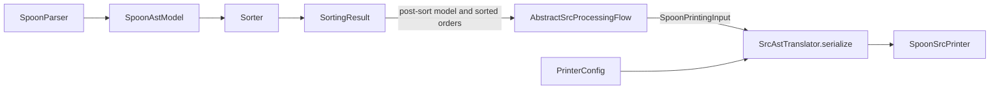

<!--
SPDX-FileCopyrightText: 2026 Anton Lem <antonlem78@gmail.com>
SPDX-License-Identifier: Apache-2.0
-->

# Source printer

Before serialization, the flow builds `SpoonPrintingInput` from the working model and changed annotation orders in
`SortingResult`. The input shares the current Spoon nodes, original source and groups, and skipped types. The flow
passes `PrinterConfig` separately, so the same input can be printed with different settings. Direct printing with
source annotation order uses an empty order map.

`SpoonSrcPrinter` uses Spoon declaration order and source positions to copy original text and insert group separators.
The printer generates layout and keeps the copied source text, including declaration bodies and comments.

| Component | Responsibility |
| --- | --- |
| `SpoonPrintingInput` | Source and current AST context plus selected annotation orders, without diagnostics or configuration |
| `SpoonSrcPrinter` | Stateless serialization entry point with explicit configuration |
| `SpoonSrcPrinter.Serialization` | Per-call state, declaration layout, member spacing and boundaries, skipped-type ranges |
| `SrcPrinterOutput` | Source slices and tails, annotation-group replacements, indentation, line separator detection, output offsets |
| `SpoonTypeMemberUtils` | Explicit members, effective source boundaries and comment attribution |
| `SrcCodeUtils` | Shared source-fragment boundary operations |
| `SpoonGroupSeparatorUtils` | Assigning separators and resolving their kind and header text |

Containers own separators. A type header, adjacent members and group metadata request one shared
blank line at each boundary. Method bodies, initializers, annotations and source comments are copied
as fragments. Nested types recurse through the same layout operation. Synthetic declarations remain
excluded; skipped types are copied as a whole and their UTF-16 output offsets are recorded.

Each type indexes its original member starts in a sorted `int[]`. Binary search finds the next source
boundary regardless of output order, including duplicate starts in multi-field declarations.
Effective starts include annotations preceding the member declaration range reported by Spoon. The reported start can
fall at a comment after those annotations. Top-level types, nested types, and members use the same
boundary calculation. It retains leading comments already included in the member range reported by Spoon;
it does not search comments independently.
Source-text helpers use half-open `[start, endExclusive)` ranges; the printer converts Spoon's inclusive source ends
before invoking them.
The output uses one `StringBuilder`, initially sized to the original source, and appends source ranges
directly. Interior line endings remain unchanged; generated lines use the dominant separator, with
CRLF, LF, CR tie precedence. The complete serialized source is not cached.

Each call creates a private `Serialization` with its own configuration reference, output buffer and range map.

## Annotation group rendering

`SrcPrinterOutput` indexes groups by their original start. When copying source, it asks `AnnotationSrcGroupRenderer`
for each group's replacement text and resumes after the original group end. The same path handles groups inside
types and in `package-info.java` or `module-info.java`.

Each group contains source-order annotation fragments and one gap per fragment. The changed order map gives the
fragments for each output slot. With no entry for the group, the printer uses its original text. A fragment that
occupies its original slot keeps its original gap verbatim.

When a fragment moves, attached comments travel with the annotation and independent comments stay in their original
slots. The scanner prepares three layouts per gap, for fragments that need zero, one, or two line separators.
The selected layout supplies the leading whitespace and determines whether to use the fragment's exact separator text.
A fixed number of layouts per slot keeps preparation linear in group size.

For example, in `@A // note\r\n@B\n@C `, moving `@A` to the second slot reuses that gap's `\n`. Moving it to
the inline third slot uses its own `\r\n` so the next token stays outside the comment. See the
[comment attachment rules](config-dsl.md#annotations-ordering).

## Source tail and group separators

The source tail starts after the greatest original end offset among top-level types, independently of
their output order. `printTail` skips the leading gap, retains indentation, and copies the remaining
source range once after one blank line. Comment text, internal spacing, trailing whitespace and the
presence or absence of a final line terminator remain unchanged. Whitespace-only tails add nothing.
File bounds and comment attachment reported by Spoon are not used, so virtual sources and comments adjacent
to the closing brace follow the same rule. A Spoon type range can already include a trailing block
comment beyond its body end; that comment stays in the copied type range. Starting the tail at the
body end would duplicate it. Repeated processing preserves this boundary.

The tail can also contain empty top-level declarations (`;`), allowed by
[JLS 7.6](https://docs.oracle.com/javase/specs/jls/se21/html/jls-7.html#jls-7.6), or a terminal ASCII SUB
character, allowed by [JLS 3.5](https://docs.oracle.com/javase/specs/jls/se21/html/jls-3.html#jls-3.5).
Copying through the source end preserves these forms, including Unicode escapes, without parsing them again.

`SpoonGroupSeparatorUtils` in `core.spoon` keeps the metadata key and blank-line marker private.
Callers assign headers with `markHeader`, assign blank lines with `markBlankLine`, and read once
with `resolveSeparator`. Its immutable `GroupSeparator` contains a `UnifiedSeparator` kind
(`NONE`, `NEW_LINE`, `HEADER`) and nullable `headerText`, present only for `HEADER`.
The `NONE` and `NEW_LINE` values reuse shared instances. Raw metadata and text classification
stay inside the utility. Empty headers and unmodified header text retain their existing behavior.

`GroupBoundaryMarker` selects the first member and interprets group configuration. The printer
owns comment-position checks, duplicate-header detection and combined spacing decisions.

## Annotation scanning boundary

`AnnotationSourceScanner` uses JDT tokens to find adjacent annotation uses and capture their ranges, argument
spelling, and comment ownership directly from the supplied source. Spoon contributes declaration structure and
type references. The token scan also covers uses that Spoon omits, such as the array-dimension annotations in
`String @Z @A [] @D @C []` and the receiver annotations in `void run(@Z @A Example this) {}`.

The printer fixtures check complete output, compilation, and repeated processing. The
[type-use fixture][type-use-fixture] includes both cases. See [annotation type resolution](annotation-type-resolution.md)
for the role of Spoon references when confirming annotation identities.

[type-use-fixture]: ../core/src/test/resources/test-cases/core/e2e/printer/scenarios/18-annotation-language-constructs/input/TypeUseAnnotationOrdering.java
